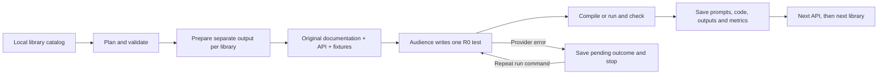

# Original microbenchmark R0 run

Prepared November 16, 2026. Run commands in Terminal on this Mac from
`/Users/clockorangezoe/Documents/phd_projects/code/geoAI/AIDEAL_workflow`.

Today's protocol uses Original documentation, one audience-written microbenchmark per selected API, one trial, and **zero code repairs**. The launcher uses `gemini-3.1-flash-lite` by default. Model access and billing still need a live check when you start it.

For a small offline print/debug example with R0, R1 and R2, see the [single-script walkthrough](CLUSTER_RUN.md#one-script-to-print-or-debug-r0-r1-and-r2). Its optional repairs do not change this full-library R0 protocol.

## 1. Set the working folder and interpreter

```zsh
cd /Users/clockorangezoe/Documents/phd_projects/code/geoAI/AIDEAL_workflow
export AIDEAL_PY=/Users/clockorangezoe/miniconda3/envs/geo_llm_spark/bin/python
export AIDEAL_RUN=/Users/clockorangezoe/Documents/phd_projects/code/geoAI/AIDEAL_WORKSPACE/03_Experiments/$(date +%Y-%m-%d-%H%M%S)-original-micro-r0-gemini-3.1-flash-lite
export PYTHONDONTWRITEBYTECODE=1
export PYTHONPATH="$PWD/vendor/aideal_engine/src"
```

The wrapper loads the vendored engine automatically. The PYTHONPATH setting also selects this engine if you copy a printed engine command. You do not need to activate another Conda environment or switch Git branches.

## 2. Print the schedule without making model calls

```zsh
"$AIDEAL_PY" scripts/run_original_micro.py --output "$AIDEAL_RUN"
```

This prints the selected API counts, output locations, and equivalent engine command for each prepared library. It reads existing inputs and makes no output changes.

| Library | Selected API names | Readiness |
|---|---:|---|
| RDPro | 16 | Prepared official-source subset |
| MDAnalysis | 1,032 | Prepared existing native manifest |
| tslearn | 235 | Prepared existing native manifest |
| mir_eval | 148 | Prepared existing native manifest |
| Thumbnailator | 149 | Prepared existing native manifest |
| SedonaDB | Pending | Audience microbenchmark runner missing |
| Total prepared | **1,580** | One R0 trial per selected name |

These are saved manifest names, not a claim that every public API or overload is covered. RDPro uses official source revision `5ee41a6dc37ebe5f63bf7a3a0b74c5483460b9c8` and the corresponding study's compiled overlay. Its native inventory groups bare method names. `readType` occurs in two classes; the configured receiver override targets `Feature.readType`, while source-location summaries can still show the other declaration.

MDAnalysis uses unchanged upstream Python/Cython input files with locally rebuilt extensions. Its 14 extension binaries are included in the launch hashes. The tslearn and mir_eval source checkouts are tracked-clean. No AIDEAL alias or embedded-hint treatment was found in these three Python libraries.

SedonaDB's saved 322 SQL-example executions are a different measurement. Its current configuration has no command or scaffold for audience-generated microbenchmarks. The launcher reports this explicitly and continues through prepared libraries. Selecting all six therefore returns exit code 2 even if the other five finish; read each library's status in `summary.json`.

## 3. Prepare isolated outputs without making model calls

```zsh
"$AIDEAL_PY" scripts/run_original_micro.py --output "$AIDEAL_RUN" --prepare
```

Five configurations were prepared on November 16. Later runner changes deliberately invalidate their recorded launcher hash. The timestamped path above prepares a fresh batch with the current code; preserve older folders as evidence. Within an unchanged checkout, repeating the same command with the same `AIDEAL_RUN` verifies the preparation. Each library has a fresh configuration, copied API manifest, copied scaffold and separate execution folder. Source trees and fixtures are reused through recorded paths. File hashes bind source, documentation, fixtures, runtimes and engine code to the new run. The launcher rejects changed prepared inputs, so use a new output directory when changing the model, sample size, code or resources.

## 4. Enter the new key locally

```zsh
read -s "GOOGLE_API_KEY?Paste your Gemini key (hidden): "
export GOOGLE_API_KEY
printf '\n'
```

The value stays in this Terminal environment. The script does not save the key in its configuration or request records.

## 5. Start, or resume, the run

```zsh
caffeinate -i "$AIDEAL_PY" scripts/run_original_micro.py --output "$AIDEAL_RUN" --run
```

Only this mode calls the model and uses API credits. Libraries run sequentially in the table order. `caffeinate` prevents idle sleep during execution. Keep the Terminal open.

The same command resumes an interrupted run. Completed API outcomes, including ordinary test failures, are reused. Provider failures remain pending and are retried on resume, with a new evidence directory. A provider error stops the batch after saving the affected API, instead of sending another request for every remaining API. SDK network retries are distinct from code repair rounds; code repairs remain zero.

To run one library, add `--libraries rdpro`. To select the five prepared libraries explicitly, add `--libraries rdpro mdanalysis tslearn mir_eval thumbnailator`.

For a small paid pilot, use a **different output folder** and `--sample 1`. The sample is deterministic, using seed 42. Do not add `--sample` to the already prepared full-run directory.

```zsh
"$AIDEAL_PY" scripts/run_original_micro.py \
  --output "${AIDEAL_RUN}-one-api-pilot" --sample 1 --run
```

## 6. Inspect progress and results

In a second Terminal, use the same `AIDEAL_RUN` assignment from step 1, then

```zsh
cat "$AIDEAL_RUN/summary.json"
tail -f "$AIDEAL_RUN/rdpro/console.log"
```

Change `rdpro` to the library currently running. The batch summary updates between libraries; the selected library's console and checkpoint update during execution.

```text
<batch>/
  summary.json                      library readiness/completion
  <library>/
    launch.json                     model, scope and bound input hashes
    configs/aideal.yaml              resolved experiment settings
    configs/project_profile.yaml    copied project description
    inputs/api_manifest.json        selected API names
    inputs/api_test_scaffold.*      execution template
    console.log                     readable progress, code and errors
    result.json                     final or provider-stopped metrics
    REPORT.md                       readable result and failure summary
    logs/error_log.jsonl             categorized failure events
    execution/
      run_identity.json             native checkpoint fingerprint
      comprehension_progress.jsonl  one checkpoint row per attempted API
      run_<API>/
        attempt_0001/
          request.json              exact rendered system/user prompt
          response.txt              raw model response, if returned
          provider.json             model-call time, reported usage/status
          ApiTest.*                 complete generated test (name varies)
          execution.json            command, exit status and execution time
          stdout.txt                full standard output
          stderr.txt                full standard error
```

Provider failures have request/provider records but no generated test or execution output. On resume, evidence numbering advances; `attempt_0002` can mean a replacement provider attempt, **not** repair round R1. `request.json` records the actual round.

`result.json` appears when the library returns or stops on a provider failure. If the process is interrupted earlier, use `execution/comprehension_progress.jsonl` until the resumed library completes. `run.complete` must be true before reporting its final score. Per-API metrics contain attempts, wall time, input/output tokens and error categories. Run-level time and usage describe the current invocation; earlier attempt evidence remains available after resume.

## What the model receives and what this score means

The native Original condition selects relevant passages from the configured upstream README and reference-document bundle, using a 12,000-character document-selection budget. It also supplies the target API, available fixture variables, execution instructions and any configured receiver guidance. Read `request.json` to see the exact input. It does not generate a new README during this run.

The audience writes the test snippet and assertions. AIDEAL inserts that snippet into the saved scaffold, compiles or executes it, and checks the process result and configured success/correctness markers. Each R0 failure is recorded without a repair call. There are no puzzle tasks or development treatments in this schedule.

The native score measures execution with audience-written assertions. It is separate from the portable task bank with independent expected outputs. The result reports `score_with_infra` as passes divided by all selected API names and `score` with infrastructure failures excluded. Both are fractions from 0 to 1. Inspect failure categories and completion state alongside either score.

## Code review entry points

- `scripts/run_original_micro.py` — plan, isolated preparation, sequential execution and result files.
- `configs/original_micro_libraries.yaml` — baseline inputs for all six library entries.
- `vendor/aideal_engine/src/aideal/doc_check_comprehension.py` — select Original documentation and API inventory.
- `vendor/aideal_engine/src/aideal/doc_check_execution.py` — prompt, R0 call, compile/run, record evidence and resume.
- `vendor/aideal_engine/src/aideal/doc_check_inputs.py` — scaffold setup and explicit receiver corrections.
- `vendor/aideal_engine/src/aideal/doc_check_provenance.py` — checkpoint input identity.
- `tests/test_original_micro_launcher.py` — small offline end-to-end example with mocked model output and real program execution.



## Offline checks completed

All five saved manifests validate. Python imports and representative fixtures passed for MDAnalysis, tslearn and mir_eval. RDPro and Thumbnailator passed native-runner smoke tests with real compilation/execution and a mocked audience response. Sixteen focused regression tests passed for native evidence, receiver overrides and launcher preparation/resume. Live model access and all 1,580 generated tests have **not** been run.
