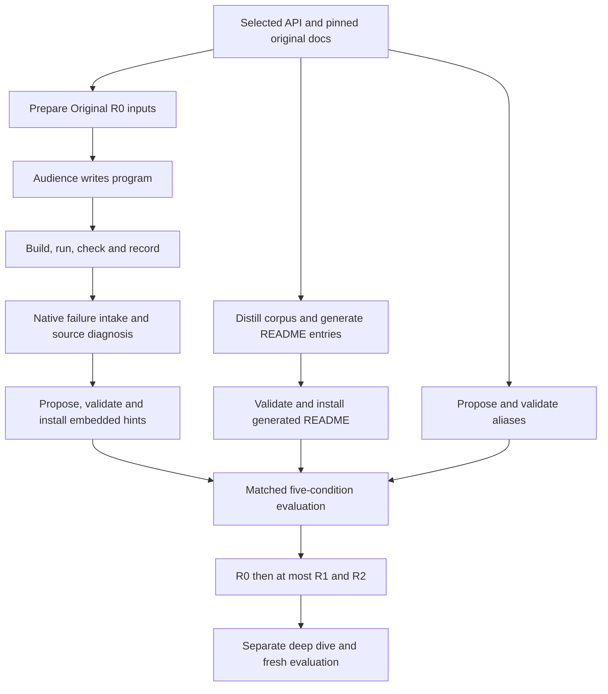

# Code review route for the frozen release

Release `2026-11-17-qualified-api-f3c6fd6fe802`; 684 tests and 365 subtests passed on both Mac and lab cluster. Code links refer to these frozen files, so line numbers do not move with your working checkout.

| Step | Function and source | What to check | Prompt boundary |
|---|---|---|---|
| 1. Select API identities | [`_select_qualified` — api_canonical_selection.py:424](evaluator-qualified/vendor/aideal_engine/src/aideal/api_canonical_selection.py#L424) | Groups only the same defining owner/API, elects explicit arity and retains exclusion evidence. | No LLM |
| 2. Load original documentation | [`load_original_documents` — original_documentation.py:23](evaluator-qualified/vendor/aideal_engine/src/aideal/original_documentation.py#L23) | Checks source/document versions, hashes, mappings and shared README. | No LLM |
| 3. Prepare Original R0 | [`prepare` — run_original_micro.py:43](evaluator-qualified/scripts/run_original_micro.py#L43) | Copies inventory/config bindings and freezes the selected bank and Original exposure. | No LLM in --prepare |
| 4. Execute the native micro loop | [`_comprehension_execute` — doc_check_execution.py:129](evaluator-qualified/vendor/aideal_engine/src/aideal/doc_check_execution.py#L129) | Builds the audience prompt, saves the requested target and executes complete responses. The initial plan allows R0 only. | prompts/comprehension_write_exec.md |
| 5. Check provider output and usage | [`invoke_text` — llm.py:208](evaluator-qualified/vendor/aideal_engine/src/aideal/llm.py#L208) | Calls the configured model, records usage and rejects known incomplete/refused/empty output. | Receives the rendered request |
| 6. Prepare README authoring | [`prepare` — run_readme_generation.py:71](evaluator-qualified/scripts/run_readme_generation.py#L71) | Binds all configured targets, whole original corpus and author settings. | No LLM in --prepare |
| 7. Generate the README | [`find_or_create` — readme_generation.py:133](evaluator-qualified/vendor/aideal_engine/src/aideal/readme_generation.py#L133) | Distills the full corpus in recorded chunks and generates exact-identity entries. | prompts/readme_distill.md; prompts/readme_entry.md |
| 8. Record each author request | [`ReadmeCallRecorder` — readme_recording.py:47](evaluator-qualified/vendor/aideal_engine/src/aideal/readme_recording.py#L47) | Saves requests, responses, status, timing and usage for authoring. | No independent model call |
| 9. Import native R0 failures | [`build_native_r0_preview` — native_r0_evidence.py:213](evaluator-qualified/workflow/native_r0_evidence.py#L213) | Verifies the frozen run and records every attempt disposition; source-backed runtime failures can enter hint development. | No LLM |
| 10. Propose embedded hints | [`propose_native_hints` — native_hints.py:223](evaluator-qualified/workflow/native_hints.py#L223) | Asks the author for guidance at verified existing exception sites; no accepted sites means no call. | prompts/native_hint_development.md |
| 11. Validate and install hints | [`validate_native_hints` — native_hints.py:348](evaluator-qualified/workflow/native_hints.py#L348) | Runs paired controls before install_native_hints can commit the changed exception message. | Validation uses executable controls |
| 12. Install source treatments | [`apply_treatments` — treatment_versions.py:345](evaluator-qualified/workflow/treatment_versions.py#L345) | Checks source/tree bindings and installs the reviewed artifacts in their designated branches. | No LLM |
| 13. Run matched conditions later | [`run_unit` — evaluation_runner.py:78](evaluator-qualified/workflow/evaluation_runner.py#L78) | Shared condition runner performs R0 then bounded R1/R2 with request and execution receipts. This is not the initial native full-bank launcher. | Condition policy supplies the prompt |

The prompt files listed above are frozen under [evaluator-qualified/prompts](evaluator-qualified/prompts/). The [six complete previews](review/qualified-pilots/INDEX.html) show the rendered requests, data paths and execution scaffolds before any model call. The full bank provides all requested target identities and input bindings.

The native R0 bridge is not an automatic promise to patch every failure. Compiler failures, unsupported exception messages, ambiguous frames and missing source evidence remain explicit dispositions. A source hint is installed only after validation. Alias development also requires build/behavior validation before its branch becomes a treatment.

Only input preparation and offline checks have completed for this replacement study. Model-generation nodes remain held for review.
