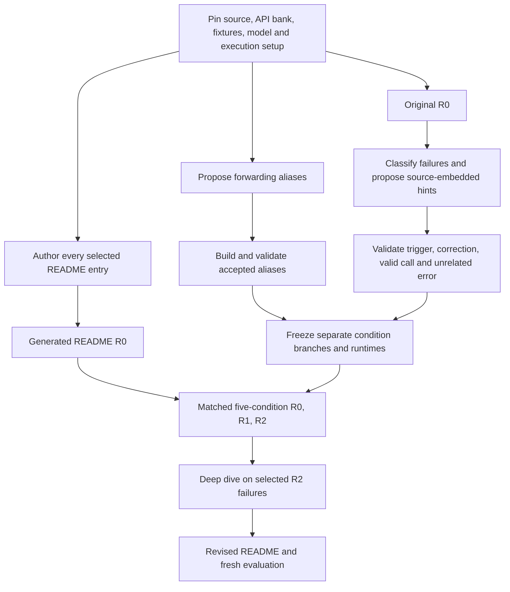

# AIDEAL experiment guide

Updated November 18, 2026. **Current launch: fresh Original R0 and existing generated README D1 at R0.** There are **2,823 targets**, **zero eligible historical results for reuse**, and **5,646 planned initial target requests**. Provider retries can add requests. D1 has not been regenerated by the author-prompt correction. No program repairs or D2 revision are included.

**Status: replacement ready; restart pending publication.** The initial run was safely stopped at 23:40:44 UTC on November 18 after confirmed omissions in the shared input contract. It was not a preplanned pilot. Retained diagnostic evidence comprises 103 returned mir_eval responses with 102 executions and 109 Thumbnailator responses with 109 executions; both had zero provider errors. The other five banks made no model calls. These partial records are not completed comparison scores.

The new full-cohort comparison under `explicit-inputs-r0/` passed preparation for all seven banks. Fourteen sampled audience prompts match outside the documentation and include each input-contract block once. Forty-five source receipts establish unchanged README files, profiles, scaffolds, manifests, source, data, runtime and model; only context descriptions and the output root change. All banks receive consistent permission to create small deterministic inputs. Three banks additionally clarify file roles, formats or metadata. This avoids attributing input ambiguity to README quality. **Paid execution has not restarted.**

[Visual guide](evaluator-correction-2026-11-18/INDEX.html) · [Exact launch steps](evaluator-correction-2026-11-18/README.md) · [Recorded status](evaluator-correction-2026-11-18/REVIEW_STATUS.json) · [Complete historical prompts and examples](evaluator-correction-2026-11-18/review/prompt-audit/INDEX.html) · [Evaluation design review](evaluator-correction-2026-11-18/review/EVALUATION_DESIGN_REVIEW.md)

## 1. Current scope and sequence

| Bank | Selected targets | Initial requests across Original and D1 | Current stage |
|---|---:|---:|---|
| RDPro Java | 69 | 138 | Ready; restart pending publication |
| RDPro Scala | 261 | 522 | Ready; restart pending publication |
| MDAnalysis | 1,519 | 3,038 | Ready; restart pending publication |
| tslearn | 354 | 708 | Ready; restart pending publication |
| mir_eval | 178 | 356 | Ready; restart pending publication |
| Thumbnailator | 225 | 450 | Ready; restart pending publication |
| SedonaDB | 217 | 434 | Ready; restart pending publication |
| **Total** | **2,823** | **5,646** | **Ready; restart pending publication** |

RDPro covers Raptor and supporting raster types, with Java and Scala reported separately. MDAnalysis now retains 1,519 targets after 19 source-audited exclusions from 1,538. tslearn retains 354 after excluding eight import hooks and forwarding wrappers from 362. The 27 exclusions include the earlier 16 MDAnalysis exclusions plus three exact NumPy/RDKit forwarders and eight tslearn hooks/wrappers. Both conditions use identical revised manifests. [Final MDAnalysis exclusions](evaluator-correction-2026-11-18/fixture-development-v1/mdanalysis/selection-correction-final/exclusion_audit.json) · [Final MDAnalysis manifest](evaluator-correction-2026-11-18/fixture-development-v1/mdanalysis/selection-correction-final/api_manifest_public_nonwrapper.json) · [Final eight tslearn exclusions](evaluator-correction-2026-11-18/review/final-scope/tslearn/audit.json) · [Final tslearn manifest](evaluator-correction-2026-11-18/review/final-scope/tslearn/api_manifest.json).

[Current 2,823 selected API identities](evaluator-correction-2026-11-18/review/final-scope/SELECTED_API_BANK.tsv) · [Current bank summary](evaluator-correction-2026-11-18/review/final-scope/BANK_SUMMARY.json). These identify the active bank; they describe native API usage targets, not fixed independently scored tasks.

The full [2,850-target API/artifact index](evaluator-correction-2026-11-18/review/prompt-audit/ALL_API_INDEX.tsv) and saved examples remain **historical evidence**. They are not the current denominator. The earlier 5,307-target full-Beast preparation is also superseded.


1. Freeze the source, target bank, runtime, fixture roles, model settings and permitted context.
2. Verify the input/output contract: identify each provided file or variable, its role and format, available metadata and required output rules. Then pass deterministic controls and check that Original/D1 differ only in their intended documentation input.
3. Generate a new Original program and a new D1 program for every retained target, with no preceding failure or repair feedback.
4. Build and execute each program in its own directory; retain its prompt, code, command, output and verdict.
5. Report the two fresh R0 conditions separately by bank.
6. Replay saved historical programs under corrected checks as a separate audit with **no model calls**. Preserve their original verdicts.

**R0** means the initial audience program. **R1/R2** mean repairs after failures; neither runs here. **D1/D2** identify README versions. A provider retry is not a repair, and a fresh independent generation is not R1.

[Initial-run preparation and prompt checks](evaluator-correction-2026-11-18/fresh-original-d1/preflight/ACTUAL_BANK_CONFIGURATION_AND_PROMPTS.json). The [initial-run readiness receipt](evaluator-correction-2026-11-18/fresh-original-d1/operator/READINESS.json) passed before the input-contract omissions were discovered. The replacement [seven-bank preflight](evaluator-correction-2026-11-18/explicit-inputs-r0/preflight/ACTUAL_BANK_CONFIGURATION_AND_PROMPTS.json) and [input-contract equivalence report](evaluator-correction-2026-11-18/explicit-inputs-r0/preflight/INPUT_CONTRACT_EQUIVALENCE.json) now pass. The final gate belongs in `explicit-inputs-r0/operator/READINESS.json`; restart follows publication.

### Stopped initial-run evidence

| Bank | Returned responses | Executed programs | Provider errors | Disposition |
|---|---:|---:|---:|---|
| mir_eval Original | 103 | 102 | 0 | Preserved diagnostic evidence |
| Thumbnailator Original | 109 | 109 | 0 | Preserved diagnostic evidence |
| Other five banks | 0 | 0 | 0 | No model calls |

[Recorded run amendment](evaluator-correction-2026-11-18/RUN_AMENDMENT.json). There are **213 saved requests, 212 returned responses and 211 executions**. One provider request was interrupted; its token/billing usage is unavailable, not zero. Keep the recorded costs separate as protocol-development cost.

[Initial-run launch receipt](evaluator-correction-2026-11-18/fresh-original-d1/operator/START.json) · [Initial-run status snapshot](evaluator-correction-2026-11-18/fresh-original-d1/operator/LIVE_STATUS.json). The stopped status and amendment preserve the original full-run intent and explain why the shared input contract changed. Preserve its costs, responses and errors; do not pool these records with the amended comparison. The input-contract change requires fresh matched requests in both conditions.

## 2. Final review checklist

| Check | Evidence / status | What it establishes |
|---|---|---|
| Frozen code release | `2026-11-18-corrected-r0-d8ba3815cf95`, 146 files verified | The exact code packaged for cluster execution |
| Offline software tests | 818 tests and 436 subtests passed; final focused suite 124 tests and 92 subtests passed | Tested execution and workflow contracts |
| MDAnalysis setup | 160 defining modules imported; 523 upstream data files; 18 input roles; IMD, Chemfiles and real 3DNA checks passed | Audited data/tool capability, not correctness of every API |
| Seven actual bank preparations | **7/7 replacement banks passed** | Selected manifests and condition inputs bind successfully |
| Paired prompt exposure | **14 sampled prompts passed; input blocks appear once** | Shared context is consistent and contains no extra condition-specific repair advice |
| Final native controls | **12 non-MD controls and two final-profile MD replay controls passed; six native MD controls bound by equivalence** | The final scaffold accepts a known correct example and rejects a deliberately wrong assertion |
| Final source-selection audit | **Complete: 27 explicit exclusions** | Excludes source-proven runtime hooks/wrappers consistently before the denominator is frozen |
| Input/output contract clarity | **Mandatory check passed on the sampled requests** | Explicit fixture roles, file formats, available metadata and output rules, shared across Original/D1 without expected-answer leakage |
| Replacement readiness | **Checks passed; final receipt/publication pending** | Bind the amended inputs and all required checks to the new namespace |
| Paid Original/D1 execution | **Restart pending publication; zero replacement calls** | Initial-run records remain diagnostic evidence, not completed scores |

[MDAnalysis setup review](evaluator-correction-2026-11-18/MDANALYSIS_SETUP_REVIEW.md) · [Final control equivalence](evaluator-correction-2026-11-18/runtime-mdanalysis-final-2026-11-18/CONTROL_EQUIVALENCE.json) · [Final MD runtime setup report](evaluator-correction-2026-11-18/runtime-mdanalysis-final-2026-11-18/setup_report.json) · [Earlier paired control programs and logs](evaluator-correction-2026-11-18/preflight/libraries/) · [Recorded review status](evaluator-correction-2026-11-18/REVIEW_STATUS.json).

**Does setup checking need an LLM?** No. Imports, file hashes, compilation, tool availability, fixture parsing and deliberate positive/negative checks give reproducible evidence. An LLM can help diagnose a failed check or propose a repair. It must not decide that the environment passes without executing and recording those checks. A missing dependency does not count as a successful deliberately failing control. Passing imports and sample executions also does not establish that the audience received a clear input contract; both checks are mandatory.

## 3. What the comparison measures

The current run measures **native execution acceptance** under original versus generated documentation. The audience chooses a usage example and writes its own checks. Exit success and an exact-API witness are stronger than an unchecked process return, but they do not independently establish task correctness or prove that the target operation performed the intended work.

| Claim | Needed evidence | Current scope |
|---|---|---|
| Setup works for audited inputs | Bound runtime, fixture/tool checks, correct and deliberately wrong controls | Runtime controls and sampled input-contract checks passed; publication pending |
| A generated program was accepted | Full executed code, exit status and exact-API witness | Measured by this native R0 comparison |
| A program solves a fixed task correctly | Independently specified expected outputs and target-use verification | **Not established by native self-checks** |
| Generated documentation caused a measured difference | Matched tasks, settings and exposure, repeated trials and independent checks | Current results are diagnostic; one native R0 program per target is limited evidence |
| Aliases, hints and their interactions help | Validated treatments and matched factorial runs | Separate later study |
| Deep-dive README repair generalizes | Development/evaluation separation and fresh held-out tasks | D2 deferred |

Keep per-library results separate. A pooled percentage would give MDAnalysis much more weight because its bank is larger. Report documented versus no-reviewed-API-excerpt strata where the mapping exists. Do not convert setup errors into API/model failures without diagnosis. Conversely, an upstream library bug is not a setup fault. Classify it from source and reproducible execution evidence instead of changing the environment until the program passes.

The later paper design includes eight factor combinations, `O`, `R`, `A`, `H`, `RA`, `RH`, `AH`, `RAH`, with microbenchmarks and puzzles, R0/R2, and separate D2 follow-ups. Those are **planned measurements**, not outputs of this launch. The current generic condition runner does not by itself implement the complete eight-arm design. Cross-task learned error memory must be disabled, isolated, or frozen to development-only evidence for held-out evaluation. [Detailed design review](evaluator-correction-2026-11-18/review/EVALUATION_DESIGN_REVIEW.md).

## 4. Inputs, prompts and one-target review

The new source-bound context describes supplied objects and permissions. It does **not** add API failure diagnoses or corrective hints to the Original condition. Both conditions receive the same contract.

| Bank | Clarified shared input contract |
|---|---|
| Thumbnailator | Distinguish an empty output buffer, an output filename and an output directory. |
| mir_eval | State supplied file columns, units and limited toy-data roles; permit suitable deterministic inputs for other formats. |
| RDPro Java | State existing raster/HDF facts and distinguish them from synthetic metadata supplied by the scaffold. |
| All seven banks | Permit small deterministic task-suitable inputs under the isolated output directory. |

[Exact contracts and source evidence](evaluator-correction-2026-11-18/review/explicit-input-contracts/MANIFEST.json) · [Verified unchanged inputs](evaluator-correction-2026-11-18/explicit-inputs-r0/preflight/INPUT_CONTRACT_EQUIVALENCE.json). These checks establish the described exposure, not independent correctness of every future program.


| Stage | Model input | Model output / retained evidence |
|---|---|---|
| Original R0 | Exact API identity/declaration, public access facts, reviewed original docs, shared execution context and input roles | Initial program, provider response and usage, executed scaffold, command and stdout/stderr |
| Existing D1 R0 | Same target and shared setup, with the existing generated API entry | Separate initial program and the same execution evidence |
| Historical README authoring | Project profile, API/source facts, document context and available examples | Existing D1 entries plus saved author requests/responses |
| Historical saved-program replay | No model request | New execution evidence linked to the unchanged saved program and its historical verdict |

Canonical API declarations/public access facts are shared across the audience conditions. Author diagnosis source windows are not part of ordinary audience exposure. The historical author prompt had invalid qualified-ID call examples; future authoring is corrected, but **this does not retroactively fix existing D1**. Neutral profile/context corrections affect the upcoming audience calls and invalidate historical prompt reuse.

Open the [complete historical paired examples](evaluator-correction-2026-11-18/review/prompt-audit/INDEX.html). For each target:

1. Read its manifest identity and source/document mappings.
2. Read the full `request.json` system/user text, not a displayed excerpt.
3. Compare `response.txt` with the program body and full executed scaffold.
4. Read `execution.json` for the exact command, working directory, timeout and exit code.
5. Read complete `stdout.txt` and `stderr.txt`; summary tails can omit important evidence.
6. Check the result's identity, selected API, hashes and mode. Distinguish historical generation, setup control, saved replay and a new corrected R0 attempt.

## 5. Code review route

| Review goal | File and starting line |
|---|---|
| Stage preparation and sequencing | [scripts/run_evaluator_correction.py:46](/Users/clockorangezoe/Documents/phd_projects/code/geoAI/AIDEAL_workflow/scripts/run_evaluator_correction.py:46) |
| Final readiness gate | [scripts/run_evaluator_correction.py:130](/Users/clockorangezoe/Documents/phd_projects/code/geoAI/AIDEAL_workflow/scripts/run_evaluator_correction.py:130) |
| Reject changed historical source/docs/data | [scripts/run_verified_readme_continuation.py:68](/Users/clockorangezoe/Documents/phd_projects/code/geoAI/AIDEAL_workflow/scripts/run_verified_readme_continuation.py:68) |
| Prepare matched condition inputs | [scripts/run_verified_readme_continuation.py:256](/Users/clockorangezoe/Documents/phd_projects/code/geoAI/AIDEAL_workflow/scripts/run_verified_readme_continuation.py:256) |
| Run one fresh condition | [scripts/run_verified_readme_continuation.py:439](/Users/clockorangezoe/Documents/phd_projects/code/geoAI/AIDEAL_workflow/scripts/run_verified_readme_continuation.py:439) |
| Native execution verdict | [vendor/aideal_engine/src/aideal/native_execution_contract.py:141](/Users/clockorangezoe/Documents/phd_projects/code/geoAI/AIDEAL_workflow/vendor/aideal_engine/src/aideal/native_execution_contract.py:141) |
| Scoped runtime readiness | [workflow/runtime_profile.py:126](/Users/clockorangezoe/Documents/phd_projects/code/geoAI/AIDEAL_workflow/workflow/runtime_profile.py:126) |
| Later R0/R1/R2 repair loop | [workflow/evaluation_runner.py:78](/Users/clockorangezoe/Documents/phd_projects/code/geoAI/AIDEAL_workflow/workflow/evaluation_runner.py:78) |

Follow `prepare` → readiness checks → condition preparation → `run_condition` → the native executor → aggregate results. The later `evaluation_runner.run_unit` repair loop is useful to understand R0/R1/R2, but this launch sets zero program repairs.

## 6. Folders, branches and isolation

```text
2026-11-17-latest-stable-canonical/
  EXPERIMENT_GUIDE.md / .html        current review entry points
  STUDY_LOCK.json                   pinned library/source identities
  evaluator-correction-2026-11-18/
    INDEX.html / WORKFLOW.svg       current ordered workflow
    REVIEW_STATUS.json             timestamped review snapshot
    README.md                      exact preparation/launch instructions
    review/
      prompt-audit/                 complete HISTORICAL 2,850-target index
      corrected-profiles/           new neutral profiles; old profiles retained
      corrected-contexts/           shared context without failure remedies
      EVALUATION_DESIGN_REVIEW.md   measurement limits and future controls
    fixture-development-v1/        reviewed inputs and MD target exclusions
    runtime-mdanalysis-final-2026-11-18/
                                   environment hashes and setup report
    preflight/                     actual programs, outputs and control receipts
    explicit-inputs-r0/
      operator/                    prepared plan, readiness, queue state
      continuation/                NEW Original / existing D1 R0 artifacts
      rescore/                     SEPARATE saved-program replay evidence
  qualified*/                      historical Original/authoring evidence
  ablation-2026-11-18/              historical generated/repair/treatment work
```

Directories for pending stages may not exist yet. Folder existence alone does not establish completion.

The shared evaluator/review repository is `ZhuochengShang/AIDEAL`, study branch `study/2026-11-17-latest-stable-canonical`. The corrected code is published at [commit `56a42d9`](https://github.com/ZhuochengShang/AIDEAL/commit/56a42d91d8548ce7e4bf71b17b19fc5155f132f7); all 146 public code files match the local and cluster frozen release. Each library repository has refs under that prefix for `original`, `readme-only`, `alias-only`, `error-hints-only`, and `combined`. These are **resource variants**, not R0/R1/R2 rounds. [Recorded installation commits](operator/ablation/2026-11-18/branches/README.md) identify installed bytes; a branch name does not prove treatment readiness. The later eight-condition paper design also requires explicit pairwise variants and configuration, not merely the five existing names.

Each job pins source and evaluator identities and uses isolated writable directories. Do not change a checkout underneath a running job. A new branch or cluster `current` pointer cannot silently change an already pinned run. Historical prompts, responses and measured results are evidence; do not delete them as cache.

The former `evaluator-correction-2026-11-18/current/` contains **unlaunched preparation evidence**. `fresh-original-d1/` now contains the **stopped initial run and its immutable measured history**. Its start/readiness receipts describe that earlier attempt and do not authorize a restart. The new active namespace is `explicit-inputs-r0/`; preparation passed and restart awaits publication. MDAnalysis uses the new metadata-only profile `runtime-mdanalysis-final-2026-11-18/`; all 3,767 recorded runtime files are unchanged, while selection bindings are updated.

Five disposable Python/pytest cache directories (961,377 bytes) were removed. No measured files or installed dependencies were deleted.

The cluster is the authoritative execution location. Local/GitHub files are review snapshots, not a live mirror of every output write. Mac and Linux dependencies are different even when source files match.

## 7. Commands and progress checks

**Local review / VS Code**, with no API key required:

```bash
cd /Users/clockorangezoe/Documents/phd_projects/code/geoAI/AIDEAL_WORKSPACE/03_Experiments/2026-11-17-latest-stable-canonical
open EXPERIMENT_GUIDE.html

cd /Users/clockorangezoe/Documents/phd_projects/code/geoAI/AIDEAL_workflow
/Users/clockorangezoe/miniconda3/envs/geo_llm_spark/bin/python \
  scripts/trace_original_micro.py --pause
```

The walkthrough uses scripted model responses and real local execution; it is not a live library comparison or Gemini measurement.

**Cluster preparation**, without model calls:

```bash
ssh lab
cd /home/zshan011/apps/aideal/studies/2026-11-17-latest-stable-canonical
/home/zshan011/apps/aideal/venv/bin/python \
  /home/zshan011/apps/aideal/releases/2026-11-18-corrected-r0-d8ba3815cf95/scripts/run_evaluator_correction.py \
  --study "$PWD" \
  --output "$PWD/evaluator-correction-2026-11-18/explicit-inputs-r0" \
  --runtime-profiles "$PWD/evaluator-correction-2026-11-18/explicit-inputs-r0/operator/RUNTIME_PROFILES.json" \
  --input-overrides "$PWD/evaluator-correction-2026-11-18/explicit-inputs-r0/operator/INPUT_OVERRIDES.json" \
  --phases continuation rescore
```

Use the reviewed operator input files and [launch instructions](evaluator-correction-2026-11-18/README.md). The operator adds `--run` only after the recorded readiness gate passes and uses the permitted credential path without exposing the key. Check for an existing supervisor before a restart; do not start duplicate queues.

**Read progress**, from the cluster study folder:

```bash
python3 - <<'PY_PROGRESS'
import json
from pathlib import Path
root = Path('evaluator-correction-2026-11-18/explicit-inputs-r0')
for name in ('operator/READINESS.json', 'operator/STATE.json',
             'continuation/supervisor/summary.json'):
    path = root / name
    print('\n' + name)
    print(json.dumps(json.loads(path.read_text()), indent=2)
          if path.exists() else 'Not recorded yet')
PY_PROGRESS
```

A completed bank must reconcile selected/completed target counts and preserve per-attempt provider usage. Missing token usage is unknown, not zero. Report initial generation, provider retries and build/run/check time separately. No new corrected result should replace a paper accuracy cell without independent correctness evidence.

## 8. Preserved earlier snapshot

The collapsed section records the earlier November 18 experiment state, before the execution correction. Its statuses, denominator and old launch commands are **historical and must not be used to restart the current run**.

<details>
<summary>Historical 2,850-target results, treatment work and earlier commands</summary>

[Current results and treatment gates](operator/ablation/2026-11-18/STATUS.md) · [Full ablation plan](operator/ablation/2026-11-18/PLAN.md) · [Live-progress snapshot](operator/ablation/2026-11-18/PROGRESS.json) · [Original completion proof](operator/resume/2026-11-18/COMPLETION.md)

## 1. Historical banks and completed baseline

| Library | Pinned release | Selected targets | Original R0 passes | Generated README entries |
|---|---|---:|---:|---:|
| RDPro / Beast, Raptor and supporting raster types | 0.10.1 | 330 (69 Java + 261 Scala) | 37 | 330 |
| MDAnalysis | 2.11.0 | 1,538 | 612 | 1,538 |
| tslearn | 0.10.0 | 362 | 219 | 362 |
| mir_eval | 0.8.2 | 178 | 128 | 178 |
| Thumbnailator | 0.4.21 | 225 | 104 | 225 |
| SedonaDB | 0.5.0 | 217 SQL targets | 78 | 217 |
| **Total** | | **2,850** | **1,178** | **2,850** |

These are selected qualified API targets, not unique short function names or counts of original-document headings. The current RDPro bank contains 271 methods and 59 concrete constructors. Its reduction is **452 candidate sites − 72 wrappers/adapters − 25 unimplemented bodies − 3 abstract constructors − 15 bodyless methods − 7 additional overloads = 330**. Different defining owners remain distinct; overload reduction happens within one owner/API. Imported and inherited-only framework APIs are excluded. [Exact RDPro decisions](review/raptor-scope/strict-no-wrappers/ALL_CANDIDATE_DECISIONS.json).

**The other banks do not yet have an equivalent strict wrapper review.** Their completed results retain the original manifests. Do not silently replace their denominators or claim identical filtering. [Cross-library selection review](review/raptor-scope/maintenance/SELECTION_POLICY.md).

The earlier RDPro count of 171 came from an older README-based inventory of bare Scala names. Full-Beast 2,787 and intermediate raster counts 422/406 are superseded scopes, not the current run. [Count explanation](review/raptor-scope/COUNT_EXPLANATION.md) · [171-target historical evidence](review/raptor-scope/history-171/README.md).

## 2. Experiment design

| Condition | Documentation supplied | Library changes | Current execution gate |
|---|---|---|---|
| Original | Original documents | None | R0 complete; fresh mir_eval R0–R2 complete |
| README only | Generated per-API entries | None | Six banks complete; MDAnalysis running |
| Alias only | Original + accepted alias descriptions | Validated forwarding aliases | Model proposals running; build/behavior validation required |
| Error Hints only | Original | Validated messages in existing exceptions | mir_eval and MDAnalysis source installed; mir_eval R0–R2 running |
| Combined | Generated entries + same aliases | Same aliases + same native hints | Must contain both accepted source treatments before evaluation |



**R0** is the initial program. **R1/R2** are the first and second repairs of a failed program. A passing task stops early. A provider retry is not a repair. Deep dive changes the README and requires a new evaluation identity; it is not R3.

The immediate Generated README comparison uses one trial, zero repairs and `gemini-3.1-flash-lite`, with the Original per-bank evaluator, source, API identities, fixtures and execution settings. Generated documentation selects a generated API entry instead of an original-document excerpt. Report that selection change as well as the text change.

SedonaDB's registered SQL bank currently lacks a compatible source-alias/native-hint adapter. RDPro, tslearn and Thumbnailator also have no accepted native hint under the current literal-message patcher. These treatment cells remain pending rather than silently becoming unchanged control branches.

The tested repair protocol includes the preceding program and bounded public execution feedback, preserving emitted native hints. The old native repair path can truncate messages and omit the previous program, so its zero-repair checkpoint cannot simply be relabelled R2. The new mir_eval comparison uses fresh R0 responses in all three ready conditions. Do not pool these R0/R2 values with earlier R0-only runs. Alias-only and Combined will require the same repair policy when ready.

The live one-target pilot completed six Gemini calls without provider, infrastructure or truncated-output errors. Both conditions failed through R2; the embedded hint reached R1 correctly but provided no observed final-success benefit in that trial. [Pilot outcomes and exact traces](operator/ablation/2026-11-18/repair-protocol/PILOT_RESULTS.md).

Alias authoring now continues after a complete rejected response, while retaining the rejection and excluding its code. It reuses previously exposed batches, reviews the remaining APIs once, and pauses on provider/incomplete output. The accepted candidate index is only an input to separate runtime validation. [Review rules and counts](operator/ablation/2026-11-18/aliases/review-all-batches/README.md).

## 3. Inputs and fairness

| Inspect | Evidence |
|---|---|
| Official sources, versions and public baseline trees | [STUDY_LOCK.json](STUDY_LOCK.json) |
| Current RDPro targets and exclusions | [Strict bank](review/raptor-scope/strict-no-wrappers/SELECTED_APIS.json) |
| Exact original-document excerpts and mappings | [Original-document manifest](review/raptor-scope/strict-no-wrappers/original-docs/manifest.json) |
| Other libraries' API inputs | [Qualified bank browser](review/qualified-bank/INDEX.html); its full-Beast RDPro rows are historical |
| Effective profiles, manifests and scaffolds | [Current catalog](review/raptor-scope/plan/RUN_CATALOG.cluster.yaml) |
| Generated condition inputs | [Seven-bank preflight](operator/ablation/2026-11-18/PREFLIGHT.json) and each run's `GENERATED_LAUNCH.json` |
| Actual model exposure and execution | Per-attempt request, response, program, stdout/stderr and result files |

For RDPro, 16 retained implementation identities have reviewed original API context; 314 have no reviewed API-specific match. This is not proof that useful documentation does not exist. Preserve unchanged source text and the source-to-document mapping separately from generated guidance.

Native API microbenchmarks use the existing execution and configured checks; generated assertions are not independent hidden-oracle accuracy. A separately frozen puzzle bank is still a distinct experiment. Original failures used to develop treatments make this a within-bank development comparison; held-out generalization needs separate tasks. [Known environment/inventory findings](operator/resume/2026-11-18/failure-review.md).

## 4. Source branches and isolation

Shared code and experiment records live on `ZhuochengShang/AIDEAL`, branch `study/2026-11-17-latest-stable-canonical`. Each of the six public library repositories uses:

```text
study/2026-11-17-latest-stable-canonical/
  original
  readme-only
  alias-only
  error-hints-only
  combined
```

[README installation commits and hashes](operator/ablation/2026-11-18/branches/README.md) identify the exact bytes. A branch name alone does not prove that a treatment is installed. Later source-installation receipts record new commits. Combined receives the same accepted alias and hint files as their individual conditions, plus the generated README.

Each condition uses an isolated source/runtime location. Never switch or modify the Original checkout beneath a running evaluation. Jobs pin immutable evaluator releases; updating the cluster's `current` pointer changes future development commands, not already-running jobs. Preserve measured branches and rejected development evidence.

## 5. Folders and review order

Canonical local study:
`/Users/clockorangezoe/Documents/phd_projects/code/geoAI/AIDEAL_WORKSPACE/03_Experiments/2026-11-17-latest-stable-canonical/`

Cluster study:
`/home/zshan011/apps/aideal/studies/2026-11-17-latest-stable-canonical/`

```text
study/
  EXPERIMENT_GUIDE.md
  review/raptor-scope/                    current RDPro bank and original-doc mapping
  operator/resume/2026-11-18/             completed Original/authoring verification
  operator/ablation/2026-11-18/           plan, queue, checks, progress, branch receipts
  qualified/                             original Python/SQL results and authoring
  qualified-raptor/                       corrected JVM results and authoring
  qualified-readme-source-note/          completed MDAnalysis authoring recovery
  ablation-2026-11-18/
    generated-readme-r0/<bank>/           current matched README evaluation
    matched-repairs/mir_eval/<condition>/ fresh 178-target R0/R1/R2 comparison
    development/aliases-reviewed/          current alias review and accepted candidate index
    development/aliases/<bank>/          isolated source attachments
    development/aliases-only-proposals/  preserved earlier proposals and rejection records
  native-hint-authoring-2026-11-18/       author requests, candidates and paired controls
  runtime-conditions/                    isolated installed source treatments
```

The cluster is the authoritative execution location. Local/GitHub records are timestamped review snapshots, not a continuous mirror of every live write. Full model and program traces remain in the cluster output directories until synchronized.

For one Generated README target, read:

1. `GENERATED_LAUNCH.json` — input checks and frozen comparison identity.
2. `configs/generated_readme.yaml` and `docs/LLM_readme.md` — active settings and documentation.
3. `execution/run_<API-storage-key>/attempt_*/` — actual prompt, response, program, output and error.
4. `execution/comprehension_progress.jsonl` — per-target progress.
5. `result.json`, `REPORT.md`, `completion.json` — final aggregates and completion checks.

Copied `configs/aideal.yaml` and `launch.json` are preparation receipts; they do not identify the active Generated condition. Later physical attempt directories can reflect provider retries even when logical program repairs remain zero.

## 6. Commands

```bash
ssh lab
cd /home/zshan011/apps/aideal/studies/2026-11-17-latest-stable-canonical
/home/zshan011/apps/aideal/venv/bin/python operator/ablation/2026-11-18/progress.py
```

To check the separate repair study from the same cluster folder:

```bash
python3 - <<'PY'
import json
from pathlib import Path
base = Path("ablation-2026-11-18/matched-repairs/mir_eval")
for condition in ("original", "generated_readme", "error_hints"):
    path = base / condition / "result.json"
    if not path.exists():
        print(condition, "queued")
        continue
    result = json.loads(path.read_text())
    print(condition, len(result["rows"]), "/", result["selected"],
          result["cumulative_passes"], "complete:", result["complete"])
PY
```

Within each repair output, `apis/<identity-hash>/round_00`, `round_01` and `round_02` contain `ROUND.json`, exact native attempt artifacts and stable-result receipts. `ROUND.json.logical_round` is authoritative: the reused native single-attempt executor labels its internal request round zero in every outer round. This mapping is recorded explicitly rather than overwriting native evidence.

The existing detached queues already run. If it stops, first inspect its process/lock and failure reason. `start_generated.py` resumes the same frozen queue; do not start a duplicate while it is active. It uses the permitted credential-file path through the existing supervisor; do not copy the key into configuration or Git.

Review locally in VS Code by opening `/Users/clockorangezoe/Documents/phd_projects/code/geoAI/AIDEAL_workflow`. [Code review route](CODE_REVIEW_ROUTE.md) and [treatment workflow](https://github.com/ZhuochengShang/AIDEAL/blob/8bddc9dbca22369283d5cb723f2c0c420e98bb27/docs/TREATMENT_WORKFLOW.md) explain entry points. A Mac execution requires separately prepared local paths and runtime bindings; it cannot resume a cluster checkpoint by copying files.

## 7. Reporting

For each library and condition report selected/completed targets, R0 success, cumulative success after R1/R2, newly fixed failures per round, unresolved categories, input/output tokens, calls, provider retries, model time and build/run/check time. Separate microbenchmarks from puzzles. Missing or unsupported treatments are not zero scores.

Native-hint control tests establish source behavior, not audience repair success. README authoring completion establishes entry coverage, not correctness. Keep these checks distinct from experiment outcomes. [Current development status and validation limits](operator/ablation/2026-11-18/STATUS.md).

</details>
