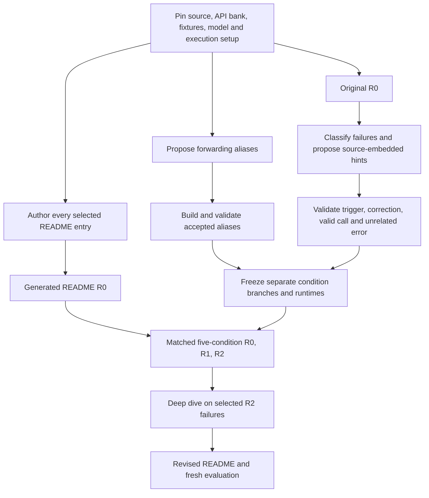

# AIDEAL experiment guide

Updated November 18, 2026. The current study contains **2,850 selected API targets across six libraries**. RDPro uses two language banks. Original R0 and README authoring are complete. Generated README R0 is running. A fresh mir_eval study now evaluates Original, Generated README and Error Hints through R2 across all 178 targets; the first two conditions have completed. Alias review has resumed; Alias-only and Combined evaluation remain gated on accepted source treatments.

[Current results and treatment gates](operator/ablation/2026-11-18/STATUS.md) · [Full ablation plan](operator/ablation/2026-11-18/PLAN.md) · [Live-progress snapshot](operator/ablation/2026-11-18/PROGRESS.json) · [Original completion proof](operator/resume/2026-11-18/COMPLETION.md)

## 1. Banks and completed baseline

| Library | Pinned release | Selected targets | Original R0 passes | Generated README entries |
|---|---|---:|---:|---:|
| RDPro / Beast, Raptor and supporting raster types | 0.10.1 | 330 (69 Java + 261 Scala) | 37 | 330 |
| MDAnalysis | 2.11.0 | 1,538 | 612 | 1,538 |
| tslearn | 0.10.0 | 362 | 219 | 362 |
| mir_eval | 0.8.2 | 178 | 128 | 178 |
| Thumbnailator | 0.4.21 | 225 | 104 | 225 |
| SedonaDB | 0.5.0 | 217 SQL targets | 78 | 217 |
| **Total** | | **2,850** | **1,178** | **2,850** |

These are selected qualified API targets, not unique short function names or counts of original-document headings. The current RDPro bank contains 271 methods and 59 concrete constructors. Its reduction is **452 candidate sites − 72 wrappers/adapters − 25 unimplemented bodies − 3 abstract constructors − 15 bodyless methods − 7 additional overloads = 330**. Different defining owners remain distinct; overload reduction happens within one owner/API. Imported and inherited-only framework APIs are excluded. [Exact RDPro decisions](review/raptor-scope/strict-no-wrappers/ALL_CANDIDATE_DECISIONS.json).

**The other banks do not yet have an equivalent strict wrapper review.** Their completed results retain the original manifests. Do not silently replace their denominators or claim identical filtering. [Cross-library selection review](review/raptor-scope/maintenance/SELECTION_POLICY.md).

The earlier RDPro count of 171 came from an older README-based inventory of bare Scala names. Full-Beast 2,787 and intermediate raster counts 422/406 are superseded scopes, not the current run. [Count explanation](review/raptor-scope/COUNT_EXPLANATION.md) · [171-target historical evidence](review/raptor-scope/history-171/README.md).

## 2. Experiment design

| Condition | Documentation supplied | Library changes | Current execution gate |
|---|---|---|---|
| Original | Original documents | None | R0 complete; fresh mir_eval R0–R2 complete |
| README only | Generated per-API entries | None | Six banks complete; MDAnalysis running |
| Alias only | Original + accepted alias descriptions | Validated forwarding aliases | Model proposals running; build/behavior validation required |
| Error Hints only | Original | Validated messages in existing exceptions | mir_eval and MDAnalysis source installed; mir_eval R0–R2 running |
| Combined | Generated entries + same aliases | Same aliases + same native hints | Must contain both accepted source treatments before evaluation |



**R0** is the initial program. **R1/R2** are the first and second repairs of a failed program. A passing task stops early. A provider retry is not a repair. Deep dive changes the README and requires a new evaluation identity; it is not R3.

The immediate Generated README comparison uses one trial, zero repairs and `gemini-3.1-flash-lite`, with the Original per-bank evaluator, source, API identities, fixtures and execution settings. Generated documentation selects a generated API entry instead of an original-document excerpt. Report that selection change as well as the text change.

SedonaDB's registered SQL bank currently lacks a compatible source-alias/native-hint adapter. RDPro, tslearn and Thumbnailator also have no accepted native hint under the current literal-message patcher. These treatment cells remain pending rather than silently becoming unchanged control branches.

The tested repair protocol includes the preceding program and bounded public execution feedback, preserving emitted native hints. The old native repair path can truncate messages and omit the previous program, so its zero-repair checkpoint cannot simply be relabelled R2. The new mir_eval comparison uses fresh R0 responses in all three ready conditions. Do not pool these R0/R2 values with earlier R0-only runs. Alias-only and Combined will require the same repair policy when ready.

The live one-target pilot completed six Gemini calls without provider, infrastructure or truncated-output errors. Both conditions failed through R2; the embedded hint reached R1 correctly but provided no observed final-success benefit in that trial. [Pilot outcomes and exact traces](operator/ablation/2026-11-18/repair-protocol/PILOT_RESULTS.md).

Alias authoring now continues after a complete rejected response, while retaining the rejection and excluding its code. It reuses previously exposed batches, reviews the remaining APIs once, and pauses on provider/incomplete output. The accepted candidate index is only an input to separate runtime validation. [Review rules and counts](operator/ablation/2026-11-18/aliases/review-all-batches/README.md).

## 3. Inputs and fairness

| Inspect | Evidence |
|---|---|
| Official sources, versions and public baseline trees | [STUDY_LOCK.json](STUDY_LOCK.json) |
| Current RDPro targets and exclusions | [Strict bank](review/raptor-scope/strict-no-wrappers/SELECTED_APIS.json) |
| Exact original-document excerpts and mappings | [Original-document manifest](review/raptor-scope/strict-no-wrappers/original-docs/manifest.json) |
| Other libraries' API inputs | [Qualified bank browser](review/qualified-bank/INDEX.html); its full-Beast RDPro rows are historical |
| Effective profiles, manifests and scaffolds | [Current catalog](review/raptor-scope/plan/RUN_CATALOG.cluster.yaml) |
| Generated condition inputs | [Seven-bank preflight](operator/ablation/2026-11-18/PREFLIGHT.json) and each run's `GENERATED_LAUNCH.json` |
| Actual model exposure and execution | Per-attempt request, response, program, stdout/stderr and result files |

For RDPro, 16 retained implementation identities have reviewed original API context; 314 have no reviewed API-specific match. This is not proof that useful documentation does not exist. Preserve unchanged source text and the source-to-document mapping separately from generated guidance.

Native API microbenchmarks use the existing execution and configured checks; generated assertions are not independent hidden-oracle accuracy. A separately frozen puzzle bank is still a distinct experiment. Original failures used to develop treatments make this a within-bank development comparison; held-out generalization needs separate tasks. [Known environment/inventory findings](operator/resume/2026-11-18/failure-review.md).

## 4. Source branches and isolation

Shared code and experiment records live on `ZhuochengShang/AIDEAL`, branch `study/2026-11-17-latest-stable-canonical`. Each of the six public library repositories uses:

```text
study/2026-11-17-latest-stable-canonical/
  original
  readme-only
  alias-only
  error-hints-only
  combined
```

[README installation commits and hashes](operator/ablation/2026-11-18/branches/README.md) identify the exact bytes. A branch name alone does not prove that a treatment is installed. Later source-installation receipts record new commits. Combined receives the same accepted alias and hint files as their individual conditions, plus the generated README.

Each condition uses an isolated source/runtime location. Never switch or modify the Original checkout beneath a running evaluation. Jobs pin immutable evaluator releases; updating the cluster's `current` pointer changes future development commands, not already-running jobs. Preserve measured branches and rejected development evidence.

## 5. Folders and review order

Canonical local study:
`/Users/clockorangezoe/Documents/phd_projects/code/geoAI/AIDEAL_WORKSPACE/03_Experiments/2026-11-17-latest-stable-canonical/`

Cluster study:
`/home/zshan011/apps/aideal/studies/2026-11-17-latest-stable-canonical/`

```text
study/
  EXPERIMENT_GUIDE.md
  review/raptor-scope/                    current RDPro bank and original-doc mapping
  operator/resume/2026-11-18/             completed Original/authoring verification
  operator/ablation/2026-11-18/           plan, queue, checks, progress, branch receipts
  qualified/                             original Python/SQL results and authoring
  qualified-raptor/                       corrected JVM results and authoring
  qualified-readme-source-note/          completed MDAnalysis authoring recovery
  ablation-2026-11-18/
    generated-readme-r0/<bank>/           current matched README evaluation
    matched-repairs/mir_eval/<condition>/ fresh 178-target R0/R1/R2 comparison
    development/aliases-reviewed/          current alias review and accepted candidate index
    development/aliases/<bank>/          isolated source attachments
    development/aliases-only-proposals/  preserved earlier proposals and rejection records
  native-hint-authoring-2026-11-18/       author requests, candidates and paired controls
  runtime-conditions/                    isolated installed source treatments
```

The cluster is the authoritative execution location. Local/GitHub records are timestamped review snapshots, not a continuous mirror of every live write. Full model and program traces remain in the cluster output directories until synchronized.

For one Generated README target, read:

1. `GENERATED_LAUNCH.json` — input checks and frozen comparison identity.
2. `configs/generated_readme.yaml` and `docs/LLM_readme.md` — active settings and documentation.
3. `execution/run_<API-storage-key>/attempt_*/` — actual prompt, response, program, output and error.
4. `execution/comprehension_progress.jsonl` — per-target progress.
5. `result.json`, `REPORT.md`, `completion.json` — final aggregates and completion checks.

Copied `configs/aideal.yaml` and `launch.json` are preparation receipts; they do not identify the active Generated condition. Later physical attempt directories can reflect provider retries even when logical program repairs remain zero.

## 6. Commands

```bash
ssh lab
cd /home/zshan011/apps/aideal/studies/2026-11-17-latest-stable-canonical
/home/zshan011/apps/aideal/venv/bin/python operator/ablation/2026-11-18/progress.py
```

To check the separate repair study from the same cluster folder:

```bash
python3 - <<'PY'
import json
from pathlib import Path
base = Path("ablation-2026-11-18/matched-repairs/mir_eval")
for condition in ("original", "generated_readme", "error_hints"):
    path = base / condition / "result.json"
    if not path.exists():
        print(condition, "queued")
        continue
    result = json.loads(path.read_text())
    print(condition, len(result["rows"]), "/", result["selected"],
          result["cumulative_passes"], "complete:", result["complete"])
PY
```

Within each repair output, `apis/<identity-hash>/round_00`, `round_01` and `round_02` contain `ROUND.json`, exact native attempt artifacts and stable-result receipts. `ROUND.json.logical_round` is authoritative: the reused native single-attempt executor labels its internal request round zero in every outer round. This mapping is recorded explicitly rather than overwriting native evidence.

The existing detached queues already run. If it stops, first inspect its process/lock and failure reason. `start_generated.py` resumes the same frozen queue; do not start a duplicate while it is active. It uses the permitted credential-file path through the existing supervisor; do not copy the key into configuration or Git.

Review locally in VS Code by opening `/Users/clockorangezoe/Documents/phd_projects/code/geoAI/AIDEAL_workflow`. [Code review route](CODE_REVIEW_ROUTE.md) and [treatment workflow](https://github.com/ZhuochengShang/AIDEAL/blob/8bddc9dbca22369283d5cb723f2c0c420e98bb27/docs/TREATMENT_WORKFLOW.md) explain entry points. A Mac execution requires separately prepared local paths and runtime bindings; it cannot resume a cluster checkpoint by copying files.

## 7. Reporting

For each library and condition report selected/completed targets, R0 success, cumulative success after R1/R2, newly fixed failures per round, unresolved categories, input/output tokens, calls, provider retries, model time and build/run/check time. Separate microbenchmarks from puzzles. Missing or unsupported treatments are not zero scores.

Native-hint control tests establish source behavior, not audience repair success. README authoring completion establishes entry coverage, not correctness. Keep these checks distinct from experiment outcomes. [Current development status and validation limits](operator/ablation/2026-11-18/STATUS.md).
