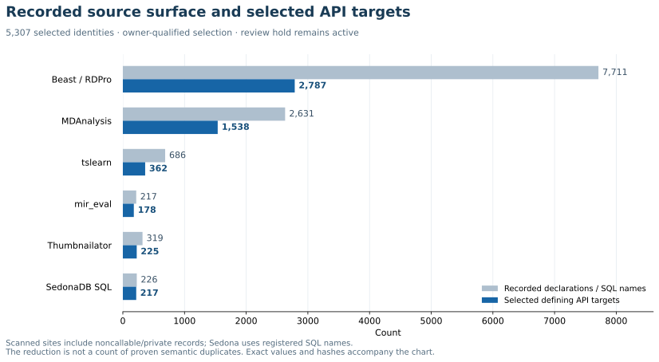
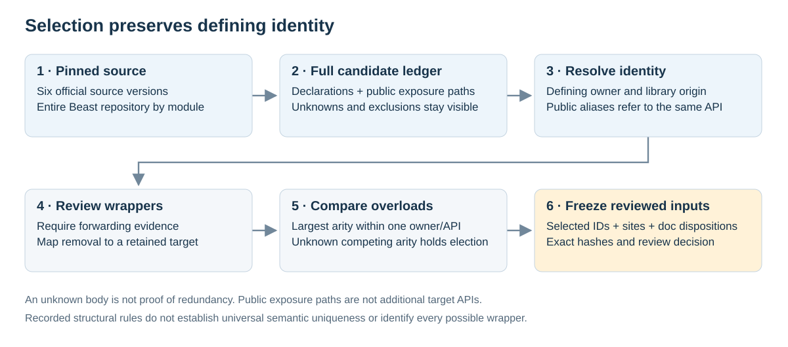
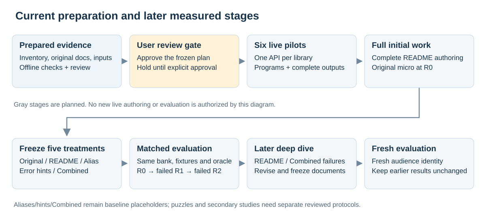

# AIDEAL experiment guide

Updated November 17, 2026. **Review hold: no live authoring or evaluation is authorized by this package.** The owner-qualified replacement passed offline regression and seven-bank preparation checks. Earlier measured results and frozen releases remain unchanged.

[All 5,307 API/task inputs](review/qualified-bank/INDEX.html) · [Readiness fixes](READINESS_FIXES.html) · [Current tracker](review/EXPERIMENT_TRACKER.html) · [Runbook](RUNBOOK.md) · [Historical cohorts](HISTORY.md)

## 1. What is current

**Why this is not a completed study:** the corrected source/doc bank and code can be reviewed, but the new live six pilots, complete README authoring, Original R0 and later repair/condition studies have not run. Treatment installation and the full matched puzzle/oracle protocol remain pending. The final receipts record 684 tests and 365 subtests passed on both Mac and lab cluster; all seven Original and README preparations passed. Passing those checks does not remove the user's review hold.

The current scope is six pinned libraries, with **the entire Beast repository** included by module. Different defining classes and modules keep separate API identities. Overload selection happens within one defining API; a common short name does not merge unrelated operations.

The previous **1,695-target bank, 477 name-mention count and old launch plan are superseded preparation evidence**. They are not the approved denominator or coverage rate for this replacement. [Earlier task previews](review/CURRENT_BANK.html) and [earlier six-pilot previews](review/PILOT_REVIEW.html) remain historical preparation references. Use the qualified bank and six full prompt previews for the current inputs.

| Review item | Current evidence |
|---|---|
| What was found and selected? | [Search all 5,307 selected targets and native micro inputs](review/qualified-bank/INDEX.html); source/doc/selection receipts per row |
| Why did the earlier counts fall? | [Historical reduction audit](review/api-audit/API_AUDIT.html), [all earlier candidate rows](review/api-audit/ALL_SOURCE_CANDIDATES.csv) |
| Which concrete bugs were fixed? | [Readiness fixes and remaining checks](READINESS_FIXES.html) |
| What actually ran? | [Existing native setup evidence](review/READINESS.html), [historical cohorts](HISTORY.md) |
| Is the code and review package identical everywhere? | [Study lock](STUDY_LOCK.json), [snapshot manifest](SYNC_MANIFEST.json), [verification script](verify_snapshot.py) |

New model calls and measured results for the owner-qualified replacement remain **zero**. Prepared prompts, mocked tests and earlier native controls are different kinds of evidence; none substitutes for six new live end-to-end pilots.

## 2. Pinned libraries and current API identities

| Library | Stable version | Official commit prefix | Source scope |
|---|---|---|---|
| Beast / RDPro | 0.10.1 | `547f7f912131` | Whole repository; Scala and Java modules reported separately |
| MDAnalysis | 2.11.0 | `ace84dde1363` | Python/Cython definitions and resolved public exposures |
| tslearn | 0.10.0 | `f6072f237313` | Library-defined Python APIs and resolved public exposures |
| mir_eval | 0.8.2 | `8db0b3812e20` | Library-defined Python APIs and resolved public exposures |
| Thumbnailator | 0.4.21 | `c9d99613878b` | Java methods and public constructors |
| SedonaDB | 0.5.0 | `751453f04cd6` | Registered SQL operations and explicit alias relationships |

The source commit is the official upstream identity. A public publication snapshot can have a different commit ID while retaining the exact same tree. [STUDY_LOCK.json](STUDY_LOCK.json) records that distinction. A local working checkout need not be at the pinned commit; inspect the recorded commit explicitly.

<!-- QUALIFIED_COUNTS_START -->
The final staged inventory records **5,307 selected identities**. These counts describe the recorded selection snapshot; the review hold and remaining limitations below still apply. [Count data and hashes](review/figures/qualified_count_data.json) bind the chart to the exact ledgers, selection receipts and documentation mappings.

| Library | Scanned sites / SQL names | Eligible callable sites | Selected APIs | Exact excerpt mapped | No exact excerpt | Selected manifests |
|---|---:|---:|---:|---:|---:|---|
| [Beast / RDPro](review/qualified-api/rdpro/canonical-selection.json) | 7,711 | 3,321 | 2,787 | 3 | 2,784 | [Java](review/qualified-api/rdpro/api_manifest.java.json) / [Scala](review/qualified-api/rdpro/api_manifest.scala.json) |
| [MDAnalysis](review/qualified-api/mdanalysis/canonical-selection.json) | 2,631 | 1,543 | 1,538 | 1,064 | 474 | [Python](review/qualified-api/mdanalysis/api_manifest.python.json) |
| [tslearn](review/qualified-api/tslearn/canonical-selection.json) | 686 | 362 | 362 | 223 | 139 | [Python](review/qualified-api/tslearn/api_manifest.python.json) |
| [mir_eval](review/qualified-api/mir_eval/canonical-selection.json) | 217 | 178 | 178 | 177 | 1 | [Python](review/qualified-api/mir_eval/api_manifest.python.json) |
| [Thumbnailator](review/qualified-api/thumbnailator/canonical-selection.json) | 319 | 319 | 225 | 225 | 0 | [Java](review/qualified-api/thumbnailator/api_manifest.java.json) |
| [SedonaDB SQL](review/qualified-api/sedonadb/canonical-selection.json) | 226 | SQL policy | 217 | 211 | 6 | [Sql](review/qualified-api/sedonadb/api_manifest.sql.json) |
| **Total selected** | — | — | **5,307** | **1,903** | **3,404** | — |



Beast splits into 1,394 Scala and 1,393 Java targets. Its 7,711 scanned records include fields and other noncallable/private declarations; 3,321 enter callable selection. Public exposure aliases are not extra targets. Sedona counts registered SQL names under a separate explicit-alias policy.

The strict documentation mapping gives Beast 3 exact excerpts among 2,787 selected identities. That means 2,784 targets have **no verified exact mapping under this detector**, not that useful original documentation is absent. All still receive the pinned README as shared Original context. Shared text does not inflate the 1,903 exact-mapped target count.
<!-- QUALIFIED_COUNTS_END -->



The selection contract is:

1. Enumerate source declarations, constructors and public access paths, including Cython where applicable. Preserve exclusions and unresolved cases in the ledger.
2. Resolve the defining owner and origin. Exclude dependency-only definitions exposed through the library; retain the library's own implementation even when it calls Spark, Java or NumPy.
3. Map public aliases and inherited exposure paths to the same defining API. A private defining module can remain a valid target when its public exposure is established.
4. Remove a forwarding wrapper only with recorded evidence and a retained target mapping. Unknown body classification alone does not prove a wrapper or justify discarding an otherwise established callable.
5. Group overloads within the same defining module/class API and select the largest explicit parameter count. An unresolved competing overload blocks that election. A singleton with unknown constructor arity remains visibly unknown, not a verified zero-argument callable.
6. Freeze the selected identities, source sites, documentation dispositions and hashes after review. SQL registration aliases follow their own explicit policy; no finite maximum SQL arity is invented.

The usual identifier is `language:fully.qualified.symbol`. Proven Scala companion class/object collisions additionally carry the owner kind, for example `scala:class:qualified.symbol` versus `scala:object:qualified.symbol`. The defining qualified name and public access paths remain separate fields.

Beast's custom `org.apache.spark.beast` definitions are library-owned despite their namespace prefix. Ordinary Spark dependency definitions are not added to the bank merely because a Beast API exposes them.

These are auditable structural rules. They do not prove that every remaining pair of APIs is semantically different or that every possible wrapper has been recognized.

The final ledger makes the remaining boundaries explicit:

- Beast retains 581 sites with earlier forwarder/wrapper/facade labels and 951 unresolved-body labels as review notes. Thumbnailator retains 26 earlier forwarder/wrapper labels and 69 unresolved-body labels. A label alone lacks the target-equivalence proof required for removal; wrapper elimination is therefore **not certified complete**.
- MDAnalysis retains 29 and tslearn 7 selected singleton APIs with unknown arity. They are not represented as verified zero-parameter calls.
- Public exposure resolution records 41 unresolved MDAnalysis paths and one unresolved tslearn path; dynamic/generated symbols and external-base enumeration boundaries remain visible in the ledgers.
- Sedona binds 225 of 226 registration names directly to source evidence and retains the dynamic `S2_CellIdFromPoint` boundary explicitly.

Zero unresolved identity/arity election sites does not mean complete dynamic exposure resolution, complete wrapper removal or a fully specified scientific evaluation. Review these limits before accepting the replacement scope.


## 3. Original documentation and exposure fairness

The earlier 477/1,695 figure counted short-name mentions in code-context text. It was **not a qualified API documentation count**. New documentation uses exact defining identities or resolved public exposure paths, with the original URL, source version, raw bytes, normalized text and anchor hashes retained.

| Library | Reviewed original corpus being bound | Coverage interpretation |
|---|---|---|
| Beast | 21 tracked documentation files, including four previously omitted module READMEs | A name mention alone does not establish a particular owner's documented contract |
| MDAnalysis | 148 version-checked rendered API pages + pinned README | Defining APIs and public aliases require exact reconciliation; this is not the entire user guide |
| tslearn | 99 version-checked rendered API pages + pinned README | Dataset payloads and unresolved documentation stubs are excluded from the reviewed text corpus |
| mir_eval | 18 version-checked rendered API pages + pinned README | Exact documented identities are mapped to the selected source targets |
| Thumbnailator | 83 content documents: 81 API/package pages, overview and source README; 349 declared member anchors | Member anchors include overloads and constructors, so 349 is not the selected target count |
| SedonaDB | 214 pinned documents: 212 SQL function pages, SQL index and README | Registered aliases are mapped explicitly; missing targets remain visible |

The three Python corpora include 265 version-checked API pages plus their three pinned repository READMEs. Their extracted anchors are documentation records, not automatically eligible benchmark targets. The new manifest marks each selected target **documented**, **undocumented** or **unresolved**. The bound target mappings establish the 1,903 exact-mapped and 3,404 no-exact-mapping dispositions above.

| Consumer | Actual documentation input |
|---|---|
| Original audience, default relevant/entry mode | The pinned top-level README verbatim, followed by exact reviewed excerpts for the requested API; an explicit no-excerpt note for an undocumented target |
| README author | Entire reviewed corpus through recorded distillation chunks, plus complete exact target excerpts and permitted source facts |
| README-only audience | The generated entry for the exact requested API identity |
| Explicit full-document audience mode | The entire selected document bundle; a separate exposure setting that must be frozen in the protocol |

Every library uses the same reviewed shared-context rule: its pinned top-level README is declared through `shared_document_ids` and supplied verbatim before target excerpts. A repeated whole-document excerpt is omitted only when its content is exactly identical to the shared document. Shared README text does **not** earn exact API-documentation coverage credit. Other introduction/setup pages are not automatically appended. Common scaffold, fixture, runtime and requested-target instructions are supplied separately and held equal across conditions. An unresolved or missing mapping blocks the relevant request. A documented excerpt that exceeds the configured budget raises an error rather than being silently cut.

Author distillation now covers every character of the configured reviewed corpus in deterministic chunks. Its receipts record chunk ranges, input/output hashes and exact requests. A summary can compress information; the claim is that no input tail is silently omitted. The number of distillation calls depends on corpus size and the reviewed chunk setting.

Do not import implementation bodies, private expected answers or evaluation failures into ordinary audience documentation. Keep documented and undocumented target strata in the results. If a study intentionally changes exposure scope, record it as a separate protocol rather than mixing the results.

## 4. Conditions, rounds and later studies

| Condition | Audience documentation | Source treatment |
|---|---|---|
| Original | Pinned top-level README + reviewed original API excerpts | Pinned original source |
| README only | Exact generated API entry | Original source; generated document installed after validation |
| Alias only | Shared README + original excerpts + alias interface description | Reviewed aliases mapped to the same defining targets |
| Error hints only | Shared README + original excerpts | Reviewed embedded exception guidance |
| Combined | Generated entry plus alias interface description | Reviewed aliases and embedded hints |

The five branch names exist for every library, but **the treatment branches are still untreated placeholders**. Branch existence does not prove that a generated README, alias implementation or hint treatment has been installed or tested.



| Stage | Meaning | Current state |
|---|---|---|
| Inventory and documentation freeze | Approve target identities, dispositions, document scope, fixtures and hashes | Inputs verified; user review pending |
| One API per library | Six end-to-end pilots with actual delivered prompts and complete outputs | Six complete prompt previews saved; no live pilot sent |
| Complete README authoring | Author every approved selected API; validate exact completion and install reviewed documents | Frozen inputs verified; user review pending |
| Original micro R0 | First audience-written program for each approved target | Pending approval |
| R1 | First bounded repair after an actual R0 failure | Pending preceding evidence and reviewed repair policy |
| R2 | Second bounded repair after an actual R1 failure | Pending preceding evidence and reviewed repair policy |
| Five-condition micro comparison | Same bank, fixtures, scoring and exposure rules for all conditions | Treatment development/installation and matched protocol pending |
| Puzzles | Complete approved public inputs, hidden expectations, scoring and outputs | Full matched bank/protocol not yet certified complete |
| README-only / Combined deep dive | Inspect R2 failures, revise docs, freeze a revision and evaluate with a fresh audience | Separate later evaluation, not a continuation counted as R0 |

Provider retries are not R1/R2. A later README revision starts a new evaluation identity. A model-authored assertion is not an independent oracle. Record which tests are independent, which are execution witnesses and which assertions were written by the audience.

Secondary user questions remain explicitly **unscheduled studies**, not extra current paid jobs:

| Question | Required comparison |
|---|---|
| Sequential all-entry README versus selected-API regeneration/order | Equal author budget and an explicit generation order |
| Attached-library refactoring/reorganization | A separate source treatment, distinct from deduplicating the evaluation bank |
| Memory on versus off | Frozen development-only memory with evaluation leakage controls |

## 5. Fixes, validation and remaining work

The implemented replacements address distinct-owner merging, unstable identity use across README stages, missing source/public exposure records, broad documentation ingestion, silent corpus truncation, and adapters guessing an API from an output-folder name. [READINESS_FIXES.html](READINESS_FIXES.html) links each fix to its evidence and recorded checks and remaining study stages.

| Evidence | What it establishes | What it does not establish |
|---|---|---|
| Offline regression tests | Deterministic contracts with mocked provider/process boundaries | Real model behavior or complete scientific correctness |
| Existing 25 native setup outcomes | Earlier positive and deliberately negative controls behaved as expected | 25 successful benchmarks, or six new live end-to-end pilots |
| Source/document checksums | Which exact bytes and versions are bound | Semantic equivalence of APIs or documentation sufficiency |
| New reviewed previews | The proposed prompt/data exposure before a call | A delivered request, measured pass or provider token receipt |
| Current source selection | A reproducible structural policy and visible dispositions | A proof that all wrappers or all bugs have been eliminated |

The current catalog is [RUN_CATALOG.cluster.yaml](review/qualified-plan/RUN_CATALOG.cluster.yaml). It contains seven banks: Beast Scala 1,394, Beast Java 1,393, MDAnalysis 1,538, tslearn 362, mir_eval 178, Thumbnailator 225 and SedonaDB 217. The initial plan is 14 held jobs: seven Original R0 banks and seven complete README-authoring banks. New outputs belong under the cluster study's `qualified/` namespace.

| Final integration binding | Receipt-backed value |
|---|---|
| Current evaluator snapshot | `evaluator-qualified/`; previous `evaluator/` preserved |
| Release ID | `2026-11-17-qualified-api-f3c6fd6fe802` |
| Evaluator content SHA256 | `f3c6fd6fe802716592df2d1342fc1b5bc9de5ca372aac880c196a240b2cb1838` |
| Integrated test receipt | [Final checks](review/qualified-checks/FINAL_VALIDATION.json) — 684 tests and 365 subtests passed on both Mac and lab cluster |
| Cluster preflight receipt | `review/qualified-checks/preflight/PREFLIGHT.json` |

[RUNBOOK.md](RUNBOOK.md) provides concrete verification and `--prepare` commands against that catalog. It deliberately contains no runnable live command. The replacement is an input-review package, not completed model experimentation.

No code change grants permission to run. The review hold persists until the user approves the concrete replacement bank and plan. Prior launch commands remain superseded.

## 6. Folder structure and manifests

```text
2026-11-17-latest-stable-canonical/
  EXPERIMENT_GUIDE.md / .html      current guide
  READINESS_FIXES.md / .html       fixes, evidence and remaining checks
  STUDY_LOCK.json                  official source vs publication identities
  SYNC_MANIFEST.json               portable-file checksums
  RUNBOOK.md                      reviewed local/cluster commands
  evaluator/                      prior frozen evaluator, preserved
  evaluator-qualified/            new qualified evaluator, release-bound
  operator/cluster/               plan, approval/hold and launch receipts
  review/
    qualified-api/
      rdpro/                      Scala/Java ledgers and selected API manifests
      mdanalysis/                 Python/Cython definitions and exposure mappings
      tslearn/                    Python definitions and exposure mappings
      mir_eval/                   Python definitions and exposure mappings
      thumbnailator/              Java methods/constructors and Javadoc mappings
      sedonadb/                   SQL registrations, aliases and document mappings
      <library>/original-docs/    source-bound corpus and target excerpts
    qualified-plan/libraries/    new bank configs, profiles and scaffolds
    qualified-bank/INDEX.html    searchable all-API/task input browser + CSV
    qualified-pilots/INDEX.html  six complete unsent R0 requests and scaffolds
    qualified-checks/           local/cluster tests and preparation/build receipts
    figures/                     count data, comparison chart and stage diagrams
    CURRENT_BANK.html             task prompts/inputs, labeled by preparation cohort
    PILOT_REVIEW.html             six pilot walkthroughs, labeled by cohort
    EXPERIMENT_TRACKER.*          current progress plus separate historical cohorts
    runtime_evidence/            setup programs, stdout/stderr and check receipts
    api-audit/                   earlier correction evidence; retained as history
```

For source-audited libraries, each `review/qualified-api/<library>/` directory contains `ledger.json`, `canonical-selection.json`, `api_inventory.<language>.json` and `api_manifest.<language>.json`. The inventory binds all candidate sites and the selected receipt separately. An API manifest lists selected exact identities. Beast has distinct Scala and Java manifest files; they share the repository provenance. Sedona's final registration binding is listed with its own policy.

Each `original-docs/manifest.json` records the shared README IDs, complete reviewed corpus and exact target mappings. Its payload paths resolve relative to its own directory. An output config may relocate while retaining an absolute manifest locator and its checksum. The manifest, complete corpus and all target excerpts are included in input fingerprints.

Every measured output must retain the exact requested API identity, public access path, delivered prompts, response, generated program, command, stdout/stderr, verdict, error category, repair round, timestamp and provider usage receipt. A filesystem-safe hashed name is only a storage key; it must never become the requested API. Missing provider usage is unknown, not zero.

## 7. Local, cluster and GitHub

Use the Mac or VS Code for review. Long runs belong in the validated cluster environment through VS Code Remote SSH. A fresh native Mac scientific runtime is not currently certified. Review-only local checks are:

```bash
cd "/Users/clockorangezoe/Documents/phd_projects/code/geoAI/AIDEAL_WORKSPACE/03_Experiments/2026-11-17-latest-stable-canonical"
python3 verify_snapshot.py
open EXPERIMENT_GUIDE.html
```

Cluster source and review locations are separate:

```text
/home/zshan011/apps/aideal/studies/2026-11-17-latest-stable-canonical/sources/<library>
/home/zshan011/apps/aideal/studies/2026-11-17-latest-stable-canonical/review_snapshot/
```

Read-only source inspection:

```bash
ssh -o ClearAllForwardings=yes lab
STUDY=/home/zshan011/apps/aideal/studies/2026-11-17-latest-stable-canonical
git -C "$STUDY/sources/rdpro" rev-parse HEAD 'HEAD^{tree}'
cd "$STUDY/review_snapshot"
python3 verify_snapshot.py
```

Every library has refs under `study/2026-11-17-latest-stable-canonical/`: `original`, `readme-only`, `alias-only`, `error-hints-only`, `combined`. Inspect a ref with `git show` without changing a checkout. Treat those refs as baseline placeholders until installation receipts identify the actual treatment commits.

The [AIDEAL study branch](https://github.com/ZhuochengShang/AIDEAL/tree/study%2F2026-11-17-latest-stable-canonical) hosts the portable review. The frozen review package is synchronized by its file checksums across local storage, the cluster and this study branch. Verify it with `python3 verify_snapshot.py`; later edits require a new freeze and sync. Main, previous branches and measured history remain preserved.

Use the concrete review-only preparation commands in [RUNBOOK.md](RUNBOOK.md) after checking the final qualified release/preflight binding. Live commands remain withheld until approval; do not reuse the superseded plan or infer permission from a passing test suite.

## Current review links

Start with [six complete Original R0 previews](review/qualified-pilots/INDEX.html), then [the full 5,307-target browser](review/qualified-bank/INDEX.html). Inspect the [paused 14-job queue](review/qualified-plan/QUEUE.cluster.json), [cost scenarios](review/qualified-plan/COST_SCOPE.md), [seven-bank preparation receipt](review/qualified-checks/preflight/PREFLIGHT.json), and [native failure-to-hint connection](review/qualified-checks/NATIVE_HINT_INTAKE.md). R0/README preparation is verified; treatments, live pilots, five-condition results and the matched puzzle protocol remain separate pending stages.

## 8. Read the code in execution order

[Code review route with exact functions, line numbers and prompts](CODE_REVIEW_ROUTE.md). The native all-API R0/README launchers and the matched five-condition runner are separate entry points. Their evidence is connected through the verified native R0 intake; do not assume that a legacy condition run is the new full-bank run.
