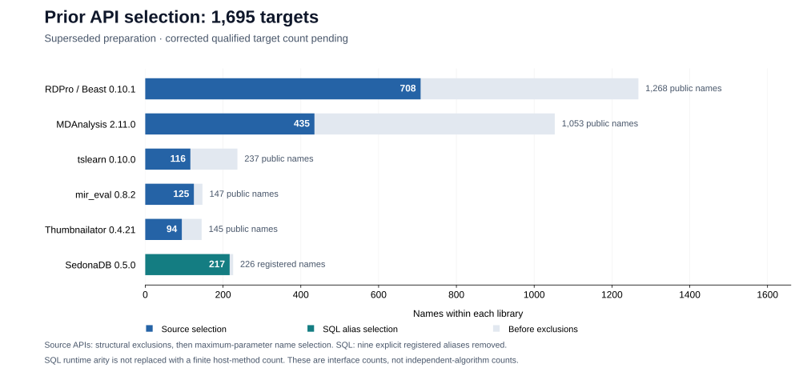
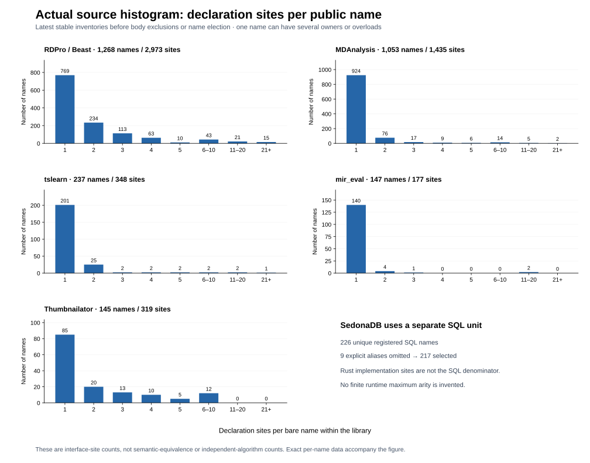
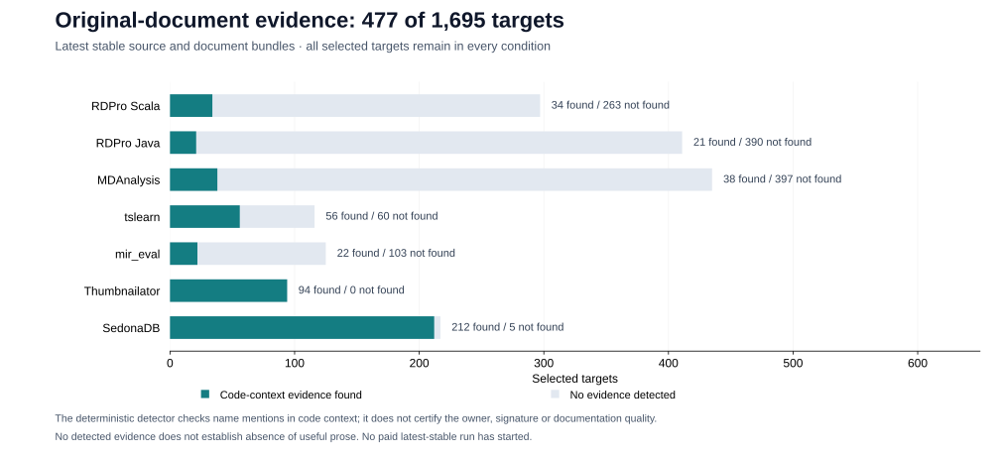
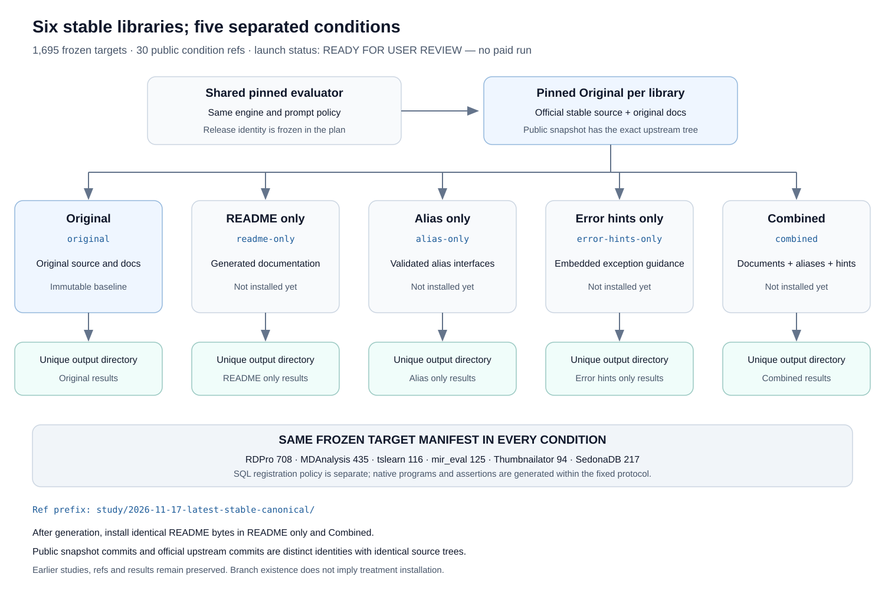
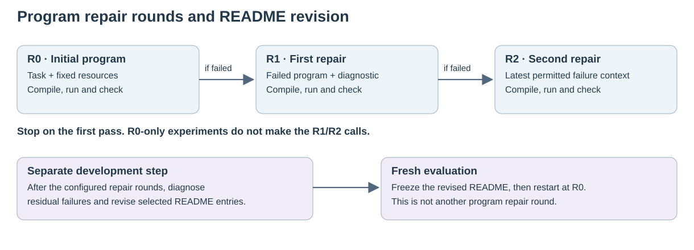

# AIDEAL: latest-stable study review

Updated November 17, 2026. **READY_FOR_USER_REVIEW. No paid run has started.** The user requested inspection before any run. Prepared inputs, existing controls and planned stages are available for review; no new authoring or evaluation result is claimed.

## 1. Open the current evidence

- [Review home](review/REVIEW_HOME.html): one page linking the complete package.
- [Runbook](RUNBOOK.md): cluster/local and VS Code commands, with the user-review gate before any live execution.
- [Snapshot verifier](verify_snapshot.py): checks packaged file hashes against the final sync manifest.
- [All 1,695 prepared task inputs](review/CURRENT_BANK.html): exact available Original prompts/context, selected declarations, profiles and scaffolds.
- [Six single-API pilot previews](review/PILOT_REVIEW.html): one per library, with available prompts and explicit placeholders for future dependent stages.
- [Experiment tracker](review/EXPERIMENT_TRACKER.html): all six libraries, five conditions, R0/R1/R2 and document-revision stages; historical cohorts are separate.
- [API decision browser](review/API_SELECTION.html): every selected, omitted and unresolved source/SQL review record.
- [Documentation coverage](review/DOC_COVERAGE.html): per-target CSVs and the shared denominator policy.
- [Compile/run evidence](review/READINESS.html): 25 expected operator-control outcomes, with saved programs, standard output, errors and execution receipts.

These are static review pages. They display text and do not execute captured programs or contact a model. Private reference solutions and credentials are excluded from audience material. Source bodies in the API audit are reviewer evidence, not audience context.

The [full guide history](HISTORY.md) preserves earlier baseline tables, the 171-name RDPro selection, the stopped 629/719 queue, source expansion and historical terminal instructions. The [historical bank landing page](review/HISTORICAL_BANKS.html) identifies the existing large task browser without duplicating its payload.

## 2. Current versions and selected API scope

| Library | Stable version | Public names before policy | Selected targets | Runtime readiness |
|---|---|---:|---:|---|
| RDPro / Beast |0.10.1|1,268|708: 297 Scala +411 Java|Stable-source production build; six native controls verified|
| MDAnalysis |2.11.0|1,053|435|Official wheels, matching fixtures and imports verified|
| tslearn |0.10.0|237|116|Official wheel, CPU shapelet backend and imports verified|
| mir_eval |0.8.2|147|125|Official wheel, optional formats and imports verified|
| Thumbnailator |0.4.21|145|94|Official Maven artifact and native controls verified|
| SedonaDB |0.5.0|226 registered SQL names|217|SQL registry/alias audit and native controls verified|
| **Total** |||**1,695**|**Ready for review; no paid run**|



Five source inventories contain 5,252 public definition sites. The selection first excludes identified forwarding/facade/no-body cases and quarantines unresolved body classifications. It then chooses the largest-parameter eligible declaration for each bare name across that library's languages. Deterministic ties use language, path, line and site identity. No selected RDPro name appears in both Scala and Java.

Python public classes remain API targets. Callable arity excludes implicit `self`/`cls`; each starred parameter counts once, and defaults/varargs remain explicit metadata. Eligible explicit constructors are retained. Inherited or uncertain constructor contracts remain visible as unresolved; a placeholder zero is not presented as known arity. Java constructors remain separate declarations in the source audit.

SedonaDB uses its public SQL registry rather than Rust helper-function counts. Nine explicit aliases are removed from 226 registered names, leaving 217. SQL runtime-defined signatures and the unbounded variadic `RS_Stack` do not receive invented finite maximum arities. The singular/plural interior-ring pair is retained: sharing a kernel does not establish equivalence across all supported backends.

The [5,478-record API browser](review/API_SELECTION.html) combines 5,252 source sites and 226 SQL names. The [SQL evidence](review/audit/sedonadb-sql/SQL_CANONICAL_ALIAS_AUDIT.json) and [source-scope reconciliation](review/audit/latest-source/SOURCE_SCOPE_RECONCILIATION.json) explain every policy boundary.

This is a conservative structural interface policy, **not a proof of arbitrary semantic independence**. Same-name alternatives can do different work; their omission follows the requested name rule. Unknown source bodies are excluded rather than asserted safe. The 708 selected RDPro names include 90 names from the historical 171; those historical counts describe a different selection.



Exact bins and per-name counts are in [chart data](review/figures/chart_data.json). This histogram precedes body exclusions/name election and explains why source-site and target-name counts differ.

## 3. Original documents and fair comparison

Freeze the selected set **S** before any generation. Let **D** be targets with detected original-document code-context evidence, and **U=S−D** be targets without such evidence. Every condition keeps all of S. Report overall outcomes, then D/U strata; generated README availability must not redefine the denominator.

| Target group | All S | Evidence found D | No detected evidence U |
|---|---:|---:|---:|
| RDPro Scala |297|34|263|
| RDPro Java |411|21|390|
| MDAnalysis |435|38|397|
| tslearn |116|56|60|
| mir_eval |125|22|103|
| Thumbnailator |94|94|0|
| SedonaDB |217|212|5|
| **Total** |**1,695**|**477**|**1,218**|



The pinned engine's `doc_code_mentions` detector checks name mentions in code context. Common names can match another owner. These are evidence labels, not manual certification of signature correctness, documentation completeness or prose quality. No detected evidence does not establish that no useful prose exists. [Per-API CSVs and receipts](review/DOC_COVERAGE.html) retain the exact audit.

Original bundles match the selected releases:

- RDPro: 17 tracked original documents.
- MDAnalysis: 186 tracked README/docs files. The old hosted supplement was mislabeled and actually contained development documentation; it is excluded. Matching hosted 2.11 pages were unavailable during preparation, so the source-doc-only scope is explicit.
- tslearn: 121 tracked documents, six added and one removed relative to the earlier bundle.
- mir_eval: 23 document paths, unchanged from its earlier bundle.
- Thumbnailator:README plus 116 HTML files from the official 0.4.21 Maven Javadoc JAR; old locally generated HTML is not treated as upstream documentation.
- SedonaDB: 214 documents, 381,045 characters; five selected names lack detected evidence.

Original retrieval uses the frozen 12,000-character relevant-context cap and an explicit missing-context message when no relevant section is found. That target remains in the bank. Coverage differences from old versions/bundles are not measured treatment effects.

Every condition receives the same qualified target declaration: owner/name, signature, ordered parameter metadata, selected source-site identity and selection digest, plus task and runtime/scaffold instructions. Full implementation bodies and review-only answers are not audience input. “README only” therefore means generated documentation with this common target/runtime context.

## 4. What is ready and what is not

| Item | State | Recorded evidence |
|---|---|---|
| Official stable sources |Verified|Exact tagged commits, trees and tracked-file bytes|
| Selection and document coverage |Frozen|1,695 targets;477D/1,218U|
| Evaluator |Verified and public|Release a6e8bb84fe32;225 files;104 tests passed|
| Runtime readiness |Verified|25 expected positive/negative outcomes|
| Library condition refs |Public|30 untreated baseline refs; exact-tree snapshot provenance|
| Original R0 preparation |Ready, on hold|Seven language/library jobs,1,695 targets|
| README authoring preparation |Ready, on hold|Seven jobs,1,695 entries plus seven distillations|
| New model requests or results |**Not started**|No new authoring/program/repair outcomes|
| Alias/hint/Combined treatments |Not installed|Later implementation and validation required|
| Matched five-condition task bank |Not yet fully frozen|Task/condition/repair identities require the next reviewed plan|

The prepared 14-job plan has SHA256 `7aef275e71077749dd53c83eb701496e4f8a43fa8b54e2bf4a79c9b9227e0255`. Preparation does not authorize execution. The user-review hold applies before any paid run.

The [readiness page](review/READINESS.html) shows six RDPro outcomes, nine scientific Python outcomes, three Thumbnailator outcomes and seven SedonaDB outcomes. A successful setup check includes correct rejection of intentionally wrong assertions or missing witnesses; these are **not 25 successful benchmarks**. The first Java negative fixture failed compilation because of an unreachable statement. That operator attempt is retained, and corrected conditional fixtures passed their expected gates without changing library code.

All six libraries have saved program/output evidence. [The byte-verified inventory](review/runtime_evidence/INDEX.json) includes 93 files; 24 scientific files were reused from existing identical copies. SedonaDB records per-case exit status/verdict in its actual control receipt, not a nonexistent `execution.json`. No execution metadata is fabricated.

Runtime identity details matter:

- RDPro uses a production artifact built from its pinned stable source; older cached JAR labels did not establish identity.
- Thumbnailator uses the official Maven 0.4.21 JAR, SHA256 `9ba7b5a55731932f2aec94e138b0f15166158e5881497dfb555db30836b7d607`.
- Scientific packages import official stable wheels with implementation bytes compared against source; generated metadata/test-packaging exceptions remain in receipts.
- tslearn shapelets use CPU PyTorch, `KERAS_BACKEND=torch`, and `CUDA_VISIBLE_DEVICES=''`. Python clears old `PYTHONPATH`/`PYTHONHOME` to avoid source shadowing.
- Five MDAnalysis fixture copies match official MDAnalysisTests 2.11.0. Their study directory is read-only; XTC safely calculates offsets when it cannot write its cache. Source and shared dependencies are unchanged.

These controls verify setup and the configured execution gates. They do not prove that every future audience program invokes its requested overload or satisfies an independent semantic oracle. SQL has recorded call/materialization checks; do not generalize those checks to every source library.

## 5. Five conditions and separate stages

| Condition | Audience documents | Executable aliases | Embedded error hints |
|---|---|---|---|
| Original |Original bundle|No|No|
| README only |Generated README|No|No|
| Alias only |Original+alias interface descriptions|Validated aliases|No|
| Error hints only |Original bundle|No|Validated exception guidance|
| Combined |Generated+alias interface descriptions|Validated aliases|Validated exception guidance|

All conditions use the same target manifest and common declaration/runtime context. Alias and error-hint code is a treatment; introducing a wrapper as an alias must not silently add a new target or change which canonical implementation is measured. That mapping and any behavior preservation need separate tests and receipts before treatment evaluation.



The stage tracker distinguishes:

1. **R0:** initial audience program from its permitted documents/context. Current Original preparation allows one attempt and zero program repairs.
2. **R1:** first program repair using the actual preceding program and failure feedback, if the later approved repair protocol permits it.
3. **R2:** second repair using the next observed failure. Report first-pass and cumulative success separately.
4. **README deep dive:** author revises documentation using reviewed failure evidence under an explicit exposure policy. This is not a program-repair round.
5. **Fresh evaluation:** new audience R0 and permitted repair rounds against the revised document, with a distinct output identity. Earlier results remain unchanged.

Provider retries/resume attempts are not R1/R2. A saved `attempt_0002` can be a provider retry or restart, so use the recorded round and request provenance. Reusing a compatible response must not charge its tokens twice.



The six pilot previews show one selected API per library and the available exact inputs. A repair request needs the actual earlier program/error; document revision needs actual evidence; fresh evaluation needs an actual revised document. Those dependent artifacts do not yet exist and must not be presented as delivered prompts or model outputs. Educational examples must be explicitly marked scripted or illustrative.

The full matched five-condition micro/puzzle bank is not yet a finished benchmark. Before it runs, freeze task identities, fixtures, seeds, model settings, document/treatment commits, repair budgets, oracle policy and output ownership. Current native micros let the audience choose examples and assertions; independent puzzle expected answers belong in a separate reviewer-only evaluation boundary.

### Secondary questions: unscheduled studies

The five main conditions stay unchanged. README only and Combined proceed from the approved R2 outcome to document deep dive, then fresh evaluation. The following questions are preserved for separate bank/protocol review; they add **zero current jobs or paid calls** and are not automatically implemented features.

| Future study | Required comparison boundary | State |
|---|---|---|
| Sequential all-entry README vs selected-API regeneration/order | Equal author budget; freeze selection/order and token/call accounting before comparison | Unscheduled |
| Attached-library refactoring/reorganization vs unchanged source | Separate code-change arm, source identity and behavior checks; benchmark deduplication is not library refactoring | Unscheduled |
| Memory on/off | Frozen development-only memory with controlled exposure; no held-out answers or prior evaluation failures | Unscheduled |
| Matched puzzles | Frozen tasks, inputs, oracle boundary, treatment mapping and repair protocol | Bank/protocol review pending |

## 6. Data bank, inputs and outputs

The [current bank](review/CURRENT_BANK.html) exposes all 1,695 prepared Original task inputs across seven language/library banks. Inspect the exact selected target, retrieved original context, system/user messages, public input description, scaffold/profile and source identity. The [pilot page](review/PILOT_REVIEW.html) provides a smaller walkthrough using the same underlying artifacts.

| Artifact | Available now | Available only after the relevant approved stage |
|---|---|---|
| Selected declarations and manifests |Yes|Immutable input identity|
| Original context and R0 request preview |Yes|Actual delivered request is separately recorded on dispatch|
| README templates/source facts |Available preparation evidence|Distillation and entry responses|
| Generated program/assertions |Operator controls only|Actual audience R0/R1/R2 programs|
| Execution logs/verdicts |Operator controls only|Measured audience execution evidence|
| README/deep-dive documents |No new generated document|Generated/revised bytes and installation receipt|
| Tokens, latency and cost |Forecast only for new work|Actual provider receipts and stage timing|

An input preview is not a model request receipt. A source-derived name list is not a completed independent benchmark. The static browser never executes its captured text.

Save complete delivered requests, model responses, rendered programs, standard output/error, execution command/status, provider usage, timestamps and hashes after execution. Preserve failed provider calls and unknown usage rather than treating them as zero cost or successful tasks.

Large fixtures stay on the cluster at recorded paths with hashes. Repeated data directories must not be casually rewritten or regenerated across conditions. Keep reviewer-only answers outside audience/README author prompts; source-informed diagnostics should not silently become audience memory.

The historical task browser remains in the November 16 local study and retains 3,712 task/design records across 27 banks. It includes 1,806 earlier R0 attempts and the stopped expanded RDPro scope. Its versions/targets/protocols differ; [historical cohort details](HISTORY.md) and the separate tracker tab prevent aggregation with this new denominator.

## 7. Public branches, cluster and local copies

The pinned [evaluator release](https://github.com/ZhuochengShang/AIDEAL/tree/release%2F2026-11-17-canonical-api-a6e8bb84fe32) is commit `e9f02e397f96d78d825cf0705f65771232b27e69`. The review supplement does not change that release. Its local copy lives under `evaluator/` in this package, with relative code links below.

All six library repositories publish five refs under `study/2026-11-17-latest-stable-canonical/`: `original`, `readme-only`, `alias-only`, `error-hints-only`, `combined`.

| Library repository | Official commit prefix | Public snapshot prefix |
|---|---|---|
| [RDPro](https://github.com/ZhuochengShang/AIDEAL-RDPro/branches) |547f7f912131|88effa8abe57|
| [MDAnalysis](https://github.com/ZhuochengShang/AIDEAL-MDAnalysis/branches) |ace84dde1363|ce6e8ddbfe7f|
| [tslearn](https://github.com/ZhuochengShang/AIDEAL-tslearn/branches) |f6072f237313|e32e94a758b2|
| [mir_eval](https://github.com/ZhuochengShang/AIDEAL-mir_eval/branches) |8db0b3812e20|967a2466f1de|
| [Thumbnailator](https://github.com/ZhuochengShang/AIDEAL-Thumbnailator/branches) |c9d99613878b|62a5fff8f577|
| [SedonaDB](https://github.com/ZhuochengShang/AIDEAL-SedonaDB/branches) |751453f04cd6|64d0e42731f4|

Full commit/tree mappings are in the [publication receipt](review/audit/latest-readiness/LIBRARY_PUBLICATION.json). Public snapshot commits are parentless and preserve the exact official upstream trees, including licenses and Git submodule entries. They are not falsely described as the official commit IDs.

The cluster source checkouts remain detached at official stable commits; the five study refs point to their identical-tree public snapshots. [Alignment evidence](review/audit/latest-readiness/CLUSTER_ALIGNMENT.json) records both identities. Later installation creates commits on treatment refs without changing the pinned source checkout. README-only and Combined must receive identical generated document bytes. Branch existence is not treatment installation.

Every experiment pins an evaluator directory, input/source/document identities and separate mutable outputs. Changing a branch or convenience pointer does not alter frozen inputs. Old refs, source snapshots and historical results are preserved; no force-push or replacement of historical evidence is part of this study.

The current canonical local folder is `03_Experiments/2026-11-17-latest-stable-canonical`. GitHub, cluster and local review copies are compared through the final package manifest; identical filenames alone do not prove identical bytes. The historical large viewer is intentionally an explicitly local-only link, not duplicated portable content.

## 8. Review commands: Mac versus cluster

These commands inspect files. They do not launch the study. The [runbook](RUNBOOK.md) separates inspection, offline trace, proposed live pilots and the held full queue. Do not execute its live commands before approval.

After the final manifest is present, verify this package from its root with:

```bash
python3 verify_snapshot.py
```

The verifier reads the manifest and hashes files; it does not run the study or contact a model.

On the **Mac**, open the current review:

```bash
cd "/Users/clockorangezoe/Documents/phd_projects/code/geoAI/AIDEAL_WORKSPACE/03_Experiments/2026-11-17-latest-stable-canonical"
open review/REVIEW_HOME.html
open review/PILOT_REVIEW.html
```

In VS Code, open `EXPERIMENT_GUIDE.md` and use Markdown Preview, or follow its relative source links. The SVGs are standalone; Mermaid support is not required.

Connect to the **cluster** and read the prepared plan:

```bash
ssh -o ClearAllForwardings=yes lab
STUDY=/home/zshan011/apps/aideal/studies/2026-11-17-latest-stable-canonical
RELEASE=/home/zshan011/apps/aideal/releases/2026-11-17-canonical-api-a6e8bb84fe32
cat "$STUDY/plan.json"
git -C "$STUDY/sources/rdpro" rev-parse HEAD 'HEAD^{tree}'
git -C "$STUDY/sources/mdanalysis" status --short
```

Each library source is under `sources/<library>`. Source-audit inventories are under `inventories/<library>`. MDAnalysis/tslearn/mir_eval/Thumbnailator/SedonaDB configurations are under `libraries/<library>`; RDPro language configs are under `rdpro/configs`. The scientific interpreter is `/home/zshan011/apps/aideal/envs/2026-11-17-latest-stable/bin/python`.

Inspect a condition without switching the pinned source checkout:

```bash
REPO="$STUDY/sources/rdpro"
PREFIX=study/2026-11-17-latest-stable-canonical
git -C "$REPO" show "$PREFIX/original:README.md"
git -C "$REPO" diff --stat "$PREFIX/original" "$PREFIX/readme-only"
git -C "$REPO" ls-remote --heads aideal-github "refs/heads/$PREFIX/*"
```

An empty initial condition diff is expected while treatments are uninstalled. Runtime JARs, wheels and fixtures are not installed merely by cloning GitHub. Replication requires the recorded setup checks and a new relocated plan, without editing this frozen catalog.

| Command family | Effect |
|---|---|
| `cat`, `git show`, static HTML |Read saved inputs/evidence|
| A launcher preparation mode |Freeze/inspect inputs; may write preparation artifacts|
| Native control/demo execution |Runs real programs even if model replies are scripted|
| Saved launch script or `--run` |Runs or resumes jobs and can spend provider credits|

The prepared launch remains on hold. Do not start any pilot, native demo or paid experiment as part of browsing this review. Old stopped-queue pause/resume examples are preserved only in [HISTORY.md](HISTORY.md), not as current instructions.

After a separately approved future launch, follow the exact paths in its plan and per-attempt receipts. Observe only the intended supervisor/worker identities; do not kill broad process classes or reset checkpoints. Changing source, model, prompt, selection, runtime, fixtures or repair policy requires a newly versioned plan/output identity.

## 9. Metrics, timing and cost

Report first-attempt R0 success and cumulative success through each permitted repair round, with completed/total counts and unresolved provider failures. Keep documented D and uncovered U strata. A task that never ran has no accuracy score. A correctly rejected negative control is not an audience success.

Native micro passes are based on the configured execution gates and audience-written assertions. Independent semantic/puzzle scores require separate fixed tasks and reference checks. Do not collapse these score types into a single percentage or claim that a successful compile proves correct target invocation.

Record elapsed provider time, native compilation/execution time, end-to-end job time, tokens and dollars per stage. Shared setup and parallel work can overlap, so summing durations is not wall-clock time. There is no measured new-study completion time yet; model latency, retries and compiler/runtime costs make total duration uncertain.

The first prepared stage has 1,695 Original requests, 1,695 README-entry requests and seven distillations: **3,397 requests before retries**. Historical per-library token means imply 8.54 million input and 1.50 million output tokens, approximately **$4.39**. RDPro's estimate uses only 16 old pilot targets. An explicit larger-context scenario is **$12.76**. These are scenarios, not spending caps or forecasts for every later treatment/repair stage.

The verified standard sequential Gemini 3.1 Flash-Lite prices are $0.25 per million input tokens and $1.50 per million output tokens including thinking. Batch rates are not assumed. [Exact forecast data](review/audit/latest-readiness/COST_FORECAST.json) retains assumptions; [Google's pricing page](https://aistudio.google.com/docs/pricing#gemini-3.1-flash-lite) is the external source checked on November 17, 2026.

Actual costs must come from saved provider receipts, including failed/retried calls. A request in flight or missing usage is unknown, not zero. Compatible checkpoint replay preserves paid evidence and must not double-count tokens.

## 10. Exact evaluator code to review

The following locations were parsed from the frozen a6 release, not guessed from the developer checkout. [The complete function index](review/audit/latest-readiness/EVALUATOR_FUNCTION_INDEX.json) records the inspected files. Links open the packaged evaluator; the labels give exact source lines for VS Code review.

| Flow step | Exact function/location in the pinned snapshot | What to inspect |
|---|---|---|
| Prepare Original |[run_original_micro.py:41](evaluator/scripts/run_original_micro.py#L41) — `prepare`|Manifest, relocated inventory, fixture/scaffold and input identity|
| Dispatch registry |[api_registry.py:12](evaluator/vendor/aideal_engine/src/aideal/api_registry.py#L12) — `configured_api_details`|Compiler, source-audit or SQL input boundary|
| Read source audit |[api_source_registry.py:132](evaluator/vendor/aideal_engine/src/aideal/api_source_registry.py#L132) — `source_audited_details`|Source SHA/tree/file bounds and elected identities|
| Canonical election |[api_canonical_selection.py:153](evaluator/vendor/aideal_engine/src/aideal/api_canonical_selection.py#L153) — `select_canonical_implementations`|Fail-closed body categories, max arity, ties and exclusions|
| Original context |[doc_check_sources.py:138](evaluator/vendor/aideal_engine/src/aideal/doc_check_sources.py#L138) — `_relevant_original_texts`|Deterministic evidence/retrieval boundary and missing context|
| Target context |[doc_check_execution.py:75](evaluator/vendor/aideal_engine/src/aideal/doc_check_execution.py#L75) — `_requested_target_context`|Shared exact target identity added to audience context|
| Native flow |[doc_check_execution.py:98](evaluator/vendor/aideal_engine/src/aideal/doc_check_execution.py#L98) — `_comprehension_execute`|Prompt, scaffold, native execution and saved evidence|
| Repair loop |[doc_check_execution.py:473](evaluator/vendor/aideal_engine/src/aideal/doc_check_execution.py#L473) — `for attempt`|R0 gets no historical failure memory; actual retries use permitted feedback|
| Native command |[execution.py:37](evaluator/vendor/aideal_engine/src/aideal/execution.py#L37) — `run_command`|Timeouts, process output and execution status|
| Prepare README |[run_readme_generation.py:67](evaluator/scripts/run_readme_generation.py#L67) — `prepare`|Selected facts, inputs and generation identity|
| Generate README |[readme_generation.py:83](evaluator/vendor/aideal_engine/src/aideal/readme_generation.py#L83) — `find_or_create`|Distillation/entry generation and persisted state|
| Record author calls |[readme_recording.py:55](evaluator/vendor/aideal_engine/src/aideal/readme_recording.py#L55) — `invoke`|Exact author request/response and usage receipts|
| Install README |[install_generated_readme.py:46](evaluator/scripts/install_generated_readme.py#L46) — `install`|Expected public parent ref, document identity and identical treatment bytes|
| Supervise jobs |[run_cluster_experiment.py:66](evaluator/scripts/run_cluster_experiment.py#L66) — `supervise`|Unique output ownership, attempts and stop handling|
| Report costs |[report_experiment_costs.py:103](evaluator/scripts/report_experiment_costs.py#L103) — `build_report`|Real usage versus unknown/replayed units and scenarios|

Prompt sources: [native program request](evaluator/prompts/comprehension_write_exec.md), [README distillation](evaluator/prompts/readme_distill.md), [README entry](evaluator/prompts/readme_entry.md), [deep dive](evaluator/prompts/deep_dive.md). Templates are not proof that a request has been delivered; use the current task preview or actual saved request as appropriate.

## 11. Architecture and review gate

The architecture has four separate responsibilities: source/SQL inventories identify eligible interfaces; frozen configurations/manifests bind tasks and common context; audience/author stages produce new artifacts; native/reference evaluation records outcomes without rewriting prior evidence. The tracker and review pages expose these boundaries rather than merging them.

Before approving a pilot, review its target, input data/fixtures, source/version identity, prompt exposure, expected witness, allowed repair budget and output location. Check whether the selected API has original-document evidence and whether all conditions retain the same target and shared context.

Before a full matched comparison, separately approve the completed task bank and treatment implementations, including alias-to-canonical mappings, embedded-hint behavior, exact README bytes, independent-oracle boundaries and condition-specific output identities. No branch placeholder should be scored as an installed treatment.

Preserve raw requests/responses, source and manifest hashes, fixture identities, programs, errors, usage receipts and historical checkpoints. Remove only verified redundant temporary transfers/previews, not unique evidence or dependencies. Current local, cluster and GitHub review copies must be verified by the package manifest after the final review artifacts are assembled.

**Current endpoint: ready for user inspection, with all paid work on hold.** The selected manifests, preparation evidence and controls are concrete; authoring/evaluation results remain absent until a later approved run.
