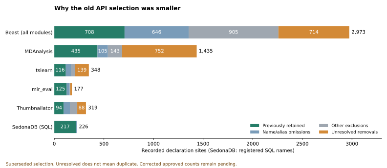

# AIDEAL experiment guide

Updated November 17, 2026. **API and documentation correction in progress. The previous launch plan is blocked. No new model calls or subject-program executions occurred during this audit.**

## 1. Start here

| Review question | Open |
|---|---|
| Which APIs were found, removed or left unresolved? | [New source and documentation audit](review/api-audit/API_AUDIT.html), [all 5,478 candidate records](review/api-audit/ALL_SOURCE_CANDIDATES.csv) |
| Why did the counts change? | [Exact reduction tables and module breakdown](review/api-audit/API_AUDIT.md) |
| Which source version and documentation were used? | [Source locations](review/api-audit/SOURCE_LOCATIONS.csv), [document paths, URLs and hashes](review/api-audit/documentation/CONFIGURED_DOCUMENT_ORIGINS.csv) |
| What can I inspect before any run? | [Prior task previews](review/CURRENT_BANK.html), [six prior pilot previews](review/PILOT_REVIEW.html) |
| What has actually run? | [Existing setup controls](review/READINESS.html), [experiment tracker](review/EXPERIMENT_TRACKER.html), [historical cohorts](HISTORY.md) |
| What changed in the code? | [API origin filter](review/api-audit/code_updates/docs/API_ORIGIN.md) |

The old 1,695 task previews remain available as **superseded preparation evidence**. They are not the approved bank for the replacement experiment. Source implementation bodies in the audit belong to the reviewer, not automatically to the audience prompt.

## 2. Source versions and API counts

All six cluster source HEADs and trees matched the pinned versions on this audit. Full identities and local Git-store paths are in [STUDY_LOCK.json](STUDY_LOCK.json). A local working checkout need not be at the pinned commit; inspect the recorded commit explicitly.

| Library | Version | Official commit | GitHub |
|---|---|---|---|
|rdpro|0.10.1|`547f7f912131`|[Public branches](https://github.com/ZhuochengShang/AIDEAL-RDPro/branches)|
|mdanalysis|2.11.0|`ace84dde1363`|[Public branches](https://github.com/ZhuochengShang/AIDEAL-MDAnalysis/branches)|
|tslearn|0.10.0|`f6072f237313`|[Public branches](https://github.com/ZhuochengShang/AIDEAL-tslearn/branches)|
|mir_eval|0.8.2|`8db0b3812e20`|[Public branches](https://github.com/ZhuochengShang/AIDEAL-mir_eval/branches)|
|thumbnailator|0.4.21|`c9d99613878b`|[Public branches](https://github.com/ZhuochengShang/AIDEAL-Thumbnailator/branches)|
|sedonadb|0.5.0|`751453f04cd6`|[Public branches](https://github.com/ZhuochengShang/AIDEAL-SedonaDB/branches)|

| Library | Version | Scanned sites / SQL names | Distinct simple names | Previous filtered count | Corrected approved count |
|---|---|---:|---:|---:|---|
|rdpro|0.10.1|2973|1268|708|Pending|
|mdanalysis|2.11.0|1435|1053|435|Pending|
|tslearn|0.10.0|348|237|116|Pending|
|mir_eval|0.8.2|177|147|125|Pending|
|thumbnailator|0.4.21|319|145|94|Pending|
|sedonadb|0.5.0|226|226|217|Pending|



These columns count different things. A definition site is a declaration in a file. A simple name ignores its owner. An API identity includes its module or class. MDAnalysis's previous 1,032 simple names became 1,053 in the new source scan; 435 was a heavily filtered subset. The old selector excluded 752 unresolved sites and merged names across unrelated owners. It also omitted Cython source definitions. Those omissions do not establish redundancy.

RDPro now means **the entire Beast repository**, including raster, vector and utility modules, as requested. The audit reports each module separately. A whole-repository count may exceed 700; the new count will follow evidence rather than a target number.

### Correct reduction order

```text
Pinned library source + matching original documentation
  -> enumerate definitions and documented public access paths
  -> resolve the actual defining owner and source file
  -> exclude dependency-only imports and inherited external methods
  -> map proven forwarding wrappers to retained library operations
  -> group overloads within the same module/class API
  -> retain the version with most explicit parameters
  -> review unresolved records and documentation mappings
  -> freeze approved IDs, documents, task bank and configuration
  -> generate README entries and run the matched evaluation
```

Keep a library-defined operation that calls Spark, Java utilities or NumPy. Keep a library override with its own implementation. Exclude a Spark/Java/Python dependency definition merely exposed through the library. Do not remove functions solely because they are named `map`, `run`, `fit`, `read` or `toString`. Cross-owner operations remain distinct. A wrapper removal needs a retained target mapping; an unresolved origin stays visible for review.

The new origin filter is implemented as an explicit discovery option. It does not repair the old global bare-name selector, add Cython discovery or migrate README identities by itself. These remaining changes block a final count and a replacement launch.

## 3. Original documentation and fairness

The previous 477/1,695 coverage number counted short names in selected code-context text. It was **not** the number of documented APIs. The new audit preserves exact document URLs, page hashes and API anchors.

| Library | Verified original-document evidence | Remaining interpretation |
|---|---|---|
| Beast | 21 tracked documentation files, including four previously omitted module READMEs | 119 source-name mentions do not prove qualified API coverage |
| MDAnalysis | Version 2.11.0 rendered API pages; 2,108 callable-like documented entries | Reconcile re-exports, inheritance, private objects and Cython definitions |
| tslearn | Stable pages identify 0.10.0; 468 callable-like documented entries | Resolve source-to-public aliases and inherited methods |
| mir_eval | Stable pages identify 0.8.2; 177 callable-like entries | All 177 recorded source sites match documented qualified targets |
| Thumbnailator | Official 0.4.21 Maven Javadoc; 349 public member signatures | Includes constructors; not the benchmark target count |
| SedonaDB | 212 pinned SQL function pages matching 212 of 226 registry names | Map registered aliases separately |

The replacement bundle has 265 version-checked official pages and 2,867 extracted API anchors. The old tslearn bundle was approximately 96% dataset text and its distillation limit cut off inside a dataset. The replacement text excludes that payload. These documents are **staged for review**, not substituted into historical runs.

Freeze one canonical target bank for all five conditions. Tag each target as documented, undocumented or unresolved using qualified documentation evidence. Report success for each stratum and the shared total. An undocumented API remains eligible if its public library identity is established. All conditions receive the same target signature and runtime instructions; implementation bodies and reference answers are not ordinary audience inputs.

## 4. Experiment plan and stages

| Condition | Audience documentation | Alias code | Embedded fix hints |
|---|---|---|---|
| Original | Original bundle | No | No |
| README only | Generated README | No | No |
| Alias only | Original + alias interface description | Validated | No |
| Error hints only | Original bundle | No | Validated exception guidance |
| Combined | Generated + alias interface description | Validated | Validated exception guidance |


```text
Development evidence -> generate/check README, aliases and native hints
                      -> freeze five library versions
Each version + same task -> R0 program -> build/run/check
                                      -> if failed: R1 repair -> check
                                                        -> if failed: R2 repair -> check
README only / Combined -> review R2 failures -> deep-dive README revision
                       -> freeze revised README -> fresh audience evaluation
```

R0 is the first program, R1 the first program repair, and R2 the second repair. Provider retries are not repair rounds. README deep dive changes the documentation and therefore starts a separate fresh evaluation. Learned development memory must not leak prior evaluation answers between trials. Hint development uses separate development failures and freezes the source changes before the controlled comparison.

The first requested live stage remains Original microbenchmarks at R0 and complete configured README authoring. The six small pilots and later R1/R2, puzzles and five-condition comparisons require their reviewed task/oracle/exposure settings. No dependent prompts or outputs should be invented before their preceding results exist.

## 5. Progress and evidence

| Work | Current state |
|---|---|
| Six pinned source identities | Verified |
| Dependency-origin discovery filter | Implemented and tested; optional configuration documented |
| Original-document acquisition | 265 pages fetched and version checked |
| Owner-qualified reduction, wrappers and full public exposures | Correction/review still required |
| New approved denominator and task manifest | Not frozen |
| Existing runtime controls | 25 expected outcomes retained; setup evidence, not audience scores |
| Five branch names for each library | Published; all new refs still point to untreated baselines |
| New R0 programs and generated README entries | Not run |
| New aliases, embedded hints and Combined installation | Pending development and validation |
| Launch status | Blocked for inventory/documentation correction and user review |

The previous evaluator release and measured cohorts stay unchanged. [The old guide](review/api-audit/PRIOR_EXPERIMENT_GUIDE.md) preserves the preparation record. Its 1,695-target and cost figures are superseded assumptions. Recalculate tokens and cost after approving the corrected bank and documentation.

## 6. Folder structure and output records

```text
2026-11-17-latest-stable-canonical/
  EXPERIMENT_GUIDE.md / .html     current guide
  STUDY_LOCK.json                versions, scope and hold state
  SYNC_MANIFEST.json             exact portable-file hashes
  evaluator/                    unchanged frozen prior evaluator
  operator/cluster/             prior launch plan and current hold receipts
  review/
    api-audit/                  correction tables, source rows and module counts
      documentation/            raw official pages, normalized text and provenance
      code_updates/             new origin-filter code, tests and documentation
    CURRENT_BANK.html           prior exact Original request previews
    PILOT_REVIEW.html           prior one-API-per-library walkthroughs
    EXPERIMENT_TRACKER.*        current progress and separate historical cohorts
    runtime_evidence/           existing setup programs, stdout/stderr and checks
```

Cluster sources live at `/home/zshan011/apps/aideal/studies/2026-11-17-latest-stable-canonical/sources/<library>`. The portable review lives in `review_snapshot/` under that study. New measured outputs must use a newly fingerprinted plan/output namespace. Record each delivered prompt, response, program, execution command, stdout/stderr, verdict, error category, repair round, timestamps and provider token receipt. Unknown usage remains unknown; it is not zero. Current previews are not delivered model requests.

## 7. Local, cluster and GitHub navigation

Use the Mac or VS Code for review. Use VS Code Remote SSH for future long runs in the validated cluster environment. A fresh native Mac scientific runtime has not been verified. Open the guide locally and verify the portable package:

```bash
cd "/Users/clockorangezoe/Documents/phd_projects/code/geoAI/AIDEAL_WORKSPACE/03_Experiments/2026-11-17-latest-stable-canonical"
python3 verify_snapshot.py
open review/api-audit/API_AUDIT.html
```

Inspect the cluster without launching anything:

```bash
ssh -o ClearAllForwardings=yes lab
STUDY=/home/zshan011/apps/aideal/studies/2026-11-17-latest-stable-canonical
cat "$STUDY/PRELAUNCH_CHECKS.json"
git -C "$STUDY/sources/rdpro" rev-parse HEAD 'HEAD^{tree}'
cd "$STUDY/review_snapshot"
python3 verify_snapshot.py
```

Each library has five refs under `study/2026-11-17-latest-stable-canonical/`: `original`, `readme-only`, `alias-only`, `error-hints-only`, `combined`. Inspect with `git show <ref>:<path>` without switching a running checkout. Changing a branch name does not update frozen inputs or prior outputs. Branch existence does not mean a treatment was installed.

The [AIDEAL study branch](https://github.com/ZhuochengShang/AIDEAL/tree/study%2F2026-11-17-latest-stable-canonical) carries the correction and review package. Main, measured history and the old evaluator release remain unchanged. Local/cluster/GitHub copies are compared by the sync manifest, not just filenames.

**Do not run the prior launch commands.** First finish and review the corrected inventory/documents, migrate qualified IDs, regenerate the plan and obtain the requested pre-run review. [RUNBOOK.md](RUNBOOK.md) retains earlier commands with this hold clearly marked.
