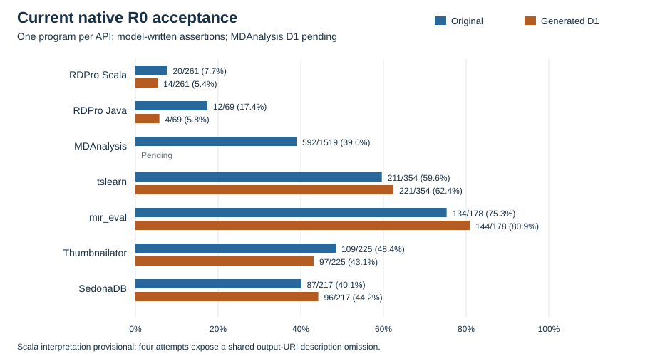
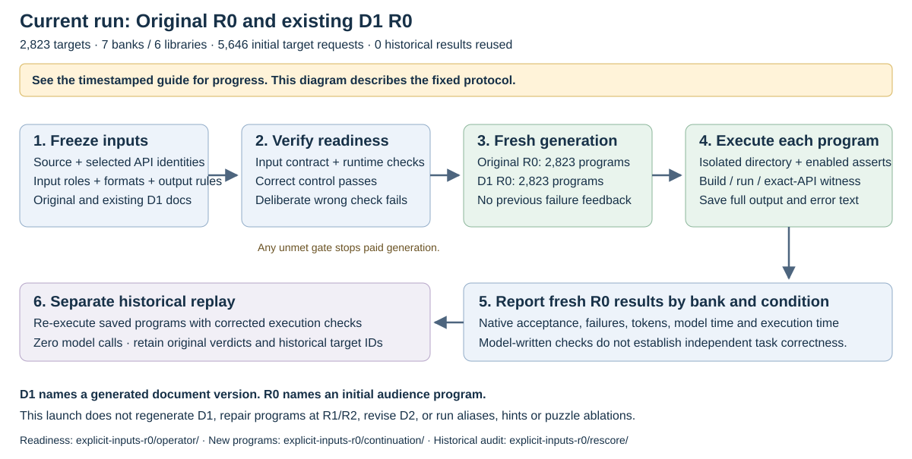

# AIDEAL experiment guide

Updated November 19, 2026 at 09:24:19 Pacific. **All 14 current Original/D1 R0 bank runs are complete: 5,646/5,646 target outcomes across 2,823 APIs.** MDAnalysis D1 finishes at **621/1519 (40.9%)**. The existing D1, frozen inputs and zero-repair protocol remain unchanged.

**Historical replay is also complete:** the separately versioned MDAnalysis recovery checked all 1,538 saved programs with zero model calls. All433 earlier completed verdicts agree, and 13,847 unique evidence files passed hash checks. The other 13 replay arms are complete. No recovery worker remains active. [Full follow-through, fixes and evidence](review/followthrough-2026-11-19/README.md).

**Start with these four links:** [Action tracker](reports/2026-11-18-professor-meeting/CHECKLIST.md), [six real executable examples](reports/2026-11-18-professor-meeting/real_examples/EXAMPLES.md), [complete banks and count reconciliation](reports/2026-11-18-professor-meeting/API_BANK_RECONCILIATION.md), and [detailed professor meeting report](reports/2026-11-18-professor-meeting/MEETING_REPORT.md). The report uses its own earlier 23:44:56 snapshot; timestamps deliberately remain visible.

[Replacement launch](evaluator-correction-2026-11-18/explicit-inputs-r0/operator/START.json) · [Timestamped progress snapshot](evaluator-correction-2026-11-18/explicit-inputs-r0/operator/LIVE_STATUS.json) · [Passed readiness](evaluator-correction-2026-11-18/explicit-inputs-r0/operator/READINESS.json) · [Published input-contract amendment `726bd29`](https://github.com/ZhuochengShang/AIDEAL/commit/726bd29f0f583d4967c7152adc3049e7814272c0). The original controller finished continuation and the historical queue; its MDAnalysis Original replay failure was resolved by a separate completed recovery. This page records a snapshot; it does not update continuously.

**Preserved initial run.** The initial run was safely stopped at 23:40:44 UTC on November 18 after confirmed omissions in the shared input contract. It was not a preplanned pilot. Retained diagnostic evidence comprises 103 returned mir_eval responses with 102 executions and 109 Thumbnailator responses with 109 executions; both had zero provider errors. The other five banks made no model calls. These partial records are not completed comparison scores.

The new full-cohort comparison under `explicit-inputs-r0/` passed preparation for all seven banks. Fourteen sampled audience prompts match outside the documentation and include each input-contract block once. Forty-five source receipts establish unchanged README files, profiles, scaffolds, manifests, source, data, runtime and model; only context descriptions and the output root change. All banks receive consistent permission to create small deterministic inputs. Three banks additionally clarify file roles, formats or metadata. This avoids attributing input ambiguity to README quality. Paid execution started only after the amended protocol was published and the new readiness gate passed.

[Visual guide](EXPERIMENT_GUIDE.html) · [Exact launch steps](evaluator-correction-2026-11-18/README.md) · [Recorded status](evaluator-correction-2026-11-18/REVIEW_STATUS.json) · [Complete historical prompts and examples](evaluator-correction-2026-11-18/review/prompt-audit/INDEX.html) · [Evaluation design review](evaluator-correction-2026-11-18/review/EVALUATION_DESIGN_REVIEW.md)

## End-to-end readiness audit

[November19 audit with code starting lines](review/audits/2026-11-19/README.md) · [Tracked actions and acceptance criteria](review/audits/2026-11-19/ACTIONS.json). The native R0 queue is complete, but the full independent eight-condition study is **not ready**. Recovery, launch scope, accounting, transport reuse, output representation and conditional-stub selection now have reviewed development fixes. These changes require a new release before they affect any measured run.

Source-grounded README extraction and eight-arm routing now pass development tests. Open gates are all-library evidence and executable-example review, fixed micro/puzzle banks, per-alias behavior checks, committed native-hint builds and actual backend repair-memory isolation. Three absent conditional MDAnalysis mock classes remain disclosed in the current frozen denominator.

## 1. Current scope and sequence

| Bank | Selected targets | Original R0 | Existing D1 R0 | Current state |
|---|---:|---:|---:|---|
| **RDPro Scala** | **261** | **20/261 (7.7%)** | **14/261 (5.4%)** | Complete; Scala interpretation provisional |
| RDPro Java | 69 | 12/69 (17.4%) | 4/69 (5.8%) | Complete; separate companion bank |
| MDAnalysis | 1,519 | 592/1519 (39.0%) | 621/1519 (40.9%) | Complete |
| tslearn | 354 | 211/354 (59.6%) | 221/354 (62.4%) | Complete |
| mir_eval | 178 | 134/178 (75.3%) | 144/178 (80.9%) | Complete |
| Thumbnailator | 225 | 109/225 (48.4%) | 97/225 (43.1%) | Complete |
| SedonaDB | 217 | 87/217 (40.1%) | 96/217 (44.2%) | Complete |
| **Total** | **2,823** | **All seven banks complete** | **All seven banks complete** | **14/14 arms complete** |

These are **native acceptance** scores from one initial program per API with model-written checks. They are not independent task accuracy. The current model is `gemini-3.1-flash-lite`, the output allowance is 8,192 tokens, and there are zero program repairs. A single run cannot isolate model sampling variation from the documentation effect.



**Scala-only RDPro:** use the 261-target Scala row above. Do not merge Java into that denominator. The completed Java bank remains preserved. Restricting future RDPro runs to Scala would reduce the all-library bank to **2,754 targets** (2,823 minus 69), but does not change any saved run or historical score. The guide does not silently change the active bank.

### Which inventory is being counted?

| Library | Counts quoted from the older paper | Current selected targets | Current exact original-document matches |
|---|---|---:|---:|
| RDPro Scala | 280 owner-qualified families; 161 names | 261 | 16 |
| SedonaDB | 201 SQL functions; 322 SQL examples | 217 | 211 |
| MDAnalysis | 1,032 names; 661 names | 1,519 | 1,061 |
| tslearn | 235 names; 235 names | 354 | 222 |
| mir_eval | 148 names; 148 names | 178 | 177 |
| Thumbnailator | 149 names; 149 names | 225 | 225 |

The older columns mix source inventories, bare-name inventories and executable documentation examples. They are not interchangeable denominators. A bare method name can merge methods from different owners. A SQL example can contain several calls or repeat one function. The current selection uses defining owners, declared public access paths, explicit scope, reviewed wrapper exclusions and the largest retained overload within an owner. [Exact reconciliation and source receipts](reports/2026-11-18-professor-meeting/API_BANK_RECONCILIATION.md).

A current document match means that the reviewed corpus maps to that exact target. It does not prove a complete, correct entry. No match does not prove the repository lacks all related prose. The 280-family RDPro catalog cannot be explained merely as a newer source revision; archived tree equivalence and extraction scope also matter.

RDPro covers Raptor and supporting raster types, with Java and Scala reported separately. MDAnalysis now retains 1,519 targets after 19 source-audited exclusions from 1,538. tslearn retains 354 after excluding eight import hooks and forwarding wrappers from 362. The 27 exclusions include the earlier 16 MDAnalysis exclusions plus three exact NumPy/RDKit forwarders and eight tslearn hooks/wrappers. Both conditions use identical revised manifests. [Final MDAnalysis exclusions](evaluator-correction-2026-11-18/fixture-development-v1/mdanalysis/selection-correction-final/exclusion_audit.json) · [Final MDAnalysis manifest](evaluator-correction-2026-11-18/fixture-development-v1/mdanalysis/selection-correction-final/api_manifest_public_nonwrapper.json) · [Final eight tslearn exclusions](evaluator-correction-2026-11-18/review/final-scope/tslearn/audit.json) · [Final tslearn manifest](evaluator-correction-2026-11-18/review/final-scope/tslearn/api_manifest.json).

[Current 2,823 selected API identities](evaluator-correction-2026-11-18/review/final-scope/SELECTED_API_BANK.tsv) · [Current bank summary](evaluator-correction-2026-11-18/review/final-scope/BANK_SUMMARY.json). These identify the active bank; they describe native API usage targets, not fixed independently scored tasks.

The full [2,850-target API/artifact index](evaluator-correction-2026-11-18/review/prompt-audit/ALL_API_INDEX.tsv) and saved examples remain **historical evidence**. They are not the current denominator. The earlier 5,307-target full-Beast preparation is also superseded.



1. Freeze the source, target bank, runtime, fixture roles, model settings and permitted context.
2. Verify the input/output contract: identify each provided file or variable, its role and format, available metadata and required output rules. Then pass deterministic controls and check that Original/D1 differ only in their intended documentation input.
3. Generate a new Original program and a new D1 program for every retained target, with no preceding failure or repair feedback.
4. Build and execute each program in its own directory; retain its prompt, code, command, output and verdict.
5. Report the two fresh R0 conditions separately by bank.
6. Replay saved historical programs under corrected checks as a separate audit with **no model calls**. Preserve their original verdicts.

**R0** means the initial audience program. **R1/R2** mean repairs after failures; neither runs here. **D1/D2** identify README versions. A provider retry is not a repair, and a fresh independent generation is not R1.

[Initial-run preparation and prompt checks](evaluator-correction-2026-11-18/fresh-original-d1/preflight/ACTUAL_BANK_CONFIGURATION_AND_PROMPTS.json). The [initial-run readiness receipt](evaluator-correction-2026-11-18/fresh-original-d1/operator/READINESS.json) passed before the input-contract omissions were discovered. The replacement [seven-bank preflight](evaluator-correction-2026-11-18/explicit-inputs-r0/preflight/ACTUAL_BANK_CONFIGURATION_AND_PROMPTS.json) and [input-contract equivalence report](evaluator-correction-2026-11-18/explicit-inputs-r0/preflight/INPUT_CONTRACT_EQUIVALENCE.json) now pass. The [replacement readiness receipt](evaluator-correction-2026-11-18/explicit-inputs-r0/operator/READINESS.json) passed and the recorded launch followed publication.

### Stopped initial-run evidence

| Bank | Returned responses | Executed programs | Provider errors | Disposition |
|---|---:|---:|---:|---|
| mir_eval Original | 103 | 102 | 0 | Preserved diagnostic evidence |
| Thumbnailator Original | 109 | 109 | 0 | Preserved diagnostic evidence |
| Other five banks | 0 | 0 | 0 | No model calls |

[Recorded run amendment](evaluator-correction-2026-11-18/RUN_AMENDMENT.json). There are **213 saved requests, 212 returned responses and 211 executions**. One provider request was interrupted; its token/billing usage is unavailable, not zero. Keep the recorded costs separate as protocol-development cost.

[Initial-run launch receipt](evaluator-correction-2026-11-18/fresh-original-d1/operator/START.json) · [Initial-run status snapshot](evaluator-correction-2026-11-18/fresh-original-d1/operator/LIVE_STATUS.json). The stopped status and amendment preserve the original full-run intent and explain why the shared input contract changed. Preserve its costs, responses and errors; do not pool these records with the amended comparison. The input-contract change requires fresh matched requests in both conditions.

## 2. Final review checklist

| Check | Evidence / status | What it establishes |
|---|---|---|
| Frozen code release | `2026-11-18-corrected-r0-d8ba3815cf95`, 146 files verified | The exact code packaged for cluster execution |
| Offline software tests | 818 tests and 436 subtests passed; final focused suite 124 tests and 92 subtests passed | Tested execution and workflow contracts |
| MDAnalysis setup | 160 defining modules imported; 523 upstream data files; 18 input roles; IMD, Chemfiles and real 3DNA checks passed | Audited data/tool capability, not correctness of every API |
| Seven actual bank preparations | **7/7 replacement banks passed** | Selected manifests and condition inputs bind successfully |
| Paired prompt exposure | **14 sampled prompts passed; input blocks appear once** | Shared context is consistent and contains no extra condition-specific repair advice |
| Final native controls | **12 non-MD controls and two final-profile MD replay controls passed; six native MD controls bound by equivalence** | The final scaffold accepts a known correct example and rejects a deliberately wrong assertion |
| Frozen source-selection receipt | **27 exclusions in the frozen bank; three further conditional stubs identified** | The frozen exclusions remain preserved; the November19 audit requires a future correction for three MDAnalysis mock targets |
| Input/output contract clarity | **Sampled checks passed; URI representation gap found later** | Explicit fixture roles, file formats, available metadata and output rules, shared across Original/D1 without expected-answer leakage |
| Replacement readiness | **Passed and published** | Bind the amended inputs and all required checks to the new namespace |
| Paid Original/D1 execution | **14/14 arms complete; 5,646 completed outcomes** | All Original and D1 completion/result receipts verified |

[MDAnalysis setup review](evaluator-correction-2026-11-18/MDANALYSIS_SETUP_REVIEW.md) · [Final control equivalence](evaluator-correction-2026-11-18/runtime-mdanalysis-final-2026-11-18/CONTROL_EQUIVALENCE.json) · [Final MD runtime setup report](evaluator-correction-2026-11-18/runtime-mdanalysis-final-2026-11-18/setup_report.json) · [Earlier paired control programs and logs](evaluator-correction-2026-11-18/preflight/libraries/) · [Recorded review status](evaluator-correction-2026-11-18/REVIEW_STATUS.json).

**Does setup checking need an LLM?** No. Imports, file hashes, compilation, tool availability, fixture parsing and deliberate positive/negative checks give reproducible evidence. An LLM can help diagnose a failed check or propose a repair. It must not decide that the environment passes without executing and recording those checks. A missing dependency does not count as a successful deliberately failing control. Passing imports and sample executions also does not establish that the audience received a clear input contract; both checks are mandatory.

## 3. What the comparison measures

The current run measures **native execution acceptance** under original versus generated documentation. The audience chooses a usage example and writes its own checks. Exit success and an exact-API witness are stronger than an unchecked process return, but they do not independently establish task correctness or prove that the target operation performed the intended work.

| Claim | Needed evidence | Current scope |
|---|---|---|
| Setup works for audited inputs | Bound runtime, fixture/tool checks, correct and deliberately wrong controls | Runtime controls and sampled input-contract checks passed; Scala URI omission still requires a separately versioned correction |
| A generated program was accepted | Full executed code, exit status and exact-API witness | Measured by this native R0 comparison |
| A program solves a fixed task correctly | Independently specified expected outputs and target-use verification | **Not established by native self-checks** |
| Generated documentation caused a measured difference | Matched tasks, settings and exposure, repeated trials and independent checks | Current results are diagnostic; one native R0 program per target is limited evidence |
| Aliases, hints and their interactions help | Validated treatments and matched factorial runs | Separate later study |
| Deep-dive README repair generalizes | Development/evaluation separation and fresh held-out tasks | D2 deferred |

Keep per-library results separate. A pooled percentage would give MDAnalysis much more weight because its bank is larger. Report documented versus no-reviewed-API-excerpt strata where the mapping exists. Do not convert setup errors into API/model failures without diagnosis. Conversely, an upstream library bug is not a setup fault. Classify it from source and reproducible execution evidence instead of changing the environment until the program passes.

The later paper design includes eight factor combinations, `O`, `R`, `A`, `H`, `RA`, `RH`, `AH`, `RAH`, with microbenchmarks and puzzles, R0/R2, and separate D2 follow-ups. Those are **planned measurements**, not outputs of this launch. The development runner now supports the eight-arm design and passes regression checks; actual library banks and treatments still require admission before a measured run. Cross-task learned error memory must be disabled, isolated, or frozen to development-only evidence for held-out evaluation. [Detailed design review](evaluator-correction-2026-11-18/review/EVALUATION_DESIGN_REVIEW.md).

## 4. Inputs, prompts and one-target review

The new source-bound context describes supplied objects and permissions. It does **not** add API failure diagnoses or corrective hints to the Original condition. Both conditions receive the same contract.

| Bank | Clarified shared input contract |
|---|---|
| Thumbnailator | Distinguish an empty output buffer, an output filename and an output directory. |
| mir_eval | State supplied file columns, units and limited toy-data roles; permit suitable deterministic inputs for other formats. |
| RDPro Java | State existing raster/HDF facts and distinguish them from synthetic metadata supplied by the scaffold. |
| All seven banks | Permit small deterministic task-suitable inputs under the isolated output directory. |

[Exact contracts and source evidence](evaluator-correction-2026-11-18/review/explicit-input-contracts/MANIFEST.json) · [Verified unchanged inputs](evaluator-correction-2026-11-18/explicit-inputs-r0/preflight/INPUT_CONTRACT_EQUIVALENCE.json). These checks establish the described exposure, not independent correctness of every future program.


| Stage | Model input | Model output / retained evidence |
|---|---|---|
| Original R0 | Exact API identity/declaration, public access facts, reviewed original docs, shared execution context and input roles | Initial program, provider response and usage, executed scaffold, command and stdout/stderr |
| Existing D1 R0 | Same target and shared setup, with the existing generated API entry | Separate initial program and the same execution evidence |
| Historical README authoring | Project profile, API/source facts, document context and available examples | Existing D1 entries plus saved author requests/responses |
| Historical saved-program replay | No model request | New execution evidence linked to the unchanged saved program and its historical verdict |

Canonical API declarations/public access facts are shared across the audience conditions. Author diagnosis source windows are not part of ordinary audience exposure. The historical author prompt had invalid qualified-ID call examples; future authoring is corrected, but **this does not retroactively fix existing D1**. Neutral profile/context corrections affect the upcoming audience calls and invalidate historical prompt reuse.

The [six current real examples](reports/2026-11-18-professor-meeting/real_examples/EXAMPLES.md) link exact prompts, generated programs, data roles, output and verdicts. They include a Scala RDPro example. The [bank index](reports/2026-11-18-professor-meeting/API_BANK_RECONCILIATION.md) lists every selected target.

Open the [complete historical paired examples](evaluator-correction-2026-11-18/review/prompt-audit/INDEX.html). For each target:

1. Read its manifest identity and source/document mappings.
2. Read the full `request.json` system/user text, not a displayed excerpt.
3. Compare `response.txt` with the program body and full executed scaffold.
4. Read `execution.json` for the exact command, working directory, timeout and exit code.
5. Read complete `stdout.txt` and `stderr.txt`; summary tails can omit important evidence.
6. Check the result's identity, selected API, hashes and mode. Distinguish historical generation, setup control, saved replay and a new corrected R0 attempt.

## 5. Code review route

These code links refer to the frozen evaluator used by the active queue. For the newly reviewed development version, use the exact starting lines in the [November19 audit](review/audits/2026-11-19/README.md#8-exact-code-starting-lines).

| Review goal | File and starting line |
|---|---|
| Stage preparation and sequencing | [scripts/run_evaluator_correction.py:46](https://github.com/ZhuochengShang/AIDEAL/blob/56a42d91d8548ce7e4bf71b17b19fc5155f132f7/scripts/run_evaluator_correction.py#L46) |
| Final readiness gate | [scripts/run_evaluator_correction.py:130](https://github.com/ZhuochengShang/AIDEAL/blob/56a42d91d8548ce7e4bf71b17b19fc5155f132f7/scripts/run_evaluator_correction.py#L130) |
| Reject changed historical source/docs/data | [scripts/run_verified_readme_continuation.py:68](https://github.com/ZhuochengShang/AIDEAL/blob/56a42d91d8548ce7e4bf71b17b19fc5155f132f7/scripts/run_verified_readme_continuation.py#L68) |
| Prepare matched condition inputs | [scripts/run_verified_readme_continuation.py:256](https://github.com/ZhuochengShang/AIDEAL/blob/56a42d91d8548ce7e4bf71b17b19fc5155f132f7/scripts/run_verified_readme_continuation.py#L256) |
| Run one fresh condition | [scripts/run_verified_readme_continuation.py:439](https://github.com/ZhuochengShang/AIDEAL/blob/56a42d91d8548ce7e4bf71b17b19fc5155f132f7/scripts/run_verified_readme_continuation.py#L439) |
| Native execution verdict | [vendor/aideal_engine/src/aideal/native_execution_contract.py:141](https://github.com/ZhuochengShang/AIDEAL/blob/56a42d91d8548ce7e4bf71b17b19fc5155f132f7/vendor/aideal_engine/src/aideal/native_execution_contract.py#L141) |
| Scoped runtime readiness | [workflow/runtime_profile.py:126](https://github.com/ZhuochengShang/AIDEAL/blob/56a42d91d8548ce7e4bf71b17b19fc5155f132f7/workflow/runtime_profile.py#L126) |
| Later R0/R1/R2 repair loop | [workflow/evaluation_runner.py:78](https://github.com/ZhuochengShang/AIDEAL/blob/56a42d91d8548ce7e4bf71b17b19fc5155f132f7/workflow/evaluation_runner.py#L78) |

Follow `prepare` → readiness checks → condition preparation → `run_condition` → the native executor → aggregate results. The later `evaluation_runner.run_unit` repair loop is useful to understand R0/R1/R2, but this launch sets zero program repairs.

## 6. Folders, branches and isolation

```text
2026-11-17-latest-stable-canonical/
  EXPERIMENT_GUIDE.md / .html        current review entry points
  STUDY_LOCK.json                   pinned library/source identities
  evaluator-correction-2026-11-18/
    INDEX.html / WORKFLOW.svg       current ordered workflow
    REVIEW_STATUS.json             timestamped review snapshot
    README.md                      exact preparation/launch instructions
    review/
      prompt-audit/                 complete HISTORICAL 2,850-target index
      corrected-profiles/           new neutral profiles; old profiles retained
      corrected-contexts/           shared context without failure remedies
      EVALUATION_DESIGN_REVIEW.md   measurement limits and future controls
    fixture-development-v1/        reviewed inputs and MD target exclusions
    runtime-mdanalysis-final-2026-11-18/
                                   environment hashes and setup report
    preflight/                     actual programs, outputs and control receipts
    explicit-inputs-r0/
      operator/                    prepared plan, readiness, queue state
      continuation/                NEW Original / existing D1 R0 artifacts
      rescore/                     SEPARATE saved-program replay evidence
  qualified*/                      historical Original/authoring evidence
  ablation-2026-11-18/              historical generated/repair/treatment work
```

Directories for pending stages may not exist yet. Folder existence alone does not establish completion.

The shared evaluator/review repository is `ZhuochengShang/AIDEAL`, study branch `study/2026-11-17-latest-stable-canonical`. The corrected code is published at [commit `56a42d9`](https://github.com/ZhuochengShang/AIDEAL/commit/56a42d91d8548ce7e4bf71b17b19fc5155f132f7); all 146 public code files match the local and cluster frozen release. Each library repository has refs under that prefix for `original`, `readme-only`, `alias-only`, `error-hints-only`, and `combined`. These are **resource variants**, not R0/R1/R2 rounds. [Recorded installation commits](operator/ablation/2026-11-18/branches/README.md) identify installed bytes; a branch name does not prove treatment readiness. The later eight-condition paper design also requires explicit pairwise variants and configuration, not merely the five existing names.

Each job pins source and evaluator identities and uses isolated writable directories. Do not change a checkout underneath a running job. A new branch or cluster `current` pointer cannot silently change an already pinned run. Historical prompts, responses and measured results are evidence; do not delete them as cache.

The former `evaluator-correction-2026-11-18/current/` contains **unlaunched preparation evidence**. `fresh-original-d1/` now contains the **stopped initial run and its immutable measured history**. Its start/readiness receipts describe that earlier attempt and do not authorize a restart. The new active namespace is `explicit-inputs-r0/`; preparation passed and the published replacement is running. MDAnalysis uses the new metadata-only profile `runtime-mdanalysis-final-2026-11-18/`; all 3,767 recorded runtime files are unchanged, while selection bindings are updated.

Five disposable Python/pytest cache directories (961,377 bytes) were removed. No measured files or installed dependencies were deleted.

The cluster is the authoritative execution location. Local/GitHub files are review snapshots, not a live mirror of every output write. Mac and Linux dependencies are different even when source files match.

## 7. Commands and progress checks

**Local review / VS Code**, with no API key required:

```bash
cd /Users/clockorangezoe/Documents/phd_projects/code/geoAI/AIDEAL_WORKSPACE/03_Experiments/2026-11-17-latest-stable-canonical
open EXPERIMENT_GUIDE.html

cd /Users/clockorangezoe/Documents/phd_projects/code/geoAI/AIDEAL_workflow
/Users/clockorangezoe/miniconda3/envs/geo_llm_spark/bin/python \
  scripts/trace_original_micro.py --pause
```

The walkthrough uses scripted model responses and real local execution; it is not a live library comparison or Gemini measurement.

**Recorded cluster preparation**, without model calls. The replacement job is already running; use the read-only progress check below rather than launching a second queue:

```bash
ssh lab
cd /home/zshan011/apps/aideal/studies/2026-11-17-latest-stable-canonical
/home/zshan011/apps/aideal/venv/bin/python \
  /home/zshan011/apps/aideal/releases/2026-11-18-corrected-r0-d8ba3815cf95/scripts/run_evaluator_correction.py \
  --study "$PWD" \
  --output "$PWD/evaluator-correction-2026-11-18/explicit-inputs-r0" \
  --runtime-profiles "$PWD/evaluator-correction-2026-11-18/explicit-inputs-r0/operator/RUNTIME_PROFILES.json" \
  --input-overrides "$PWD/evaluator-correction-2026-11-18/explicit-inputs-r0/operator/INPUT_OVERRIDES.json" \
  --phases continuation rescore
```

Use the reviewed operator input files and [launch instructions](evaluator-correction-2026-11-18/README.md). The operator adds `--run` only after the recorded readiness gate passes and uses the permitted credential path without exposing the key. Check for an existing supervisor before a restart; do not start duplicate queues.

**Read progress**, from the cluster study folder:

```bash
python3 - <<'PY_PROGRESS'
import json
from pathlib import Path
root = Path('evaluator-correction-2026-11-18/explicit-inputs-r0')
for name in ('operator/READINESS.json', 'operator/STATE.json',
             'continuation/supervisor/summary.json'):
    path = root / name
    print('\n' + name)
    print(json.dumps(json.loads(path.read_text()), indent=2)
          if path.exists() else 'Not recorded yet')
PY_PROGRESS
```

A completed bank must reconcile selected/completed target counts and preserve per-attempt provider usage. Missing token usage is unknown, not zero. Report initial generation, provider retries and build/run/check time separately. No new corrected result should replace a paper accuracy cell without independent correctness evidence.

## 8. What remains to do, in order

| Order | Work item | Done when | Current state |
|---|---|---|---|
| 1 | Finish the current MDAnalysis D1 bank | All 1,519 target outcomes reconcile with its completion receipt | Running; do not start a second worker |
| 2 | Reconcile inventories and original documentation | Every retained ID has its owner, source, scope decision and document match; historical counts keep their unit | Current bank available; three conditional MDAnalysis mock classes need a future scope correction |
| 3 | Correct the shared Scala output contract | Local path and file-URI handling pass positive and negative controls under a new evaluator identity | Fixed in development contract v3; not deployed; four observed failures remain in saved results |
| 4 | Validate generated README entries | Signatures, receiver construction, input types and example behavior agree with source and executable checks | Concrete RDPro defects found; full D1 validation pending |
| 5 | Freeze independent microbenchmarks | Each task has explicit inputs, expected outputs, target-use checks and known passing/failing reference programs | Not yet complete for the six-library cohort |
| 6 | Freeze puzzle banks | Multistep tasks have data, independent oracles, difficulty labels and a development/held-out split | Current six-library integration-task references are not an executed puzzle bank |
| 7 | Develop aliases and native hints | Supported source edits pass builds and paired behavior checks and are bound to exact commits | Development evidence exists; full matched treatment matrix pending |
| 8 | Run eight matched conditions | Identical tasks, fixtures, model settings, repair limits and frozen resources across conditions | Planned; not filled by current native scores |
| 9 | Build D2 from development evidence | Revise only supported README entries, freeze D2, keep held-out evaluation failures out | Planned |
| 10 | Reevaluate and publish | Fresh D2 programs, separate micro/puzzle R0/R2, tokens/time, complete reproducibility package | Pending |

The [action tracker](reports/2026-11-18-professor-meeting/CHECKLIST.md) records evidence and progress. It is a dated review artifact, not an automatic monitoring service. Update its snapshot from a read-only cluster check rather than inferring progress from elapsed time.

## 9. Full experiment design

D0 is the original documentation. D1 is the first generated README. D2 is a separately saved, source-validated revision. R0 is one initial audience program. R1 and R2 repair that program after actual failures. D2 starts fresh programs rather than continuing an old R2 conversation.

| ID | README | Executable aliases | Native embedded hints | Planned reporting |
|---|---|---|---|---|
| O | D0 | No | No | Micro R0/R2 and puzzle R0/R2 |
| R | D1 | No | No | Micro R0/R2 and puzzle R0/R2 |
| A | D0 | Yes | No | Micro R0/R2 and puzzle R0/R2 |
| H | D0 | No | Yes | Micro R0/R2 and puzzle R0/R2 |
| RA | D1 | Yes | No | Micro R0/R2 and puzzle R0/R2 |
| RH | D1 | No | Yes | Micro R0/R2 and puzzle R0/R2 |
| AH | D0 | Yes | Yes | Micro R0/R2 and puzzle R0/R2 |
| RAH | D1 | Yes | Yes | Micro R0/R2 and puzzle R0/R2 |
| R with D2 | D2 | No | No | Fresh micro/puzzle R0/R2 |
| RAH with D2 | D2 | Frozen same aliases | Frozen same hints | Fresh micro/puzzle R0/R2 |

```text
Development failures + source evidence
         │
         ├── validate D1 → targeted README revision → freeze D2
         ├── propose forwarding aliases → compile and paired checks → freeze A
         └── propose exception-message guidance → paired checks → freeze H

Held-out task + chosen frozen condition
         │
         ▼
    R0 program → build/run/check ── pass ──► record final result
         │ fail
         ▼
    R1 repair  → build/run/check ── pass ──► record final result
         │ fail
         ▼
    R2 repair  → build/run/check ──────────► record final result

D2 follow-up uses a fresh R0 session with the same held-out tasks.
```

The audience sees the permitted README and alias descriptions. Native hints arrive through the library exception only when the matching failure executes. Author source diagnosis and learned development memory must not leak into held-out audience trials. Memory can support resource development but cannot accumulate evaluation-condition experience across trials.

### Simple metrics

- **Micro R0** = independently correct initial micro programs / all scheduled micro trials.
- **Micro R2** = micro trials solved at R0, R1 or R2 / all scheduled micro trials.
- **Puzzle R0/R2** use the same rule with puzzle trials and remain separate.
- **Recovered at R1** counts initially failing trials first solved on R1. **Recovered at R2** counts those first solved on R2. State whether a percentage divides by all trials or initial failures.
- **Combined task accuracy** = (correct micro trials + correct puzzle trials) / (all scheduled micro trials + all scheduled puzzle trials). This matches the paper and weights the two categories by their scheduled trial counts. Always show the separate micro and puzzle scores alongside it. This planned summary is not the current native score.
- Record input tokens, output tokens, model-request seconds and compile/run/check seconds separately. Add provider retries to cost, not to the logical repair-round count. Treatment construction and D2 development have their own totals.

## 10. Complete bank and evidence navigation

| What to inspect | Where | Interpretation |
|---|---|---|
| Every current selected API | [All targets and recorded attempt paths](reports/2026-11-18-professor-meeting/real_examples/banks/ALL_CURRENT_API_TARGETS.csv) · [2,823-row TSV](evaluator-correction-2026-11-18/review/final-scope/SELECTED_API_BANK.tsv) | Authoritative native target identities |
| One file per execution bank | [Bank reconciliation and index](reports/2026-11-18-professor-meeting/API_BANK_RECONCILIATION.md) | Partitions of the same selection, not new sampling |
| Six real examples | [Examples](reports/2026-11-18-professor-meeting/real_examples/EXAMPLES.md) | Saved model request, response, actual program and execution |
| Original documents versus source APIs | [Report inventory section](reports/2026-11-18-professor-meeting/MEETING_REPORT.md#4-api-inventory-and-documentation-coverage) | Exact reviewed corpus matches and unmatched targets |
| Current full run artifacts | `evaluator-correction-2026-11-18/explicit-inputs-r0/continuation/` on the cluster | Full attempt evidence; local is a review snapshot |
| Existing generated README installation | [Branch commits](operator/ablation/2026-11-18/branches/README.md) | D1 contains 2,850 authored entries; current evaluation selects 2,823 |
| Current independently scored puzzle bank | Pending | Referenced integration-task files are not available in this current cohort; no puzzle measurement is claimed |
| Historical evidence | [Previous snapshots](reports/2026-11-18-professor-meeting/navigation-history/) and [meeting report](reports/2026-11-18-professor-meeting/MEETING_REPORT.md#7-historical-rdpro-comparison) | Preserve their own model, denominator and checks |

For one target, review in this order: target declaration → full request → raw response → wrapped program → exact execution command → full stdout/stderr → verdict → usage and timing. A success marker by itself is not an independent correctness oracle. A reference example is not an audience-model experiment. A provider retry is not a program repair.

## 11. Paper and meeting deliverables

- [Detailed meeting report](reports/2026-11-18-professor-meeting/MEETING_REPORT.md) includes current results, concrete failures, historical comparison, code review anchors and costs in tokens/time.
- [Current Overleaf project](https://www.overleaf.com/project/6994c3a9272624262d5bba44) uses the official VLDB template and keeps current native results separate from planned independently scored tables.
- The new meeting slide deck is editable in the Codex presentation viewer. The older Google Slides file remains historical source material.
- The template conversion compiles with zero errors. Remaining bibliography metadata and accessibility warnings still need editorial review. Formatting does not establish experimental completion or submission readiness.
