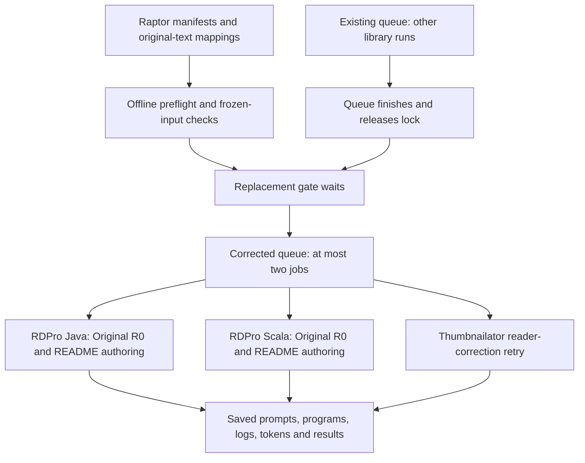

# AIDEAL experiment guide

Updated November 17, 2026. The current scope is **2,850 selected targets across six libraries and seven language banks**. RDPro now covers Raptor and its supporting raster types. Other libraries retain their inputs, releases and running/completed jobs.

**Queue status observed at 2026-11-18T02:23:47.650280+00:00.** All six final cluster preparation checks passed with zero model calls. The strict 330-target bank uses evaluator `2026-11-17-strict-raptor-64fcd34eb17c`. The selection/reader checks passed 98 tests and 36 subtests, and the actual reader resolved all 330 targets. A separate constructor-correction release passed its 664-test suite. These are software checks, not new experiment results. The replacement was published before launch and is queued behind the current library jobs; no new Raptor model request has started at this checkpoint. The gate waits for the existing queue to release its process lock. README authoring and R0 are separate stages; an authored entry is not an evaluation pass.

[RDPro count explanation](review/raptor-scope/COUNT_EXPLANATION.md) · [replacement catalog](review/raptor-scope/plan/RUN_CATALOG.cluster.yaml) · [exact reduction decisions](review/raptor-scope/strict-no-wrappers/README.md) · [completed results](operator/launch/completed/) · [replacement preparation receipt](review/raptor-scope/operator/RECOVERY_CHECKS.json) · [code review route](CODE_REVIEW_ROUTE.md)

## 1. Current scope

| Library | Pinned version | Selected targets | Current scope |
|---|---|---:|---|
| RDPro / Beast |0.10.1|**330**|Raptor and supporting raster types; 261 Scala + 69 Java|
| MDAnalysis |2.11.0|1,538|Existing Python/Cython bank, unchanged|
| tslearn |0.10.0|362|Existing Python bank, unchanged|
| mir_eval |0.8.2|178|Existing Python bank, unchanged|
| Thumbnailator |0.4.21|225|Existing Java bank; reader-correction retry retained|
| SedonaDB |0.5.0|217|Existing SQL bank, unchanged|
| **Total** | |**2,850**|Seven banks because RDPro uses two languages|

RDPro's **330 targets comprise 271 methods and 59 concrete-constructor targets**. Of these, 265 belong to the Raptor module and 65 to supporting raster types. They are not 330 distinct short method names. This changes the evaluation/authoring bank; it does not delete source functions or dependencies.

| Review point | Count | Meaning |
|---|---:|---|
| Superseded full-Beast bank | 2,787 | All selected Beast modules |
| Initial raster bank | 422 | Earlier per-owner selection before strict exclusions |
| Intermediate forwarding review | 406 | Removed 16 verified forwarding forms; now superseded |
| **Final strict raster bank** | **330** | **271 methods + 59 concrete constructors** |

The strict review starts from all **452 raster candidate declaration sites**, so excluded wrappers cannot hide a lower-arity implementation. Its reduction is **452 − 72 wrappers/adapters − 25 unimplemented `???` bodies − 3 abstract-type constructors − 15 methods without bodies − 7 additional overloads = 330**. The 452 candidates and the earlier 422 selected identities are different counting units.

Selection removes wrappers before choosing the largest-parameter eligible implementation within the same owner/API. For example, `Intersections.compute` and `RaptorJoin.raptorJoinLocal` now select their implementation overloads rather than the equal-arity forwarding overloads. Different defining owners remain distinct; a shared name or a small equal body is insufficient to merge them. Imported or inherited-only Java/Spark methods are excluded, while library-defined implementations of framework interfaces may remain.

| Retained example | Excluded as an independent target |
|---|---|
| `RasterOperationsLocal.mapPixels` implementation | `RaptorMixinOperations3.mapPixels` forwarding entry point |
| `RasterFileRDD` concrete constructor | `sc.geoTiff` / `sc.hdfFile` configuration facades |
| `RasterMetadata.create`, which builds an affine transform | `RasterMetadata.retile`, which constructs another metadata object |
| `MemoryTile.getPixelValue` implementation | `MemoryTile.get`, `length`, and `copy` with `???` bodies |
| Concrete tile constructors | Abstract `ITile` constructor |

[Selected identities](review/raptor-scope/strict-no-wrappers/SELECTED_APIS.json), [all candidate decisions](review/raptor-scope/strict-no-wrappers/ALL_CANDIDATE_DECISIONS.json), and [source-bound exclusions](review/raptor-scope/strict-no-wrappers/selection_exclusions.json) record the exact decisions. Native facade calls remain usable and documented in the installed library.

The old **171** was a generated-README inventory of bare Scala names, selected under different rules. It was not the complete Raptor source count or the original-document API count. [Historical manifests and explanation](review/raptor-scope/history-171/README.md) preserve the comparison. The linked raster documentation describes 18 operation families through 21 calling interfaces; documentation families and qualified source targets are different counting units.

The implementation entry points are `qualified_inventory_details` in `vendor/aideal_engine/src/aideal/api_public_inventory.py:475`, `reviewed_selection_exclusion_ids` in `api_canonical_selection.py:302`, and `_select_qualified` in the same file at line 471. The reader checks the bound source review before the selector chooses an overload. Inventories without this opt-in review retain their existing behavior.

## 2. Inputs and documentation fairness

| Input | Where to inspect | What it establishes |
|---|---|---|
| Official source and release |[Study lock](STUDY_LOCK.json)|Pinned upstream commits and publication tree identities|
| Raptor target manifests |[Scala](review/raptor-scope/strict-no-wrappers/api_manifest.scala.json), [Java](review/raptor-scope/strict-no-wrappers/api_manifest.java.json)|Exact identities selected for both R0 and authoring|
| Raptor plan, profiles and scaffolds |[Replacement catalog](review/raptor-scope/plan/RUN_CATALOG.cluster.yaml), `review/raptor-scope/plan/libraries/`|Language environment, manifests and request setup|
| Original documentation |[Original-text manifest](review/raptor-scope/strict-no-wrappers/original-docs/manifest.json), [mapping review](review/raptor-scope/strict-no-wrappers/original-docs/README.md)|Unmodified source-bound text and reviewed receiver/forwarding mappings|
| Other libraries' task inputs |[Qualified input browser](review/qualified-bank/INDEX.html)|Unchanged banks; its old full-Beast rows are historical|
| Exact delivery evidence |Each bank's saved requests, responses and exposure receipts|What the model actually received and returned|

Original R0 receives the pinned README, reviewed original excerpts for the target, and common task/scaffold/fixture instructions. README authoring receives the configured source facts and reviewed documentation through recorded distillation and per-target requests. The generated-README condition uses the generated entry in a later evaluation. Missing documentation matches must not be treated as proof that no useful documentation exists.

The strict bank has **16 retained implementation identities with reviewed original API context** and **314 without a reviewed API-specific match**. This differs from the 18 documented operation families because native facade calls can map to the same implementation. Source-bound exposure proofs connect `geoTiff`/`hdfFile` to `RasterFileRDD`, `overlay` to its core implementation, and `retile` to `reshapeNN`. Original excerpts remain byte-identical; source proofs and source-derived corrections are not added to audience prompts. The abstract `ITile` type remains in the original corpus but is no longer an independent executable target. [Actual-reader validation](review/raptor-scope/strict-no-wrappers/original-docs/VALIDATION.json) resolves all 330 targets.

Keep source identity, documentation coverage, execution outcome and generated-entry completion as separate fields. Do not transfer historical results to the new bank or count generated assertions as independent hidden-oracle accuracy.

## 3. Execution order and status



| Stage | What it does | Current interpretation |
|---|---|---|
| Original micro R0 |One audience program per selected target, zero snippet repairs|Other libraries continue unchanged; strict Raptor passed final preparation and is queued behind current jobs|
| README authoring |Generate every selected manifest entry using `--scope manifest`|Independent authoring job; completion does not prove correctness|
| R1 / R2 |First and second program repair after an actual failure|Later study stages, not enabled by the current zero-repair R0 launch|
| README-only evaluation |Run the same bank against generated documentation|Separate evaluation after authoring and validation|
| Aliases / embedded hints |Develop, validate and install source treatments|Not established by creating branches or generating README entries|
| Five-condition comparison |Original, README only, Alias only, Error hints only, Combined|Requires installed treatments and a matched frozen protocol|
| Puzzles / deep-dive revision |Broader tasks; revise README after selected R2 failures and reevaluate|Separate later protocol and fresh evaluation identity|

Provider retries are not R1 or R2. A startup/infrastructure failure is not a failed API program. Keep the failed Java/Scala startup attempts, spent tokens and corrected-reader release receipts alongside subsequent attempts. The new evaluator release is **`2026-11-17-strict-raptor-64fcd34eb17c`**. It contains the constructor receiver-hint correction and applies hash-bound source exclusions before overload selection. Existing inventories without the new exclusion configuration preserve their earlier behavior.

| Verification | Recorded outcome | Boundary |
|---|---|---|
| Strict selection and reader checks | 98 tests + 36 subtests passed | Software regression checks; no model calls |
| Actual strict API reader | 69 Java + 261 Scala targets resolved | Confirms source selection and implementation overloads |
| Original-document audience reader | All 330 targets resolved; 16 mapped | Confirms unchanged excerpt delivery, not example correctness |
| Earlier constructor-correction suite | 664 tests passed | Separate release/checkpoint; not a claim of rerunning 664 on the final strict release |
| **Final strict cluster preflight** | **PASS: six jobs, zero model calls** | Exact counts and frozen input hashes verified |
| **Replacement gate / Raptor requests** | **WAITING FOR CURRENT QUEUE** | Gate process verified alive; no new Raptor model requests yet |

[Final release](review/raptor-scope/operator/EVALUATOR_RELEASE.json), [strict checks](review/raptor-scope/operator/STRICT_SELECTION_VALIDATION.json), and [constructor suite log](review/raptor-scope/operator/CONSTRUCTOR_FULL_TESTS.log) preserve the evidence. The final [cluster preparation receipt](review/raptor-scope/operator/RECOVERY_CHECKS.json) records the verified release and inputs.

## 4. Folders and evidence

Local study root:

```text
/Users/clockorangezoe/Documents/phd_projects/code/geoAI/AIDEAL_WORKSPACE/03_Experiments/2026-11-17-latest-stable-canonical/
  EXPERIMENT_GUIDE.md
  review/raptor-scope/
    COUNT_EXPLANATION.md
    SCOPE_CHANGE.json
    strict-no-wrappers/           CURRENT 330 targets, exclusions, API inventories
      original-docs/              CURRENT unchanged text and reviewed mappings
    consolidated/                 historical 406-target checkpoint
    original-docs/                historical 406-target documentation mapping
    document-audit/                raster documentation review
    history-171/                   older denominator evidence
    plan/                          current catalog, profiles, scaffolds, manifests
  review/qualified-api/            existing source ledgers, including historical full Beast
  operator/launch/completed/       published completed summaries
```

Cluster study root:

```text
/home/zshan011/apps/aideal/studies/2026-11-17-latest-stable-canonical/
  sources/                        pinned library checkouts
  review_snapshot/                reviewed inputs and portable study files
  qualified/                      existing other-library jobs and original attempts
  qualified-description-recovery/ superseded waiting full-Beast correction plan
  qualified-raptor/
    launch/                       queue, frozen binding, checks, gate state and monitor
    runs/original/<bank>/<bank>/   replacement R0 requests, programs and results
    authoring/<bank>/<bank>/       replacement author requests, entries and completion
    supervisor/                   queue attempts and logs
```

For RDPro, `<bank>` is `rdpro_scala` or `rdpro_java`. The same replacement namespace also holds the already-planned Thumbnailator reader-correction retry. Its API count and source scope do not change.

| Evidence to inspect | Relative path within a bank's output |
|---|---|
| Frozen target input |`inputs/api_manifest.json`, `configs/aideal.yaml`|
| Launcher and process output |`launch.json`, `console.log`|
| R0 attempts and execution feedback |`execution/`, `execution/comprehension_progress.jsonl`|
| Final R0 summary |`result.json`, `REPORT.md`|
| Author prompts and responses |`author_calls/`|
| Author progress and resulting README |`.aideal_exec/readme_generation_state.json`, `docs/LLM_readme.md`, `completion.json`|

Record actual prompts, responses, program code, commands, stdout/stderr, verdicts, error categories, rounds, timestamps and provider token usage. An absent final file means pending/incomplete; missing usage is unknown, not zero. Local/GitHub snapshots show their observation time; raw cluster logs continue growing between snapshots.

## 5. Commands to review progress

Use the Mac/VS Code for review and the validated cluster runtime for long runs. These commands inspect files and status without making model requests.

On the Mac:

```bash
cd "/Users/clockorangezoe/Documents/phd_projects/code/geoAI/AIDEAL_WORKSPACE/03_Experiments/2026-11-17-latest-stable-canonical"
cat review/raptor-scope/COUNT_EXPLANATION.md
python3 -m json.tool review/raptor-scope/SCOPE_CHANGE.json
python3 -m json.tool review/raptor-scope/strict-no-wrappers/api_manifest.scala.json
python3 -m json.tool review/raptor-scope/strict-no-wrappers/api_manifest.java.json
```

On the cluster:

```bash
ssh -o ClearAllForwardings=yes lab
/home/zshan011/apps/aideal/venv/bin/python   /home/zshan011/apps/aideal/studies/2026-11-17-latest-stable-canonical/qualified-raptor/launch/progress_all.py
```

Append `--json` for structured status. The combined monitor preserves existing jobs and substitutes the corrected Raptor/Thumbnailator jobs. The current `RECOVERY_CHECKS.json` records six successful final preparation checks and binds the strict review, source-selection files, original documentation and evaluator. `STATE.json` is created when the gate starts; the monitor reports its live status. Inspect the recorded status and exact commands:

```bash
python3 -m json.tool /home/zshan011/apps/aideal/studies/2026-11-17-latest-stable-canonical/qualified-raptor/launch/STATE.json
python3 -m json.tool /home/zshan011/apps/aideal/studies/2026-11-17-latest-stable-canonical/qualified-raptor/launch/RECOVERY_CHECKS.json
python3 -m json.tool /home/zshan011/apps/aideal/studies/2026-11-17-latest-stable-canonical/qualified-raptor/launch/QUEUE.json
```

`QUEUE.json` records the exact executable, catalog, model, output root and arguments for every replacement job. The gate launches them after validation and the existing queue's completion. Do not manually start another copy while the queue owns these outputs. Closing SSH does not stop the detached queue.

## 6. Branches and historical evidence

The [AIDEAL study branch](https://github.com/ZhuochengShang/AIDEAL/tree/study%2F2026-11-17-latest-stable-canonical) hosts portable inputs and review outputs. Each library's five condition refs remain under `study/2026-11-17-latest-stable-canonical/`: `original`, `readme-only`, `alias-only`, `error-hints-only`, and `combined`. A ref remains a baseline placeholder until an installation receipt identifies its actual treatment commit.

Inspect refs with `git show` or `git log`; switching a review checkout is not how an active frozen experiment chooses its source. Its catalog, recorded commits and output directories choose the inputs. Do not change a pinned source checkout while a job uses it.

The [preserved 5,307-target preparation guide](HISTORICAL_GUIDE_5307.md) keeps the earlier review checkpoint. Keep its full-Beast manifests, qualified preparation checks, original launch receipts and earlier measured studies as historical evidence. Their 5,307/2,787 counts and old review-hold wording describe their saved preparation snapshot, not the current Raptor plan. [RUN_RECOVERY.md](RUN_RECOVERY.md), [RUN_FLOW.md](RUN_FLOW.md) and older figures explain the earlier launch; use this guide, the Raptor receipts and current monitor for the replacement scope.

The source-selection review is a structural audit, not proof that all semantic duplicates or runtime bugs are absent. Preflight confirms preparation checks only. Report native runs and model outcomes when their recorded jobs actually finish.


The historical `SYNC_MANIFEST.json` and `verify_snapshot.py` describe the earlier full-Beast preparation. For the current overlay, use [review file hashes](review/raptor-scope/REVIEW_FILE_HASHES.json) and the [evaluator binding](review/raptor-scope/operator/EVALUATOR_RELEASE.json). The cluster retains the original frozen review snapshot; the revised guide is stored beside it at the study root.

[Cluster synchronization receipt](review/raptor-scope/operator/SYNC_VERIFICATION.json) verifies all 272 evaluator files. All 199 Python files in the release also match the local working copy.
