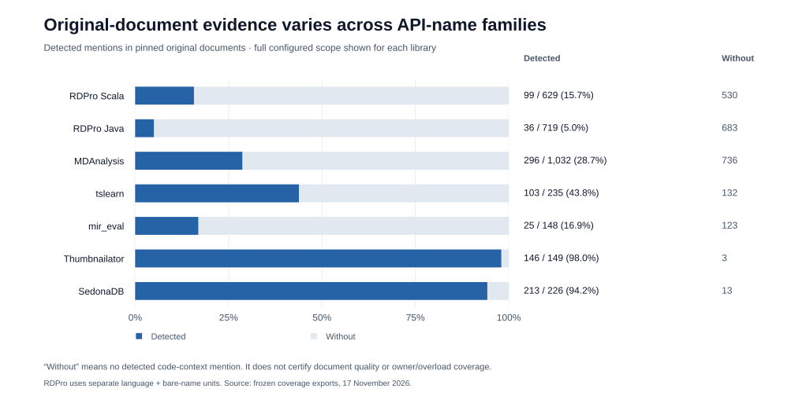
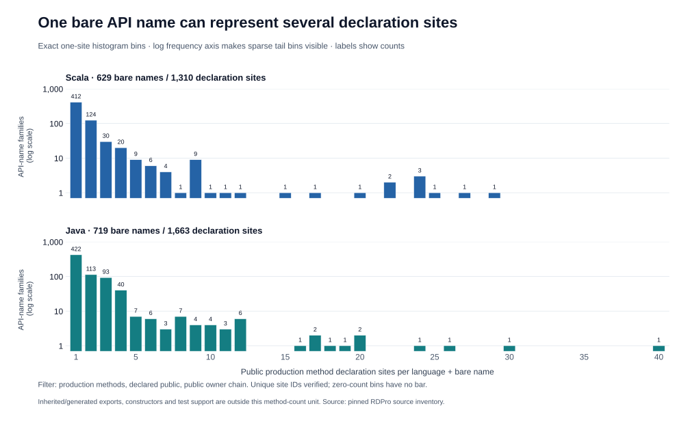
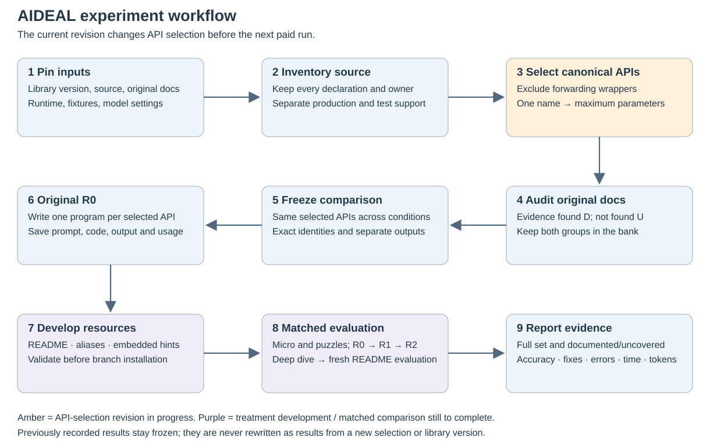
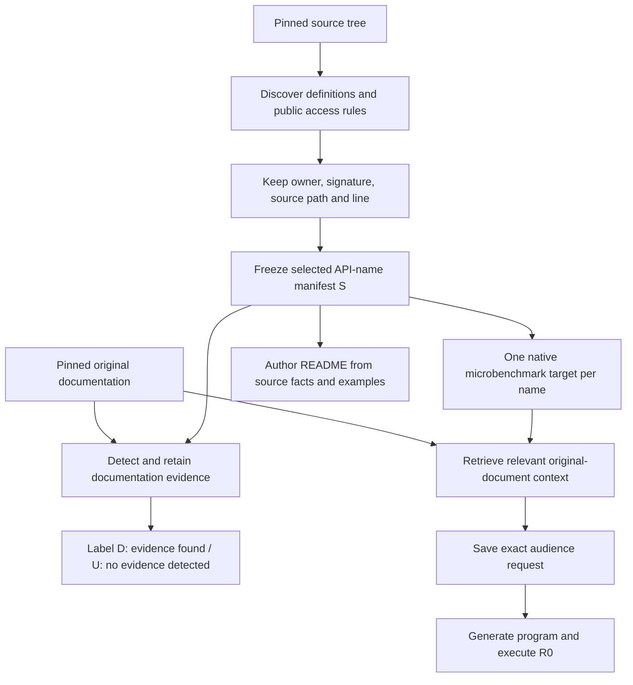
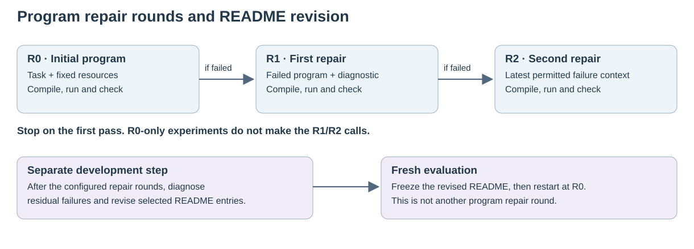
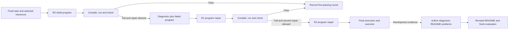
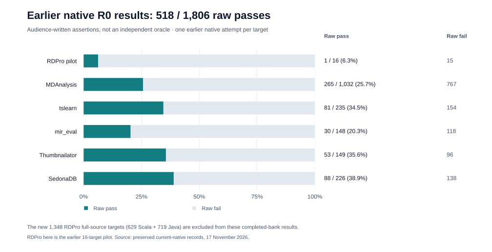
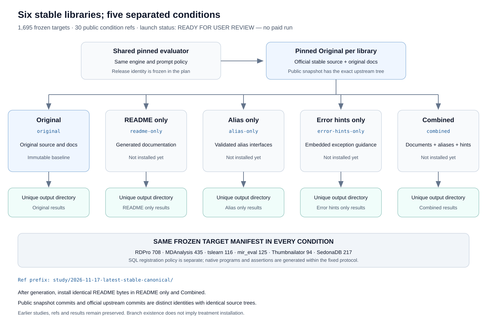
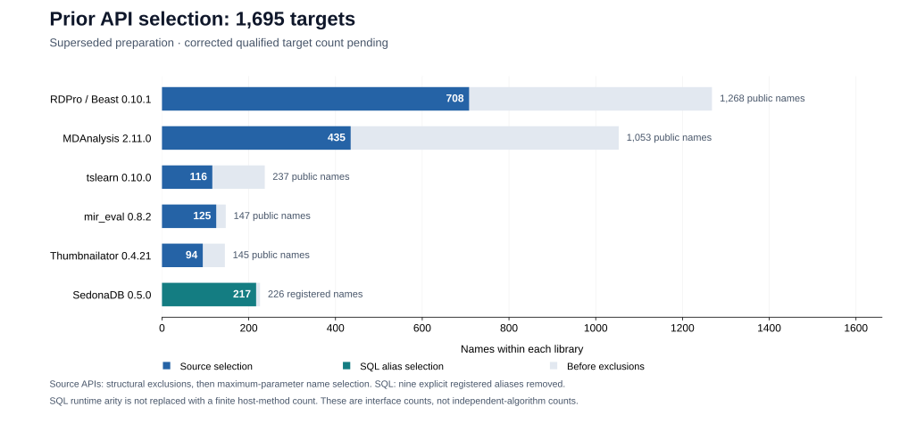
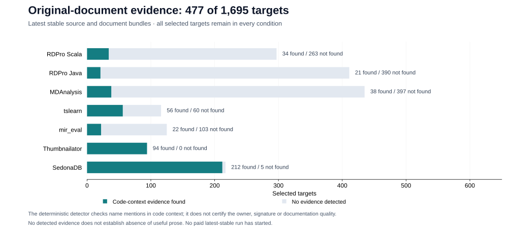

# Preserved guide and historical cohorts

This is the earlier guide snapshot retained during the current-first reorganization. Its historical tables, stopped queues, source inventories and operator examples are preserved. Any current/pending language within the snapshot belongs to that earlier editorial state. Use [the current guide](EXPERIMENT_GUIDE.md), [tracker](review/EXPERIMENT_TRACKER.html) and [current task bank](review/CURRENT_BANK.html) for the accepted latest-stable scope and review hold. No paid current-study run has started.

# AIDEAL experiment guide

Updated November 17, 2026. **READY FOR USER REVIEW. No paid run has started for the latest-stable canonical study.** The user requested review before any run; preparation is frozen and launch remains on hold.

## Start here

- [Open the review home](review/REVIEW_HOME.html): current scope, readiness evidence, documentation coverage, plan and previews.
- [Follow every condition and repair stage](review/EXPERIMENT_TRACKER.html), with current and historical cohorts in separate views.
- [Browse all 1,695 prepared task inputs](review/CURRENT_BANK.html): actual frozen Original context and available authoring inputs, with no invented outputs.
- [Inspect the six-library pilot previews](review/PILOT_REVIEW.html): planned inputs and prompt stages, with no invented model responses or results.
- [Review every API selection and exclusion](review/API_SELECTION.html): 1,695 selected targets from 5,252 source sites plus 226 registered SQL names.
- [Browse existing captured task inputs and outputs](review/BANK_REVIEW.html): historical and stopped-study evidence only. This is not a new-study result bank.
- [Inspect current original-document coverage](review/DOC_COVERAGE.html) and [download the exact per-library CSV summary](review/audit/latest-coverage/summary.csv).
- [Read the 25 readiness-control outcomes](review/READINESS.html), [the frozen plan status](review/audit/latest-readiness/REVIEW_STATUS.json), and [the cost scenarios](review/audit/latest-readiness/COST_FORECAST.json).

The static pages display recorded text; they do not run captured programs or contact a model. Reviewer-only reference solutions and secret credentials are excluded. Exact source bodies in the selection audit are review evidence, not audience context.

## Current study: ready, awaiting user review

| Item | Current state | Scope |
|---|---|---|
| Latest stable sources | Verified | Six official tags, exact commits and trees |
| API selection | Frozen | RDPro708, MDAnalysis435, tslearn116, mir_eval125, Thumbnailator94, SedonaDB217 |
| Runtime and compile/run readiness | Verified | 25 expected operator-control outcomes; positive and deliberate negative cases |
| Evaluator | Public and verified | `a6e8bb84fe32`, 225 files; 104 tests passed |
| Library study refs | Public and verified | 30 refs; five untreated baseline refs per library |
| Original R0 / README preparation | Complete | 14 jobs; 1,695 targets and 1,695 README entries frozen |
| Paid model requests / new study results | **Not started** | User review is required before any run |
| Alias and embedded-hint treatments | Not installed | Reviewed implementation and validation are later stages |
| Matched five-condition R0/R1/R2 and puzzles | Planned | Separate inputs, treatment identities and output namespaces must be frozen |

The current evaluator is [published on GitHub](https://github.com/ZhuochengShang/AIDEAL/tree/release%2F2026-11-17-canonical-api-a6e8bb84fe32), commit `e9f02e397f96d78d825cf0705f65771232b27e69`. The prepared 14-job plan has SHA256 `7aef275e71077749dd53c83eb701496e4f8a43fa8b54e2bf4a79c9b9227e0255`. A prepared job is not a launched job.

### Earlier evidence remains preserved

The November baseline completed 1,806 native R0 attempts. The expanded RDPro queue launched at 19:07 UTC and was stopped at 19:16 UTC on November 17 because its language/name selection did not implement the revised wrapper and global-name policy. Its snapshot retains 50 Scala R0 outcomes (three raw passes), 126 README entries, and no Java execution. The earlier MDAnalysis README authoring revision completed 1,032 entries. These artifacts retain their original versions and denominators.

The existing historical task browser contains 3,712 records across 27 historical or stopped-study banks. Its large payload stays in the original local folder; this portable review package provides its inventory and an explicitly local-only link, without duplicating the payload. Pending rows have no invented delivered prompt or result. Source inventories and task-result counts are different quantities. Earlier scores use audience-written assertions; they are not independent semantic-oracle scores.

Read the current selection and coverage below before using the historical baseline tables. Sections 1–7 explain the preserved experimental method and current protocol; Section 8 explains branches and storage; Section 10 separates local review from cluster inspection; the final sections record current source and runtime acceptance.

## 1. What “full API” means

The earlier RDPro configuration was a narrow pilot: it scanned three Scala files, found 50 distinct names at 60 definition sites, tested 16 names, and authored 50 entries. It should not have been described as the full RDPro experiment. The old 171-entry bank is also a selected historical scope, not a complete source inventory.

The completed November baseline executed native microbenchmarks by **API name family**. Multiple owners or overloads can share a name. Therefore, 1,032 MDAnalysis targets do not mean 1,032 independently verified signatures, and a pass for one name does not establish that every overload works. The coverage export retains the individual source sites so these collisions can be reviewed.

Those earlier configurations scan their configured source trees. Their language discovery rules, exclusions, and extension-module limits still apply. SedonaDB instead uses the 226 SQL functions registered by its measured 0.5.0 runtime. It does not substitute Rust implementation-function counts for SQL APIs.

### Completed November baseline and its configured scope

| Library | Configured API names | Definition sites | Names with original-doc evidence | Names without detected evidence | R0 targets | Raw R0 passes |
|---|---:|---:|---:|---:|---:|---:|
| RDPro pilot | 50 | 60 | 11 | 39 | 16 | 1/16 |
| MDAnalysis | 1,032 | 1,397 | 296 | 736 | 1,032 | 265/1032 |
| tslearn | 235 | 343 | 103 | 132 | 235 | 81/235 |
| mir_eval | 148 | 179 | 25 | 123 | 148 | 30/148 |
| Thumbnailator | 149 | 340 | 146 | 3 | 149 | 53/149 |
| SedonaDB | 226 | 226 | 213 | 13 | 226 | 88/226 |

The original-documentation columns use the same deterministic code-context detector as the engine: code blocks, backticks, or call patterns in the pinned documentation bundle. They are **evidence labels, not manual certification** of the correct owner, signature, or documentation quality. Common names can match another context. “No detected evidence” does not prove that no useful prose exists.

SedonaDB has 212 individual API reference pages, while this detector finds code-context evidence for 213 names across the complete original bundle. These are different quantities. Keep both labels; do not report either as the number of registered SQL APIs.

These six R0 jobs used Gemini 3.1 Flash-Lite, one attempt per target, and zero repairs. All 1,806 target records are exported. Their test programs contain audience-generated assertions; they are **native execution checks, not independent semantic-oracle scores**. Do not combine them numerically with the historical Codex puzzle comparison.

### RDPro expansion and historical mapping

| RDPro source scope | Frozen names | Public method sites | Original-doc evidence D | No detected evidence U |
|---|---:|---:|---:|---:|
| Scala production methods | 629 | 1,310 | 99 | 530 |
| Java production methods | 719 | 1,663 | 36 | 683 |
| Total language/name units | 1,348 | 2,973 | 135 | 1,213 |

This superseded inventory spans the **entire pinned Beast production source**, including raster, vector and utility modules. Scala and Java execute in separate configured banks. These counts group overloaded or same-named methods; they do not count every qualified method as a separate test.

The complete inventory also retains test support, constructors, fields, types, initializers and nonpublic declarations. Test-framework methods under `commontest` are excluded from the production denominator and recorded explicitly: 39 public sites add 26 Scala names. Including those test-support names would yield 655 Scala names. Two noncompilable archetype templates are also excluded and documented. Inherited and compiler-generated JVM exports are not claimed as a complete source inventory.

The earlier preparation-only counts of 621 Scala and 701 Java are superseded by **629 and 719**. They never became paid evaluation denominators. The final compiler inventory retains operators, underscore names and generic methods rather than silently dropping them.

### Overlap is not the same as duplication

| Quantity | Count | What it means |
|---|---:|---|
| Historical selected README/API bank | 171 | Previous study selection, not a repository-wide source inventory |
| Superseded Scala name groups | 629 | One target per bare method name in production Scala source |
| Superseded Java name groups | 719 | One target per bare method name in production Java source |
| Names appearing in both languages | 80 | Same spelling, not necessarily the same operation |
| Distinct spellings across both languages | 1,268 | 629 + 719 − 80; still not a semantic operation count |
| Superseded evaluation units | 1,348 | Language + name, with Java and Scala treated as separate source/API contexts |

Repeated source sites are catalogued once, and identical names within a language are grouped. **Forwarding wrappers and equivalent operations have not been removed from RDPro or semantically deduplicated from this bank.** The two implementation languages can expose the same underlying behavior; conversely, common names such as `get` can denote unrelated operations. Scala source can also contain helpers intended for Java callers, so source language is not a perfect caller-language boundary.

That stopped study measured the declared language/name interface surface. It must not report 1,348 unique algorithms or independently different operations. A separate operation-level analysis should map each wrapper to its canonical target using source bodies, select representatives before evaluating, and report results with that new frozen manifest. Keep the stopped bank unchanged as evidence. The replacement uses a new manifest, library-version pins and output directory. The [overlap audit](review/audit/overlap/README.md) records exact sites, name intersections and real forwarding examples when available.




The dark portion marks automatic evidence found in the original documentation; the light portion remains in the same evaluation bank. It does not measure README quality.



This histogram explains why name counts and declaration counts differ. A name can occur at multiple owners or overloads. The complete per-name counts and exact bins are available in [chart data](review/figures/chart_data.json).


The official source provenance records Bitbucket release commit `547f7f912131a8032f6b5d26991415a5faf05cef`. The published experiment snapshot `5ee41a6dc37ebe5f63bf7a3a0b74c5483460b9c8` is parentless but has the **identical Git tree** `757142fe21ba53b1388880d6abc7423aff844295`. It is not evidence of a newer RDPro release.

Retain separate flags for historical membership: 161 previously validated targets, 171 historical README entries, and the new source-derived selection. All 171 names occur in the broader Scala source. Ten entries outside the 161 selection are not automatically hallucinated merely because that older selection omitted them. Historical model, scaffold, repair budget, and task differences prevent a direct controlled comparison with the new run.

## 2. Freeze the denominator before comparing conditions

Use a source-derived, reviewed selection **S** that is independent of generated documentation and observed pass/fail outcomes. Freeze its names, definition identities, source revision, exclusions, fixtures, task definitions, and model settings.

Partition the same selection using the pinned original documentation:

- **D:** selected APIs with detected original-documentation evidence.
- **U:** selected APIs without detected original-documentation evidence, where U = S minus D.

Every condition receives the same S. Report results on **all S**, then separately on **D** and **U**. This measures the overall effect of the resources while showing whether improvement comes from better guidance for documented APIs or added coverage for previously uncovered APIs. Do not silently remove U from Original or add newly generated entries only to the Generated denominator.

The older `manifest` CLI defaults to the shared documented subset `S ∩ O ∩ G`. That can support an additional documented-subset analysis, but it is not the primary full-scope selection. Use `--set surface` explicitly when freezing the full configured source surface. The current launchers consume explicit saved manifests and do not infer their denominator from README headings.

An evidence-based exclusion needs a reason, owner/signature, and timing. Record unsupported languages, inaccessible definitions, generated methods, and missing runtime support before evaluation. A generated program's hallucinated import or wrong argument is an audience failure, not proof that the API is ineligible. Provider outages remain pending or unavailable outcomes; report completion separately from correctness. Review automatic infrastructure classifications before excluding anything from a denominator.

The historical documentation audit was computed after its completed R0 runs using only source and documentation text. The replacement coverage is now frozen before any new model call, against the new selected manifests and version-matched original bundles. Neither audit selects targets using outcomes.

## 3. How API discovery and original-document retrieval work





1. Source discovery reads the configured globs and filters. Python uses AST identity information alongside the configured scanner; the new RDPro audit uses Scala and Java compiler parsers to retain declarations and enclosing owners. A source inventory does not itself prove that every target can be exercised by the configured runtime.
2. The manifest freezes selected names. The definition inventory preserves all discovered sites, not only the first overloaded method.
3. Original-document retrieval looks for relevant code-context sections for **every selected target**, including targets absent from the original documentation. Current native R0 uses relevant context capped at 12,000 characters per target, rather than always sending the whole README.
4. If retrieval finds no relevant section, it supplies an explicit missing-context message. The API stays in the bank. For example, the saved pilot task for `readType` contains “No code-context section for `readType` was found in the configured original documentation.”
5. Every new condition receives the same selected declaration metadata: qualified owner/name, signature, ordered parameters, source-site identity and selection digest. It also receives task instructions and fixed runtime/scaffold information. The documentation differs by condition; full implementation bodies and review-only answers are not audience input. README only therefore means generated documentation plus this shared target/runtime context, not an isolated README string.

## 4. What a native microbenchmark contains

For each target, AIDEAL asks the audience to write a small program using that API, create suitable values or use supplied fixtures, make assertions, and emit the required witness after the assertions. AIDEAL inserts the program into a language-specific scaffold, compiles when necessary, executes it, and checks the configured exit status and markers.

The bank therefore has two stages:

- **Before model execution:** frozen target, documentation selection rule, prompt template, fixtures, runtime, and check policy.
- **After execution:** the exact delivered prompt, generated assertions/program, provider response, compiled source, output, error, and verdict.

A list of API names is not a fully specified independent benchmark. In native tests, the audience chooses its example and assertions. The independent RDPro banks instead supply fixed task inputs and separate expected-value algorithms. Report those bank types separately.

The browser exports the captured R0 requests and outputs in full, with an export timestamp for each bank. Tasks still running or pending have no invented result. The very large repeated compiler/classpath command is represented by its original artifact path and hash; the actual command remains in the cluster execution record. Raw recorded text is displayed as text and is never executed by the browser.

### Available task banks

| Bank | Unique task/design records | What is actually available |
|---|---:|---|
| Current six-library Original native R0 | 1,806 | Complete saved audience attempts and execution records |
| Full-source RDPro Original R0 | 1,348 | 629 Scala + 719 Java targets; saved attempts as available, remaining targets explicitly pending |
| RDPro broad independent bank | 32 | 16 micro + 16 puzzles; 96 fixture instances; saved reference and negative-control validation |
| RDPro schema/metadata independent bank | 8 | 4 micro + 4 puzzles; 24 fixture instances; separate historical pilot |
| RDPro source-contract development | 8 | Development cases, not held-out evaluation |
| RDPro matched draft candidates | 166 | 161 target placeholders without prompts + 5 draft puzzle candidates; not evaluable |
| Two historical RDPro puzzle banks | 5 each | Defined composition/discovery tasks; validation strength differs by bank |
| Portable library pilots | 1 each in four libraries | Tiny adapter-check tasks; not a completed six-library puzzle study |
| Domain task-family designs | 8 | Planning records covering five declared levels, not executable cases |
| Empty bank drafts | 7 files | Zero tasks; displayed explicitly |
| Archived Sedona SQL examples | 322 | Three setup-variant replays; no audience generation or independent semantic oracle |

A historical 480-unit RDPro comparison means 32 cases × 3 trials × 5 conditions; it does not mean 480 unique cases. Likewise, multiple fixture inputs and composition/discovery presentations must not inflate the count of unique tasks. Historical validation receipts are preserved evidence, not a claim that this audit reran every control.

### How to inspect one complete example

1. Open [BANK_REVIEW.html](review/BANK_REVIEW.html) and select **Tasks**.
2. Choose the library and bank. The earlier RDPro pilot and the new Scala/Java banks are separate choices.
3. Search for an API name, then open its row. Read **request** before **response** to see precisely what the model knew.
4. Compare the returned snippet with the complete scaffolded program, compiler/runtime output, provider tokens and recorded verdict.
5. Open the API/source view to compare its owner, signature and file/line against the original-documentation evidence.
6. For puzzles, inspect the full public task, input files and allowed resources. Private expected answers remain in a separate reviewer-only file; the browser does not expose them to a model.

The browser contains **3,712 task/design records across 27 bank entries**. This is a navigation count, not 3,712 independent completed benchmark tasks. It includes drafts, SQL replays and the 1,348 newly launched targets.

## 5. R0, R1 and R2



| Round | Audience input | What changes | Meaning of success |
|---|---|---|---|
| R0 | Task, permitted resources, fixed execution setup | Initial program | Pass on the first attempt |
| R1 | Same task/resources + failed program and permitted diagnostic | First program repair | Passed by at most one repair |
| R2 | Same task/resources + latest permitted repair context | Second program repair | Passed by at most two repairs |

AIDEAL stops a task when it passes or reaches the repair limit. Therefore, an R0 pass does not make two unnecessary repair calls. R1/R2 are program repair rounds, not additional API groups and not README revisions. This launch's baseline script enforces R0 only. Use a separately frozen repair study for R0→R2.

Deep-dive README repair is a later development operation after the configured program-repair rounds. It uses source and failure evidence to revise selected README entries. Then start a **fresh evaluation** with the revised README. Record the revised document hash and distinguish within-bank development improvement from performance on held-out tasks.



The prepared Original R0 jobs allow one initial execution per API and zero repairs. They have not launched. R1/R2 and README revision are separate planned stages; provider retries are not program-repair rounds.

## 6. Full five-condition plan

| Condition | Audience documentation | Callable aliases | Source-embedded fix hints | Planned measurement |
|---|---|---|---|---|
| Original | Original bundle | No | No | Micro and puzzle R0, then cumulative R2 |
| README only | Generated README | No | No | R0/R2; deep-dive revision; fresh R0/R2 |
| Alias only | Original + alias interface descriptions | Validated wrappers | No | Matched micro and puzzle R0/R2 |
| Error hints only | Original | No | Validated exception-message edits | Matched R0/R2; record whether a hint was actually emitted |
| Combined | Generated + alias interface descriptions | Validated wrappers | Validated exception-message edits | R0/R2; deep-dive revision; fresh R0/R2 |

Current completed work is the earlier Original native R0 baseline plus six completed README authoring jobs. MDAnalysis uses an explicit validation revision, with 1032/1,032 accepted entries at the snapshot above. Compatible old responses were replayed without billing them again; the original failed records remain intact. Creating a branch does not mean its alias or hint treatment has been installed. The completed authoring does not automatically establish complete alias/hint/puzzle readiness for all six libraries.

README authoring sends the project profile, exact API facts/signatures, available source comments, selected upstream test examples, original-document examples, a distilled documentation summary, and the author prompt. It does not normally send the entire repository. Static authoring completion verifies the recorded output and entry coverage; it is not proof that all README examples execute correctly.

Alias development uses selected source definitions and development failures, asks the author for a clearer forwarding interface and rationale, and permits no proposal when evidence is insufficient. Build and paired behavior checks must precede installation. Native hint development diagnoses an observed misuse, proposes guidance at an existing exception statement, preserves its condition/type, and checks triggering, corrected, valid, and unrelated-error programs against both versions. Unsupported edits remain recorded, not installed.

Use development R0 failures to construct treatments, then freeze them. Do not expose held-out expected answers, hidden target mappings, or other trials' solutions to the audience. Shared learned error memory remains a development resource unless a separately declared memory ablation enables it during evaluation.

Additional ablations remain separate: sequential versus selected-entry README generation/repair; full versus partial regeneration; source wrapper/duplication refactoring. Keep unselected documentation bytes fixed in a selective condition. Change one factor at a time or declare a factorial comparison.

### Remaining work and acceptance gates

| Stage | Inputs | Automated work | Required evidence before proceeding |
|---|---|---|---|
| A. Original R0 | Pinned source, docs, fixed manifest and runtime | Generate and execute one program per API | Per-attempt prompt, output, diagnostics, tokens and completion |
| B. README authoring | Same source inventory, source comments, tests and original docs | Distill once, generate each selected entry, validate format | Complete entry set, output hash and provider receipts |
| C. Treatment development | Development failures and source evidence | Propose forwarding aliases and embedded exception guidance | Build, positive/negative behavior checks, exact source diff |
| D. Treatment installation | Accepted proposals and completed README | Install separate versions with receipts | Branch commit, base tree, changed files, matched README bytes |
| E. Matched evaluation | Frozen five versions and same bank | R0, then up to two repairs; micro and puzzle separately | Fixed denominator, model, permissions and output isolation |
| F. Targeted README deep dive | Residual failures after R2 | Diagnose and revise selected entries | Revised document hash, changed-entry list, fresh evaluation |
| G. Report | All attempted and pending units | Full S and D/U scores, error catalog, time/tokens | No pooling of different models, runtimes or task definitions |

Native microbenchmarks reuse the target selection and prompt policy; the audience still chooses each example/assertion. For strict task-level comparison, use the independently specified task banks with fixed inputs and hidden expected-value checks. The current independent RDPro bank covers 16 APIs, not all 1,348 new name groups. A complete independent all-source task bank remains development work.

## 7. Scores, repairs, time and tokens



These are the earlier completed native results. The partial, stopped RDPro results remain separate and do not supply a completed full-source score. Counts alone cannot establish that documentation caused each failure; inspect the incorrect calls, runtime assumptions and assertion design.

| Metric | Simple calculation | Example with 100 tasks |
|---|---|---|
| R0 success | Initial passes / scheduled tasks | 40 initial passes = 40% |
| Additional R1 fixes | First passes at R1 / scheduled tasks | 20 new passes = +20 percentage points |
| Additional R2 fixes | First passes at R2 / scheduled tasks | 10 new passes = +10 percentage points |
| Cumulative R2 success | All passes through R2 / scheduled tasks | (40 + 20 + 10) / 100 = 70% |
| R2 recovery among remaining failures | New R2 passes / failures entering R2 | 10 / 40 = 25% |
| Completion | Adjudicated tasks / scheduled tasks | 95 final results = 95%; five still unavailable |

This is an illustration, not an experiment result. A task already passed at R0 does not count again as a newly fixed R1/R2 task.

For a frozen selection with N scheduled task–trial units, report:

- **Completion:** units with an adjudicated result divided by N; provider-pending units remain visible.
- **R0 success:** units passed on the first attempt divided by N.
- **Cumulative R2 success:** units passed by R0, R1 or R2 divided by the same N.
- **Newly fixed at round k:** units whose first pass occurs at round k, divided by N. Also show recovery among the previously failing units with an explicitly stated denominator.
- **Micro and puzzle scores:** separate tables/plots. If a combined score is needed, predeclare equal weighting or pooled weighting; never silently average incompatible historical protocols.
- **Input/output tokens:** sum actual provider receipts, including unsuccessful returned responses. Replayed responses add no new model usage. Keep unknown usage separate.
- **Model time:** request elapsed time. **Test execution time:** compile/build/run/check duration. **Wall time:** end minus start, which also includes preparation and waiting. Concurrent-job times are not summed to estimate wall time.

Report full S and its D/U strata using the same definitions. The native engine also stores infrastructure-adjusted summaries; these are not automatically the primary score. A missing module caused by a hallucinated import can receive an `infra` tag, so inspect the failure before removing it.

Known API cost = input tokens × $0.25 / 1,000,000 + output tokens × $1.50 / 1,000,000 for standard Gemini 3.1 Flash-Lite text requests. Output includes provider-reported thinking tokens. This queue uses the standard API, not discounted Batch API. [Google pricing](https://ai.google.dev/gemini-api/docs/pricing). Costs exclude unobserved provider charges and infrastructure. Refresh receipts for current totals; estimates are not caps or paper selection criteria.

### Recorded cost and planning scenario

| Receipt scope | Recorded requests | Input tokens | Output tokens | Known priced usage |
|---|---:|---:|---:|---:|
| Earlier six-library study, including MD continuation | 3,653 | 10,576,343 | 1,807,242 | $5.354949 |
| New full-source RDPro | 178 | 581,003 | 92,485 | $0.283978 |

Snapshot time is the same as the progress table. A request in flight may have unknown usage; it is not a confirmed provider failure. See the reports for unknown counts and projections.

Before the now-stopped RDPro model calls, the explicit planning scenario was 1,348 R0 requests + 1,348 entry requests + two distillation requests = **2,698 requests**, using **16,216,000 input and 4,047,000 output tokens**, or **$10.1245** at the listed rates. This is a scenario, not a spending cap. Actual context sizes, retries and failed returns change the cost. Any remaining-work projection for that stopped plan is obsolete. The replacement estimate is recorded separately below using the 1,695 selected latest-stable targets.

Standard text rates were checked against [Google's pricing page](https://aistudio.google.com/docs/pricing#gemini-3.1-flash-lite) on November 17, 2026. Private usage controls do not determine library selection or paper claims.

### Current preparation cost scenarios

The frozen first stage contains 1,695 Original R0 requests, 1,695 README-entry requests and seven document-distillation requests: **3,397 requests before retries**. Historical per-library token means imply approximately 8.54 million input tokens and 1.50 million output tokens, or **$4.39**. The RDPro estimate uses only 16 old pilot targets. An explicit larger-context scenario is **$12.76**; neither figure is a spending cap or a forecast for all later repair/treatment experiments.

The standard sequential API rates are $0.25 per million input tokens and $1.50 per million output tokens including thinking. Batch discounts are not assumed. [Exact assumptions and arithmetic](review/audit/latest-readiness/COST_FORECAST.json) are preserved. No new-study usage or result is reported yet.

## 8. Where code, branches and results live

| Purpose | Cluster path |
|---|---|
| Historical original six-library study | `/home/zshan011/apps/aideal/studies/2026-11-16-six-library-gemini-flash-lite` |
| Stopped expanded RDPro study | `/home/zshan011/apps/aideal/studies/2026-11-17-full-rdpro` |
| Versioned evaluator releases | `/home/zshan011/apps/aideal/releases/` |
| Controller Python | `/home/zshan011/apps/aideal/venv/bin/python` |
| Historical scientific Python environment | `/home/zshan011/apps/aideal/envs/2026-11-16-libraries/bin/python` |
| SedonaDB 0.5.0 environment | `/home/zshan011/apps/aideal/envs/2026-11-16-sedonadb/bin/python` |

The current study is `/home/zshan011/apps/aideal/studies/2026-11-17-latest-stable-canonical`, with official source checkouts under `sources/LIB`, inventories under `inventories/LIB`, and per-library configuration under `libraries/LIB` (RDPro uses `rdpro/configs`). The current scientific interpreter is `/home/zshan011/apps/aideal/envs/2026-11-17-latest-stable/bin/python`. Original snapshots remain under the earlier study's `sources/LIB`. SedonaDB's measured checkout is `sources/sedonadb-release-0.5.0`. Each queue binds an exact evaluator release. Updating the `current` pointer does not change an already frozen plan.

The earlier five refs per library are `study/2026-11-16-gemini-3.1-flash-lite/{original,readme-only,alias-only,error-hints-only,combined}`. New RDPro scope uses a new branch namespace recorded in its own `branches.json`. README installation records exact commits and document hashes in `installation.json` and writes the same document to README-only and Combined.

Inspect another version with `git show BRANCH:path`. Do not switch the source checkout used by an active run. Concurrent conditions need separate checked-out working directories and output directories. The new source checkouts remain detached at their official stable commits. The 35 earlier study refs and all older refs are preserved; 30 additional latest-stable condition refs are public and verified. Later README commits made on the cluster still require an explicit publication refresh; GitHub does not update merely because a cluster branch advances.

```text
STUDY/
  configs/ or original_micro_linux.yaml  effective configuration
  inputs/                               manifest, fixed scaffolds and fixtures
  branches.json                         source identities and condition refs
  plan.json                             exact pinned job commands
  supervisor/JOB/attempt_NNNN/           command, console, times and exit status
  runs/original/LIB/LIB/                 frozen R0 identity and result
    execution/                          exact requests, programs and process evidence
  authoring/LIB/LIB/                     README generation identity and output
    author_calls/                       actual provider requests/responses/usage
    docs/LLM_readme.md                   generated document
    completion.json                     authored coverage receipt
  authoring/LIB/installation.json        branch installation receipt, when completed
  review/                               task browser and API/document evidence
  COSTS.json / COSTS.md                  actual usage and labelled projection
```

The repeated library directory comes from a per-job container plus the launcher's per-library output. An explicit authoring validation revision can have a nested `revisions/` directory. It must reference compatible old receipts without overwriting them or counting their tokens twice.


### Public GitHub branches and how they work

The current prefix is `study/2026-11-17-latest-stable-canonical/` in all six library repositories. Each has `original`, `readme-only`, `alias-only`, `error-hints-only` and `combined`. All 30 refs are public, with untreated baseline content. Public commits are parentless snapshots with exactly the official upstream trees, including licenses and Git submodule entries. Their commit IDs differ from official upstream IDs; [the publication receipt](review/audit/latest-readiness/LIBRARY_PUBLICATION.json) records both. [Cluster alignment](review/audit/latest-readiness/CLUSTER_ALIGNMENT.json) keeps source HEAD at the official commit while condition refs point to the corresponding public snapshot.

The following branch table records the earlier historical publication, not the current evaluator or treatment state.



| Repository | New public branch family | Current content |
|---|---|---|
| [AIDEAL evaluator](https://github.com/ZhuochengShang/AIDEAL/tree/release/2026-11-17-r0-readme-f2fc66558adb) | `release/2026-11-17-r0-readme-f2fc66558adb` | Tested 216-file deployed release, exact commit `fc70c0732730a3d8a33f441895ce3c8c588018aa` |
| [RDPro](https://github.com/ZhuochengShang/AIDEAL-RDPro/branches) | November 16, five suffixes; November 17, five more | Old pilot README installed; wider queue stopped for selection/version revision |
| [SedonaDB](https://github.com/ZhuochengShang/AIDEAL-SedonaDB/branches) | November 16, five suffixes | README installed; aliases and hints pending |
| [MDAnalysis](https://github.com/ZhuochengShang/AIDEAL-MDAnalysis/branches) | November 16, five suffixes | 1,032-entry README installed and published; aliases and hints pending |
| [tslearn](https://github.com/ZhuochengShang/AIDEAL-tslearn/branches) | November 16, five suffixes | README installed; aliases and hints pending |
| [mir_eval](https://github.com/ZhuochengShang/AIDEAL-mir_eval/branches) | November 16, five suffixes | README installed; aliases and hints pending |
| [Thumbnailator](https://github.com/ZhuochengShang/AIDEAL-Thumbnailator/branches) | November 16, five suffixes | README installed; aliases and hints pending |

For all six libraries, the November 16 prefix is `study/2026-11-16-gemini-3.1-flash-lite/`. For expanded RDPro, the November 17 prefix is `study/2026-11-17-rdpro-entire-source/`. Append one of these five suffixes:

| Suffix | Intended treatment | Full-source RDPro state at launch |
|---|---|---|
| `original` | Original source and original docs | Frozen baseline |
| `readme-only` | Generated README | Baseline ref; waits for both language documents |
| `alias-only` | Validated executable forwarding aliases | Baseline placeholder |
| `error-hints-only` | Validated guidance embedded in existing exception messages | Baseline placeholder |
| `combined` | Generated README + aliases + embedded hints | Baseline ref; README installation comes first |

**A branch name is a condition label, not proof of an installed treatment.** The five full-source refs initially point to the same baseline commit. The installer checks the expected parent commit before adding `docs/LLM_readme.scala.md` and `docs/LLM_readme.java.md` to README-only and Combined. Both branches receive identical document bytes. Alias and hint installation must produce their own reviewed diffs and validation receipts before those names can be evaluated as treated versions.

All six November 16 README-only and Combined branches now contain generated README files. MDAnalysis completed 1,032 entries and published commit `377872631da8d8bd60ef6eae7449bf6e9875277b` using its separate validation revision. Those Combined branches do not yet contain the new alias and embedded-hint treatments.

Existing `main` and 41 pre-existing library branches were preserved. The evaluator release is a standalone deployed-file snapshot, not a proposal to delete unrelated files from `main` or a replacement for every developer tool in the working checkout. Its parent and exact tree are recorded in [publication receipts](review/audit/github/central_publication.json).

| Isolation rule | Why another experiment stays unchanged |
|---|---|
| Plan pins an evaluator directory and source/document hashes | Updating `current` or a GitHub branch does not replace already frozen inputs |
| Each condition has its own source snapshot and output directory | One treatment cannot overwrite another condition's programs or logs |
| Queue and output ownership locks | A second worker cannot silently write the same mutable outputs |
| Verified completion and replay receipts | Reuse requires compatible identities; editing a cached result is rejected |
| Additive branches, no force-push or history rewrite | Older studies keep their original commit identities |

Git branches are pointers to commits, not copies of all files. Two branches can initially point to the same commit. Inspecting with `git show` is safe during a run; switching the active source checkout is not the way to compare live conditions. Use separate working copies for concurrent runs and freeze their commits in a new study plan.

### Historical local publication repositories and measured sources

| Library | Local publication repository | Cluster measured source |
|---|---|---|
| RDPro | repository.git (operator-local path: `/Users/clockorangezoe/Documents/phd_projects/code/geoAI/AIDEAL_WORKSPACE/03_Experiments/rdpro/2026-09-22-gpt-5.3-codex-broad-study/repository.git`) | `/home/zshan011/apps/aideal/studies/2026-11-16-six-library-gemini-flash-lite/sources/rdpro` |
| SedonaDB | sedonadb (operator-local path: `/Users/clockorangezoe/Documents/phd_projects/code/geoAI/AIDEAL_workflow/.local/library_publications/sedonadb`) | `/home/zshan011/apps/aideal/studies/2026-11-16-six-library-gemini-flash-lite/sources/sedonadb-release-0.5.0` |
| MDAnalysis | mdanalysis (operator-local path: `/Users/clockorangezoe/Documents/phd_projects/code/geoAI/AIDEAL_workflow/.local/library_publications/mdanalysis`) | `/home/zshan011/apps/aideal/studies/2026-11-16-six-library-gemini-flash-lite/sources/mdanalysis` |
| tslearn | tslearn (operator-local path: `/Users/clockorangezoe/Documents/phd_projects/code/geoAI/AIDEAL_workflow/.local/library_publications/tslearn`) | `/home/zshan011/apps/aideal/studies/2026-11-16-six-library-gemini-flash-lite/sources/tslearn` |
| mir_eval | mir_eval (operator-local path: `/Users/clockorangezoe/Documents/phd_projects/code/geoAI/AIDEAL_workflow/.local/library_publications/mir_eval`) | `/home/zshan011/apps/aideal/studies/2026-11-16-six-library-gemini-flash-lite/sources/mir_eval` |
| Thumbnailator | thumbnailator (operator-local path: `/Users/clockorangezoe/Documents/phd_projects/code/geoAI/AIDEAL_workflow/.local/library_publications/thumbnailator`) | `/home/zshan011/apps/aideal/studies/2026-11-16-six-library-gemini-flash-lite/sources/thumbnailator` |

Each measured local/cluster repository has an `aideal-github` remote pointing to its matching public GitHub repository. Some older `origin` remotes point to local seeds or upstream repositories, so use `aideal-github` explicitly for these study branches.

SedonaDB's measured source snapshot matches the 1,423 retained regular-file leaves of official 0.5.0, but omits four Git submodule entries and `r/sedonadb/src/rust/Cargo.toml`. Therefore it is not an identical upstream Git tree. Its measured SQL runtime exposes 226 functions; keep the snapshot and this provenance caveat instead of rewriting historical results.

## 9. Code review, in execution order

Portable links below open the frozen evaluator snapshot under `evaluator/`. Historical line numbers in labels may differ after the canonical-selection changes; use the named function in that pinned file. Operator working-folder paths are reference locations, not the evaluator identity for this study.

| Step | Start here | What to inspect |
|---|---|---|
| Queue and resume | [run_cluster_experiment.py:66](evaluator/scripts/run_cluster_experiment.py) → `supervise` | Bounded workers, lock, frozen commands, per-attempt logs |
| Source API scan | [api_discovery.py:27](evaluator/vendor/aideal_engine/src/aideal/api_discovery.py) → `public_api_surface`, `public_api_details` | Configured names versus definition identities |
| Manifest and docs | [doc_check_sources.py:53](evaluator/vendor/aideal_engine/src/aideal/doc_check_sources.py) → `_load_manifest`, `_relevant_original_texts` | Fixed denominator; missing docs retained |
| R0 preparation | [run_original_micro.py:40](evaluator/scripts/run_original_micro.py) → `prepare` | Model, zero repairs, source/runtime/prompt hashes |
| Native iteration | [doc_check_comprehension.py:15](evaluator/vendor/aideal_engine/src/aideal/doc_check_comprehension.py) → `comprehension_check` | One target at a time and checkpoint reuse |
| Prompt and round loop | [doc_check_execution.py:25](evaluator/vendor/aideal_engine/src/aideal/doc_check_execution.py) | Exact request, model response, scaffold, execution, repair loop |
| Process control | [execution.py:37](evaluator/vendor/aideal_engine/src/aideal/execution.py) → `run_command` | Timeout, child cleanup, credential environment filtering |
| README setup | [run_readme_generation.py:48](evaluator/scripts/run_readme_generation.py) → `inspect`, `prepare`, `run_library` | Manifest/surface scope, frozen author identity, completion gate |
| README author | [readme_generation.py:83](evaluator/vendor/aideal_engine/src/aideal/readme_generation.py) → `find_or_create` | Source facts, examples, distillation, per-entry prompts |
| Author evidence | [readme_recording.py](evaluator/vendor/aideal_engine/src/aideal/readme_recording.py), [readme_validation.py](evaluator/vendor/aideal_engine/src/aideal/readme_validation.py), [readme_replay.py](evaluator/vendor/aideal_engine/src/aideal/readme_replay.py) | Exact requests, source-note validation, explicit compatible replay |
| Installation | [install_generated_readme.py:40](evaluator/scripts/install_generated_readme.py) | Completion hash, branch compare-and-swap, unchanged Original |
| Coverage audit | `review/refresh/export_api_coverage.py` | Name/document evidence and explicit ambiguity |
| Costs | [report_experiment_costs.py:103](evaluator/scripts/report_experiment_costs.py) | Actual provider usage; replay is not another paid call |

The links above open exact local code locations in the AIDEAL_workflow folder (operator-local path: `/Users/clockorangezoe/Documents/phd_projects/code/geoAI/AIDEAL_workflow`). The separate expanded-RDPro inventory records compiler parser source and per-definition file/line. These are preparatory inventory tools, not an extra audience model.

### Follow the actual request loop

| Step | Function / line | Saved input or output |
|---|---|---|
| 1 | `run_original_micro.prepare` | `launch.json`, frozen manifest and effective config |
| 2 | `_comprehension_inventory` and `_relevant_original_texts` | Target and the original documentation actually selected |
| 3 | `_comprehension_execute`, API loop at line 352 | Per-target output directory and resumable checkpoint |
| 4 | Attempt loop at line 390; `load_prompt` at line 407 | `request.json`, including exact system and user text |
| 5 | `invoke_text` at line 424 | `response.txt`, `provider.json`, model time and token usage |
| 6 | Scaffold and execution, lines 444–478 | `ApiTest.scala` / Java/Python equivalent, `execution.json`, stdout/stderr |
| 7 | Verdict and checkpoint | First passing round, status, error category and evidence locations |

Use the code links above to verify lines against your working copy; the published release pins the exact reviewed code. The full-source registry begins at [`api_registry.py:136`](evaluator/vendor/aideal_engine/src/aideal/api_registry.py). The audience prompt template is [`comprehension_write_exec.md`](evaluator/prompts/comprehension_write_exec.md). README authoring instead uses [`readme_distill.md`](evaluator/prompts/readme_distill.md) once and [`readme_entry.md`](evaluator/prompts/readme_entry.md) for each entry.

The current native API sweep executes in the vendored `doc_check_execution.py` path. The independent-task treatment comparisons use [`workflow/evaluation_runner.py`](evaluator/workflow/evaluation_runner.py). They are different benchmark paths. Do not assume that a repair policy or score from one automatically governs the other.

## 10. Local review and cluster inspection

### Current review: no program execution or paid calls

On the **Mac**, open `review/REVIEW_HOME.html`, `review/PILOT_REVIEW.html`, or this guide. These relative assets can be reviewed together without a runtime installation. Operator paths below identify this machine; they are not portable install instructions.

```bash
open "/Users/clockorangezoe/Documents/phd_projects/code/geoAI/AIDEAL_WORKSPACE/03_Experiments/2026-11-17-latest-stable-canonical/review/REVIEW_HOME.html"
```

On the **cluster**, these commands read the prepared current study and official source identity:

```bash
ssh -o ClearAllForwardings=yes lab
STUDY=/home/zshan011/apps/aideal/studies/2026-11-17-latest-stable-canonical
cat "$STUDY/plan.json"
git -C "$STUDY/sources/rdpro" rev-parse HEAD 'HEAD^{tree}'
git -C "$STUDY/sources/mdanalysis" status --short
```

The prepared launch is on hold. The pilot preview shows the intended stages and exact available inputs. A README response, repair prompt using actual failure feedback, or later execution outcome cannot be shown as real until that preceding stage exists. Any illustrative feedback must be marked illustrative. Parent directories, manifests, prompts and evidence hashes must remain identical when the portable review bundle is copied to GitHub, cluster and local review storage.

### Historical inspection and operator reference

The remainder of this section explains the stopped queue and general stop/resume mechanics. It is not an instruction to restart that queue or approve the replacement run.

### Step 1. Open the local guide and historical task browser

Run these on your **Mac**, or open the files from VS Code. No key or model call is needed.

```bash
cd "/Users/clockorangezoe/Documents/phd_projects/code/geoAI/AIDEAL_WORKSPACE/03_Experiments/2026-11-16-six-library-gemini-flash-lite"
open review/BANK_REVIEW.html
open review/SOURCE_INVENTORY.html
```

In VS Code, open `EXPERIMENT_GUIDE.md` and use Markdown Preview. SVG charts display without installing Mermaid. Mermaid blocks provide editable diagram sources if the preview supports them.

### Step 2. Connect and select the expanded study

```bash
ssh -o ClearAllForwardings=yes lab
STUDY=/home/zshan011/apps/aideal/studies/2026-11-17-full-rdpro
RELEASE=/home/zshan011/apps/aideal/releases/2026-11-17-r0-readme-f2fc66558adb
PYTHON=/home/zshan011/apps/aideal/venv/bin/python
```

**This queue is stopped and superseded. Do not restart it.** The following commands inspect its preserved evidence:

```bash
cat "$STUDY/supervisor/summary.json"
tmux list-sessions
cat "$STUDY/plan.json"
```

| Command | Effect |
|---|---|
| `cat`, `tail`, `git show` | Inspect saved evidence; no model request |
| Launcher without `--run` or with `--prepare` | Inspect or freeze inputs; no model request |
| Saved `launch.sh` / launcher `--run` | Generate/resume work; uses provider credits |
| Cost refresh | Read receipts and update the cost report; no model request |

### Step 3. Follow R0 and README output

```bash
R0="$STUDY/runs/original/rdpro_source_scala/rdpro_source_scala"
AUTHOR="$STUDY/authoring/rdpro_source_scala/rdpro_source_scala"
tail -n 30 "$R0/console.log"
tail -n 30 "$AUTHOR/console.log"
cat "$AUTHOR/.aideal_exec/readme_generation_state.json"
```

For live output, use `tail -f "$R0/console.log"`; press **Ctrl+C** to stop watching. This stops `tail`, not the experiment. The README is written to `docs/LLM_readme.md.pending` while authoring, then promoted to `docs/LLM_readme.md` on completion. `completion.json` confirms the final authored coverage; it does not claim the examples were execution-validated.

For Java, replace **both** occurrences of `rdpro_source_scala` in the paths with `rdpro_source_java`. A pending job may not have a console file yet.

### Step 4. Inspect an exact task

The operator `+=` is an actual target and has an initial saved attempt:

```bash
ATTEMPT="$R0/execution/run_+=/attempt_0001"
cat "$ATTEMPT/request.json"
cat "$ATTEMPT/response.txt"
cat "$ATTEMPT/ApiTest.scala"
cat "$ATTEMPT/stdout.txt"
cat "$ATTEMPT/stderr.txt"
cat "$ATTEMPT/execution.json"
cat "$ATTEMPT/provider.json"
```

Read `round` in `request.json`: round 0 means the initial program. `attempt_0001` is a persisted request sequence, not automatically R1. A provider retry/resume can create another attempt directory without adding a program-repair round.

For README requests, list the recorded request paths and open one pair:

```bash
find "$AUTHOR/author_calls" -name request.json -print | head -n 5
```

Each directory contains `request.json`, `response.txt` and `provider.json`. The request states whether it is document distillation or API-entry authoring. Do not print environment variables or the key file; neither is needed for this review.

### Step 5. Refresh usage and check completion

```bash
bash "$STUDY/refresh_costs.sh"
cat "$STUDY/COSTS.md"
cat "$STUDY/supervisor/summary.json"
```

For a future fully completed queue, inspect both R0 `result.json` files, both authoring `completion.json` files and `installations/completion.json`. The finalizer installs both language READMEs only after both completion receipts exist. All-success checks and generated content validation are different from audience success rates.

### Step 6. Pause a future active queue safely

First inspect the exact saved supervisor process:

```bash
cat "$STUDY/supervisor.pid"
ps -p "$(cat "$STUDY/supervisor.pid")" -o pid,args
```

Only if the command shown is `run_cluster_experiment.py` with **this study's plan**, request a graceful stop:

```bash
kill -TERM "$(cat "$STUDY/supervisor.pid")"
```

Wait until that process and its owned workers have exited. An interrupted model request may already have incurred usage even if its response was not saved. Completed compatible evidence is preserved. Do not kill all Python/Spark processes, delete checkpoints or change the plan to force reuse.

**Do not resume the superseded `2026-11-17-full-rdpro` plan.** Its requested target selection and version policy have changed. The replacement study is prepared under a new root and remains on explicit user-review hold. For an unchanged future plan, resuming may reuse compatible completed checkpoints. A changed source, model, prompt, runtime, fixture, selection or repair policy always needs a new study directory.

### Step 7. Inspect GitHub branches without disturbing execution

On the cluster, the measured RDPro checkout remains on its original source. These commands do not switch it:

```bash
REPO=/home/zshan011/apps/aideal/studies/2026-11-16-six-library-gemini-flash-lite/sources/rdpro
PREFIX=study/2026-11-17-rdpro-entire-source
git -C "$REPO" remote get-url aideal-github
git -C "$REPO" ls-remote --heads aideal-github "refs/heads/$PREFIX/*"
git -C "$REPO" show "$PREFIX/original:README.md"
git -C "$REPO" diff --stat "$PREFIX/original" "$PREFIX/readme-only"
```

After installation, the diff should include the generated language documents. Before installation, an empty diff is expected. Installation changes a local branch ref; an explicit non-force publication step is required before GitHub displays that new commit.

For independent replication, clone the two repositories in your own review directory, select the published evaluator release, and inspect the library condition. Git alone does not install runtime JARs, Python packages, fixtures or rewrite machine-specific paths:

```bash
git clone --branch release/2026-11-17-r0-readme-f2fc66558adb https://github.com/ZhuochengShang/AIDEAL.git AIDEAL-evaluator
git clone --branch study/2026-11-17-rdpro-entire-source/original https://github.com/ZhuochengShang/AIDEAL-RDPro.git RDPro-review
```

Record the resolved commit SHA, provision the runtime described in the full-study README, relocate paths in a **new** catalog, rerun the offline controls, then freeze a new plan. Do not edit the frozen cluster catalog. The current published snapshot is reproducible source/configuration evidence, not yet a one-command portable installation on any machine.

### Step 8. Educational local trace (optional future execution)

The existing trace demo can be run from the **local evaluator working folder** after review. It is not being executed during the current hold:

```bash
cd /Users/clockorangezoe/Documents/phd_projects/code/geoAI/AIDEAL_workflow
/Users/clockorangezoe/miniconda3/envs/geo_llm_spark/bin/python scripts/trace_original_micro.py --pause
```

Its default model replies are scripted, while execution is real. It prints each selected input, prompt, function location, output path and repair step. Press Enter to proceed at each pause; Ctrl+C stops the demo. In VS Code select the same interpreter, set breakpoints in `trace_model` / `trace_execution`, and use **F5**, **F10** to step over, **F11** to enter a function, and **Shift+F5** to stop. This educational demo has its own output directory; it does not change the R0 study's zero-repair protocol. `--live` deliberately enables paid calls and is a separate action.

## 11. Cache cleanup policy and evidence

Removed two task-generated transfer payload copies only after checking all 278 file hashes against retained cluster files: duplicate runtime transfer files (351,767,680 bytes) and source archive transfers (105,614,459 bytes). Total recovered space is **457,382,139 bytes**, about 457 MB / 436 MiB. [Cleanup receipt](review/audit/CACHE_CLEANUP.json) and [verification](review/audit/CACHE_VERIFICATION.json) record the decision. No library checkout, installed dependency, key file, raw experiment result or unrelated user cache was deleted.

Keep raw requests, responses, token receipts, source revisions, manifests, fixture hashes, failure logs and completed checkpoints. These are experiment evidence, not disposable cache. Compatible checkpoints prevent duplicate paid calls. Preserve the old RDPro pilot as a labelled historical result; the new full-scope study receives a clean output namespace.


## 12. Latest stable source selection and original documents

| Library | Stable release | Source / registered names before policy | Selected targets | Readiness |
|---|---|---:|---:|---|
| RDPro / Beast | 0.10.1 | 1,268 | 708 (297 Scala, 411 Java) | Stable source build and six native controls verified |
| MDAnalysis | 2.11.0 | 1,053 | 435 | Stable wheels, fixtures, imports and three native controls verified |
| tslearn | 0.10.0 | 237 | 116 | Stable wheel, CPU shapelet backend and three native controls verified |
| mir_eval | 0.8.2 | 147 | 125 | Stable wheel, optional formats and three native controls verified |
| Thumbnailator | 0.4.21 | 145 | 94 | Official Maven artifact and three native controls verified |
| SedonaDB | 0.5.0 | 226 registered SQL names | 217 | SQL alias audit, official runtime and seven controls verified |
| **Total** | | | **1,695** | **Ready for user review; no paid run** |



The [API selection browser](review/API_SELECTION.html) retains **5,478 review records: 5,252 source declaration sites and 226 registered SQL names**. Five source libraries use conservative structural body filtering, quarantine unresolved cases, and elect the maximum-parameter eligible declaration for each name across that library's languages. Python arity excludes implicit `self`/`cls` and counts a starred parameter once; defaults and varargs remain recorded. Public class APIs and explicit Java constructors remain visible. An inherited or otherwise unknown constructor contract is explicitly unresolved, not a zero-argument API or a duplicate.

SedonaDB uses its public SQL registry, not Rust helper methods. The [SQL audit](review/audit/sedonadb-sql/SQL_CANONICAL_ALIAS_AUDIT.json) removes nine explicitly proven aliases from 226 registered names. Runtime-defined or unbounded variadic arity is not assigned a fabricated finite maximum. The singular/plural interior-ring pair remains because shared kernel use does not establish equivalence across all supported backends.

These policies implement an explicit interface selection rule. They do not prove that all remaining APIs perform independent computations, or that unrelated same-named APIs are semantically equivalent. Unresolved source bodies stay excluded and reviewable. The [scope reconciliation](review/audit/latest-source/SOURCE_SCOPE_RECONCILIATION.json) explains changes from the earlier inventories; old results are not relabeled as results for this new scope.

### Current original-document coverage and fair comparison

| Frozen target group | All selected S | Evidence found D | No detected evidence U |
|---|---:|---:|---:|
| RDPro Scala | 297 | 34 | 263 |
| RDPro Java | 411 | 21 | 390 |
| MDAnalysis | 435 | 38 | 397 |
| tslearn | 116 | 56 | 60 |
| mir_eval | 125 | 22 | 103 |
| Thumbnailator | 94 | 94 | 0 |
| SedonaDB | 217 | 212 | 5 |
| **Total** | **1,695** | **477** | **1,218** |



These values come from the pinned engine's `doc_code_mentions` detector over the exact original bundles. [All per-API CSVs and receipts](review/DOC_COVERAGE.html) are available. Evidence is a code-context name match, not manual certification of owner, overload, completeness or prose quality. The same S, shared declaration/runtime context, task policy and 12,000-character original-document retrieval cap are retained across the appropriate comparison conditions. Every condition keeps U; report both all-S results and D/U strata. Generated README availability must not redefine the denominator.

Original document bundles follow the selected release. MDAnalysis uses 186 tracked README/docs files; the old hosted supplement was mislabeled and actually contained development documentation, so it is excluded. Matching hosted 2.11 pages were unavailable during preparation; this source-doc-only scope is explicit. tslearn uses 121 tracked documents (+6/-1 relative to the earlier bundle), mir_eval 23 unchanged paths, and Thumbnailator 117 documents (README plus 116 HTML files from the official 0.4.21 Maven Javadoc JAR). The old locally generated Thumbnailator HTML is not presented as upstream documentation. RDPro uses 17 original documents; SedonaDB 214 documents totaling 381,045 characters. These scope changes explain why old and current coverage counts cannot be compared as a treatment effect.

### Runtime evidence and its limits

[Readiness evidence](review/READINESS.html) records 25 expected outcomes: six RDPro, nine scientific Python, three Thumbnailator and seven SedonaDB. Deliberately failing assertions and omitted-witness programs must be rejected, so this is **not 25 successful benchmarks**. The first Java negative fixture contained an unreachable statement and failed compilation before its identity check; that failed operator attempt is retained alongside the corrected conditional fixture. No library production code changed for that fixture correction.

The old cached Beast JARs did not establish stable-source identity; the new production artifact is built from the pinned stable source. Thumbnailator uses the verified official Maven 0.4.21 binary, SHA256 `9ba7b5a55731932f2aec94e138b0f15166158e5881497dfb555db30836b7d607`. The scientific environment imports official stable wheels with implementation bytes compared against source; package-generation/test-packaging exceptions are documented. tslearn shapelets use CPU PyTorch with `KERAS_BACKEND=torch` and `CUDA_VISIBLE_DEVICES=''`. Python runs unset old `PYTHONPATH` and `PYTHONHOME` to avoid old source shadowing.

Five MDAnalysis fixture copies are byte-matched to official MDAnalysisTests 2.11.0, then made read-only in the new study. XTC offset-cache creation falls back to safe offset calculation with a documented warning; source checkouts and shared dependencies are not changed. These fixture checks are setup evidence, not audience performance.

The new source checkouts are pinned at official commits under `sources/<library>`. [Source materialization](review/audit/versions/STABLE_SOURCE_MATERIALIZATION.json), [library publication](review/audit/latest-readiness/LIBRARY_PUBLICATION.json) and [runtime readiness](review/audit/latest-readiness/RUNTIME_READY.json) bind the identities. Final release `a6e8bb84fe32` includes 104 passing tests; earlier c7a native controls remain valid through recorded byte equality of the executor/registry modules. Selected target metadata in a prompt does not itself prove that an audience program invokes the requested overload. SQL has its own recorded call/materialization checks; do not generalize that mechanism to every source library.

### Accepted RDPro selection under the revised rule

| Selection stage | Definition sites | Unique names |
|---|---:|---:|
| Public production source inventory | 2,973 | 1,268 across both languages |
| Eligible under the conservative body policy | 1,354 | 708 |
| Elected maximum-parameter definitions | 708 | 708 |
| Selected Scala / Java | 297 / 411 | No name appears in both |

The selection excludes 50 facade sites, 503 direct forwarding sites, 194 wrapper sites and 158 declarations without bodies. Another 714 unresolved sites are quarantined. Among eligible implementations, 646 additional definitions lose the global name election. This is an explicit conservative policy, not proof that every possible semantic relationship has been resolved.

Open the [canonical API review](review/API_SELECTION.html) to inspect all 708 selected definitions and every rejection, including parameter counts, signatures, owner/file/line and body evidence. The [full decision CSV](review/audit/overlap/canonical_api_selection.csv) contains all 2,973 rows. Ninety names from the historical 171 remain under this stricter policy; the other 81 names and their reasons remain in the audit. Do not describe the old 171 as an earlier count of this exact new selection.

The initial opt-in selector and compatibility checks passed **52 tests**; the final release has **104 passing tests**. Loading the actual frozen registry separately validated all elected source signatures and returned exactly 297 Scala and 411 Java definitions, with zero shared selected names. This verifies selection and metadata; it does not prove that an audience-generated program called the intended overload. The replacement request identifies that target explicitly, and invocation validation must be reported separately from ordinary execution success.

## 13. Replacement study acceptance checklist

The user selected **latest stable releases**, not default-branch development snapshots. The replacement plan is `2026-11-17-latest-stable-canonical`; it is not yet a paid run.

| Gate | What must be recorded |
|---|---|
| Official release | Upstream release/tag, exact commit, source tree and verification date for all six libraries |
| Installed runtime | Imported package/JAR version and its agreement with the selected source release |
| Source inventory | Public production definitions, owners, signatures, bodies and source hashes |
| Wrapper exclusion | Source-backed forwarding/facade classification; uncertain cases stay outside the accepted selection |
| Global name election | One target per name across languages; largest parameter count among eligible non-wrapper definitions |
| Ties and omissions | Deterministic tie rule and a row for every excluded/retained definition |
| README facts | Only the elected definition is used as the target; excluded overloads are retained in the audit |
| Documentation evidence | Recompute D/U against the original docs from that same release |
| Runtime controls | Positive, deliberate failure, witness omission, fixture and import/source identity checks |
| Frozen launch | Same selected APIs and settings across conditions, separate outputs and treatment commits |

The earlier overload helper was not a strict implementation of the new rule. It prioritized preferred paths and existing comments before parameter count, only partially collapsed overloads, and reported forwarding candidates without removing all wrappers. The replacement policy is explicit and versioned so historical runs retain their original meaning. Same-name omission follows the user's selection rule; it does not prove that unrelated same-named functions are behaviorally equivalent. Static wrapper detection also cannot establish arbitrary semantic equivalence, so unsupported cases must remain visibly unresolved or excluded.


The [earlier version audit](review/audit/versions/VERSION_AUDIT.md) is retained as historical diagnosis. Its pending-action language describes the state before these stable sources and runtimes were prepared. The current study is **READY_FOR_USER_REVIEW**, with no new authoring or evaluation results.
