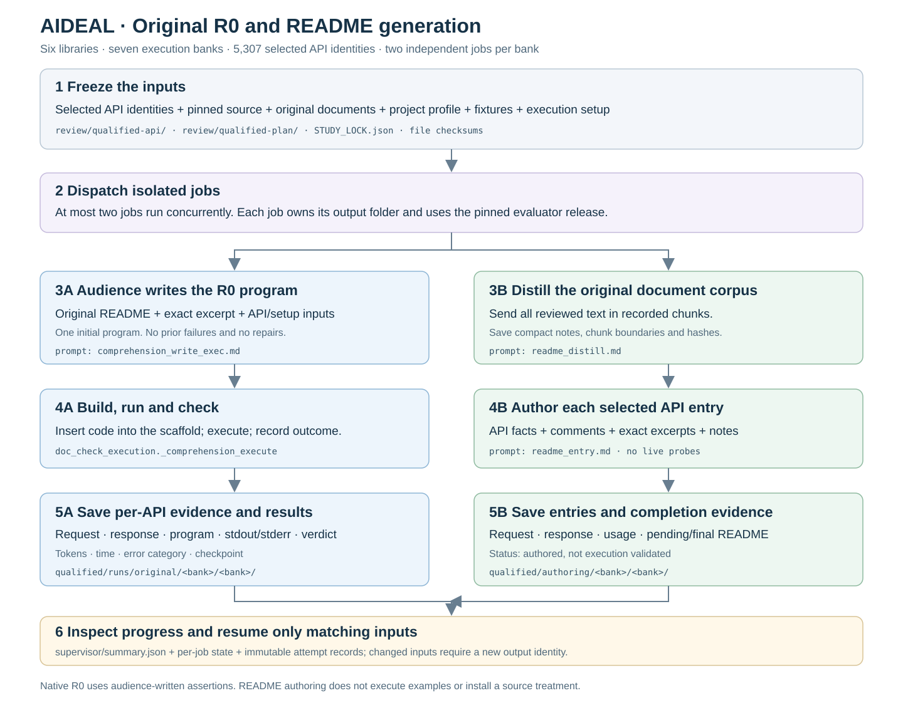

# All-library R0 and README run

**Launch state:** [Current timestamped status](CURRENT_LAUNCH.json)  
**Frozen evaluator:** `2026-11-17-qualified-api-f3c6fd6fe802`  
**Launch and verification receipt:** [Open receipt](operator/launch/PRELAUNCH_CHECKS.json)

This launch evaluates Original documentation once per selected API and writes a generated README entry for every selected API. It uses Gemini 3.1 Flash-Lite with an 8,192-token output allowance per request. **R0 has one trial and zero program repairs.** R1, R2, alias generation, embedded-hint installation, puzzle evaluation and deep-dive README revision are later stages.

The diagram shows the two independent paths and the evidence each produces. A queued job is not a completed result. Inspect the launch receipt and current supervisor state for actual progress.



## 1. Scope and version boundaries

| Library | Execution bank | Selected API targets | Original R0 | README authoring |
|---|---|---:|---|---|
| Beast / RDPro | `rdpro_scala` | 1,394 | One audience program per API | One entry per API |
| Beast / RDPro | `rdpro_java` | 1,393 | One audience program per API | One entry per API |
| MDAnalysis | `mdanalysis` | 1,538 | One audience program per API | One entry per API |
| tslearn | `tslearn` | 362 | One audience program per API | One entry per API |
| mir_eval | `mir_eval` | 178 | One audience program per API | One entry per API |
| Thumbnailator | `thumbnailator` | 225 | One audience program per API | One entry per API |
| SedonaDB | `sedonadb` | 217 SQL operations | One audience test per operation | One entry per operation |
| **Six libraries, seven banks** | | **5,307** | **5,307 API requests** | **5,307 entry requests + corpus distillation** |

The two RDPro banks cover the entire selected Beast source scope, reported by language and module. Their total is 2,787. Distinct defining owners remain distinct; overload reduction applies within one owner/API. Unknown dynamic exposures and unproved wrapper relationships remain explicit review notes.

The initial plan contains 14 jobs, not 14 model requests. Its prepared corpus requires 25 distillation requests across the seven authoring banks, giving **10,639 minimum requests** before provider retries or separate pilots. [Cost assumptions](review/qualified-plan/COST_SCOPE.md) are operator estimates, not measured costs.

Source versions and exact trees are recorded in [STUDY_LOCK.json](STUDY_LOCK.json). The study toolkit and source-library branches have different roles:

| Git location | Purpose | What this launch changes |
|---|---|---|
| AIDEAL study branch | Evaluator, prompts, prepared inputs and reproducibility records | Publish reviewed code and launch/progress evidence |
| Each library's `original` branch | Pinned untreated source | No source modification |
| Each library's `readme-only` branch | Destination for a separately validated README treatment | Authoring output alone does not install it |
| `alias-only`, `error-hints-only`, `combined` | Later treatment destinations | No treatment generated or installed by these two jobs |

The five source branches begin as baseline placeholders. A new README file in an output directory is not evidence that its treatment branch has been updated. Installation requires a separate receipt and commit.

## 2. Folder structure

Review on your Mac in:

```text
/Users/clockorangezoe/Documents/phd_projects/code/geoAI/
├── AIDEAL_workflow/                  editable code; preserve existing user edits
└── AIDEAL_WORKSPACE/03_Experiments/
    └── 2026-11-17-latest-stable-canonical/
        ├── EXPERIMENT_GUIDE.md       scope, design and remaining stages
        ├── RUN_FLOW.md              this input → code → output walkthrough
        ├── CODE_REVIEW_ROUTE.md      detailed function and line-number route
        ├── STUDY_LOCK.json          source/evaluator identities
        ├── SYNC_MANIFEST.json       frozen portable-file checksums
        ├── evaluator-qualified/    frozen evaluator; not a result directory
        ├── review/
        │   ├── qualified-api/<library>/
        │   │   ├── ledger.json                    candidates and dispositions
        │   │   ├── canonical-selection.json       retained exact API identities
        │   │   ├── api_manifest.<language>.json    selected targets
        │   │   ├── api_inventory.<language>.json   source/selection binding
        │   │   └── original-docs/manifest.json     corpus, exact excerpts, hashes
        │   ├── qualified-plan/
        │   │   ├── RUN_CATALOG.cluster.yaml       all seven bank configurations
        │   │   ├── libraries/<bank>/configs/      project and execution settings
        │   │   ├── libraries/<bank>/inputs/       test scaffold
        │   │   └── runtime/rdpro-classpath.json   pinned JVM runtime inputs
        │   ├── qualified-bank/INDEX.html         all selected APIs and inputs
        │   ├── qualified-pilots/INDEX.html       six complete unsent previews
        │   └── qualified-checks/                 test and preparation evidence
        ├── operator/verification/                earlier synchronization receipts
        ├── operator/launch/                      authorized plan, scripts and checks
        ├── LAUNCH_MANIFEST.json                   launch-file checksums
        └── CURRENT_LAUNCH.json                    timestamped live-status snapshot
```

The following cluster layout separates frozen inputs from mutable outputs:

```text
/home/zshan011/apps/aideal/
├── releases/2026-11-17-qualified-api-f3c6fd6fe802/          exact evaluator for this launch
├── venv/                            controller and model-client Python
├── envs/                            scientific Python environments
├── runtimes/                        pinned JDK and other execution tools
└── studies/2026-11-17-latest-stable-canonical/
    ├── sources/<library>/           pinned original source checkouts
    ├── rdpro/inputs/fixtures/        raster, vector and HDF fixtures
    ├── libraries/<library>/fixtures/ additional scientific fixtures
    ├── review_snapshot/             same portable review package as local/GitHub
    └── qualified/                   output namespace for this selected scope
        ├── launch/                  startup checks, provider check, live state
        ├── supervisor/              queue state, commands and process logs
        ├── runs/original/<bank>/<bank>/   Original R0 evidence
        └── authoring/<bank>/<bank>/       README authoring evidence
```

The repeated `<bank>/<bank>` is intentional: the outer directory belongs to one queue job; the inner directory is the launcher's per-library output. Do not remove one level when looking up results. All fourteen input directories have now been prepared. Model responses, generated programs and measured results appear only after a job starts; check the timestamped status for what exists.

## 3. Inputs: what each model receives

| Consumer | Supplied text/data context | Excluded from this stage |
|---|---|---|
| Original R0 audience | Pinned shared README; exact mapped original API excerpts or an explicit no-excerpt note; exact requested API identity/declaration and public access paths; receiver/setup instructions; available input paths and preloaded variables | Generated README, previous failures, new aliases/hints, source implementation bodies and private expected answers |
| Corpus distillation author | Every character of the reviewed original document corpus, split into recorded chunks; project profile in the rendered prompt | Program execution and R0 failure history |
| README entry author | API identity, signature, parameters, return facts, source comments and source locations; public access paths; distilled corpus notes; complete original API excerpts; project profile; required entry template | Entire source repository bodies, live probes and evaluation failures |

**Current qualified authoring does not send source-test examples.** The qualified path disables the older bare-name test/sibling-example index, so its test-example prompt section says that no existing test was found. This avoids attributing a same-named test to the wrong defining API. Source-test grounding would require its own exact-identity mapping before enabling it.

Input files are not uploaded as binary fixtures to the model. The prompt describes their paths and available variables; the cluster program reads the configured files when it runs. Examples include:

| Bank | Configured input data |
|---|---|
| RDPro Scala/Java | `nldas_boston_30m.tif`, a sampled Boston shapefile, `sample.hdf` |
| MDAnalysis | PSF, DCD, PDB, GRO and XTC examples under its fixture directory |
| tslearn | Pinned `Trace.npz` dataset |
| mir_eval | Beat reference/estimate text, chord labels and melody reference text |
| Thumbnailator | PNG/JPEG grid images and an EXIF JPEG |
| SedonaDB | `cea.tif` and `test4.tiff`, plus SQL/Python setup in the scaffold |

Inspect exact paths, scaffold and full rendered input in the [all-API browser](review/qualified-bank/INDEX.html) and [six previews](review/qualified-pilots/INDEX.html). A preview is not a delivered API request; the actual delivered request is saved with each attempt.

## 4. Function calls and prompts, in order

Links below refer to the frozen files. Line numbers were checked against `2026-11-17-qualified-api-f3c6fd6fe802`; refresh them if the evaluator changes.

| Step | Function to start reading | What it does | Prompt used |
|---|---|---|---|
| 1 | [`prepare`](evaluator-qualified/scripts/run_cluster_experiment.py#L35), then [`supervise`](evaluator-qualified/scripts/run_cluster_experiment.py#L70) | Checks distinct output directories; binds the plan; owns one queue lock; runs at most two jobs | None |
| 2A | [`prepare`](evaluator-qualified/scripts/run_original_micro.py#L43) | Copies selected inventory/profile/scaffold; binds source, original documents and runtime; sets zero repairs | None |
| 3A | [`run_library`](evaluator-qualified/scripts/run_original_micro.py#L192) → [`comprehension_check`](evaluator-qualified/vendor/aideal_engine/src/aideal/doc_check_comprehension.py#L15) | Selects Original documentation and dispatches executable microbenchmarks | None until the next function |
| 4A | [`_comprehension_execute`](evaluator-qualified/vendor/aideal_engine/src/aideal/doc_check_execution.py#L129) | Loops over selected APIs; renders one R0 request; saves response; fills scaffold; runs/checks program; appends checkpoint | [`comprehension_write_exec.md`](evaluator-qualified/prompts/comprehension_write_exec.md) |
| 5A | [`invoke_text`](evaluator-qualified/vendor/aideal_engine/src/aideal/llm.py#L208) | Calls the model, collects reported usage, rejects known incomplete/refused/empty output before execution | Receives the exact system/user messages from step 4A |
| 2B | [`prepare`](evaluator-qualified/scripts/run_readme_generation.py#L71) | Binds the explicit authoring scope, source/docs, profile, model and output identity | None |
| 3B | [`run_library`](evaluator-qualified/scripts/run_readme_generation.py#L180) → [`find_or_create`](evaluator-qualified/vendor/aideal_engine/src/aideal/readme_generation.py#L133) | Starts or resumes exact-identity README authoring | Dispatches the next two prompts |
| 4B | [`distilled_readme_context`](evaluator-qualified/vendor/aideal_engine/src/aideal/readme_generation.py#L31) | Sends all corpus chunks; saves combined notes and chunk hashes | [`readme_distill.md`](evaluator-qualified/prompts/readme_distill.md) |
| 5B | [`find_or_create`](evaluator-qualified/vendor/aideal_engine/src/aideal/readme_generation.py#L133), entry loop | Assembles API facts and the template; requests and validates each entry; writes the pending README | [`readme_entry.md`](evaluator-qualified/prompts/readme_entry.md) |
| 6B | [`ReadmeCallRecorder.invoke`](evaluator-qualified/vendor/aideal_engine/src/aideal/readme_recording.py#L55) | Saves each exact author request/response, status, usage, timing and replay identity | Records steps 4B and 5B |
| 7B | [`run_library`](evaluator-qualified/scripts/run_readme_generation.py#L180), completion gate | Requires every selected ID exactly once with complete entries and matching hashes | None; examples are not executed here |

The two meanings of “generation” are separate: **the audience generates a test program in R0; the author generates documentation in README authoring.** The native R0 launcher does not use `workflow/evaluation_runner.py`; that file supports the later matched-condition task workflow.

## 5. Original R0: request → program → result

For each selected API, the native loop is `for attempt in range(1 + max_fix_rounds)`. With `max_fix_rounds = 0`, it executes once at round 0. Provider retries or resumed requests can create more evidence directories, but they are not R1/R2 repairs.

Expected files under `qualified/runs/original/<bank>/<bank>/`:

```text
configs/aideal.yaml                 effective frozen run settings
configs/project_profile.yaml        copied project profile
inputs/api_inventory.json           copied source/selection binding
inputs/api_manifest.json            exact selected API list
inputs/api_test_scaffold.*          copied execution scaffold
launch.json                        source/config/model/input identity
console.log                        API-level progress and failures
execution/
  run_identity.json                native evaluation fingerprint
  comprehension_progress.jsonl     flushed result row after each finished API
  run_<safe-api-key>/
    requested_target.json          exact API identity; folder name is only storage
    ApiTest.* / api_test.py         latest complete scaffold + model snippet
    attempt_0001/
      request.json                 delivered system/user messages, API and round
      response.txt                 exact model text, including retained partial output
      provider.json                status, model-call time and reported token usage
      ApiTest.* / api_test.py       immutable program copy for this attempt
      execution.json               command, working directory, timeout, exit and time
      stdout.txt                   full program standard output
      stderr.txt                   full program standard error
logs/error_log.jsonl                structured outcomes and failure categories
result.json                        final or interrupted run report and per-API metrics
REPORT.md                          human-readable report, when metrics are available
```

A provider failure can leave `request.json` and `provider.json` without an executable program. An incomplete model response is retained as evidence and is not executed. During a long run, the checkpoint and per-attempt files are the live progress source; `result.json` is produced when that invocation returns.

Read one API in this order: `requested_target.json` → `request.json` → `response.txt` → program → `execution.json` → `stdout.txt`/`stderr.txt` → its checkpoint row → `result.json`.

The execution success gate checks process completion, configured success/error markers and the required correctness witness. The prompt asks the audience to assert a falsifiable expected property. **That audience-written assertion is not an independent hidden oracle.** Report native execution success separately from a later independently checked puzzle/task score.

For completed runs, the native result reports both raw pass fraction (`passes / selected targets`) and a score excluding failures classified as infrastructure. Preserve both denominators and the categories. A missing provider-usage receipt is unknown usage; consult `provider.json` rather than interpreting a zero-looking aggregate as proof of zero cost.

## 6. README: corpus → entries → completed document

Expected files under `qualified/authoring/<bank>/<bank>/`:

```text
configs/aideal.yaml                 effective authoring settings
configs/project_profile.yaml        copied project profile
inputs/api_inventory.json           source/selection binding
inputs/api_manifest.json            scope, IDs and selected definition facts
launch.json                        source/config/model/authoring identity
console.log                        entry progress and the reason for any stop
author_calls/<request-hash>/attempt_0001/
  request.json                     exact system/user messages; phase=distill or entry
  response.txt                     model text or retained partial output
  provider.json                    state, request/response hashes, tokens and timing
docs/
  original_readme_notes.md          combined corpus summaries
  original_readme_notes.json        every chunk range and input/output hash
  LLM_readme.md.pending             entries written so far during generation
  LLM_readme.md                     final document after complete generation
.aideal_exec/readme_generation_state.json
                                   fingerprint, completed IDs/count, completion flag
result.json                        authoring result
completion.json                    authored_not_execution_validated + evidence hashes
```

The author first distills the complete reviewed corpus in recorded chunks. It then processes the selected API IDs in sorted order. Every accepted entry must preserve the required structure and exact identity. The recorder can reuse a successful response only when the saved request, response and validation still match. Failed or interrupted calls remain separate evidence.

`LLM_readme.md.pending` is a partial output. `completion.json` is the completion gate, and its status is **`authored_not_execution_validated`**. It does not establish that the generated examples compile or that a README treatment branch has been installed.

## 7. Queue monitoring, interruption and resume

Expected files under `qualified/supervisor/`:

| File | Meaning |
|---|---|
| `queue.lock` | Exclusive queue ownership; do not launch a second supervisor on the same output |
| `plan_binding.json` | Exact queue, command files, release and supervisor identity |
| `summary.json` | Current states for all queued jobs; updated while the supervisor runs |
| `<job>/state.json` | Most recent state of that job |
| `<job>/attempt_0001/command.json` | Actual command and pinned working directory |
| `<job>/attempt_0001/console.log` | Launcher process output; per-API progress is in the bank's own `console.log` |
| `<job>/attempt_0001/result.json` | Process exit, job status and completion-artifact hash |

A completed **job** can contain failed API programs. The supervisor's completion test concerns a finished invocation and its expected artifact, not a 100% scientific score. Conversely, a provider outage is not evidence that the library task is unsolvable.

The current supervisor limits concurrency to two jobs. It records a failed job and can continue to remaining jobs; it does not automatically stop the whole queue after a provider outage. Each bank stops on its own provider error. Before restarting, inspect the failed provider receipt and the reason for the stop.

To check on the cluster without changing any outputs:

```bash
ssh -o ClearAllForwardings=yes lab
STUDY=/home/zshan011/apps/aideal/studies/2026-11-17-latest-stable-canonical
cd "$STUDY/review_snapshot"
python3 verify_snapshot.py
python3 -m json.tool "$STUDY/qualified/supervisor/summary.json"
tail -n 30 "$STUDY/qualified/runs/original/rdpro_scala/rdpro_scala/console.log"
tail -n 30 "$STUDY/qualified/authoring/mdanalysis/mdanalysis/console.log"
```

Before launch, the output files above may not exist. The receipt identifies the actual session and launch command. A detached cluster session survives closing the Mac or disconnecting VS Code. To stop, send the supervisor its normal termination signal; it terminates its child process groups and retains completed evidence. Do not delete partial output to “restart.” Reuse the exact frozen plan for a verified resume; changed source, docs, model, prompts or configuration require a separately identified output.

The portable input snapshot is identical on local storage, cluster and the published study branch. Live outputs are created on the cluster. They appear locally and on GitHub only after an explicit results synchronization; neither Git nor the browser performs that synchronization automatically. A progress snapshot must state when it was collected.

## 8. What changed for this launch

| Update | Purpose | Evidence |
|---|---|---|
| README jobs explicitly use `--scope manifest` | Freeze the reviewed 5,307-target scope | [Authorized queue](operator/launch/QUEUE.json); all seven source-surface and manifest sets agree |
| Actual output inputs prepared for all 14 jobs | Detect path and identity mismatches before model calls | [Preparation results](operator/launch/PRELAUNCH_CHECKS.json) |
| Verified startup wrapper | Check the payload, source versions and queue ownership; test provider access; then release this study's review holds and start the existing supervisor | [start_authorized.py](operator/launch/start_authorized.py) |
| Provider credential boundary checked | Confirm generated child programs do not inherit provider keys | [11 local checks](operator/launch/checks/security/OPERATOR_RESULT.json); [8 operator checks on cluster](operator/launch/checks/OPERATOR_CLUSTER_TESTS.log) |
| Read-only progress command | Count completed APIs and authored entries without a model call | [progress.py](operator/launch/progress.py) |

The frozen evaluator itself remains unchanged from the release that passed 684 tests and 365 subtests on both Mac and cluster. The baseline `STUDY_LOCK.json`, `EXPERIMENT_GUIDE.md` and `SYNC_MANIFEST.json` preserve the earlier review snapshot. Current authorization and launch state live in this launch addendum; they supersede that snapshot's review-hold status for the authorized R0/README stages.

The startup wrapper first makes a short Gemini readiness request, saved under `qualified/launch/provider_checks/`. This is an access check, not a benchmark result. If it fails, no bank starts and the review hold remains. After it passes, the wrapper archives the study's hold files and starts the two-worker queue. Small banks run first to provide earlier complete feedback; the API sets and R0 policy remain unchanged.

## 9. Exact cluster commands

To inspect current progress:

```bash
ssh -o ClearAllForwardings=yes lab
STUDY=/home/zshan011/apps/aideal/studies/2026-11-17-latest-stable-canonical
/home/zshan011/apps/aideal/venv/bin/python "$STUDY/qualified/launch/progress.py"
```

The authorized launch/resume command is below. Use it only when no supervisor already owns this queue. The wrapper starts a detached process; closing SSH or VS Code does not stop it. It reads the user-selected credential file without printing its contents.

```bash
/home/zshan011/apps/aideal/venv/bin/python   "$STUDY/qualified/launch/start_authorized.py"   --key-file /home/zshan011/gemini-apikey-aideal.txt
```

For a normal stop, read `qualified/launch/LAUNCH_PROCESS.json`, confirm that PID still belongs to this launcher with `ps -p PID -o pid,etime,args`, then send `kill -TERM PID`. The supervisor terminates its active child process groups and preserves evidence. Resume with the same command and unchanged inputs; do not delete completed results. A provider outage or invalid generated README entry requires inspection before resuming.

Local and GitHub files are timestamped snapshots of cluster progress. Re-run the read-only progress command for live counts. README generation does not automatically advance the library treatment branches in this launch.
