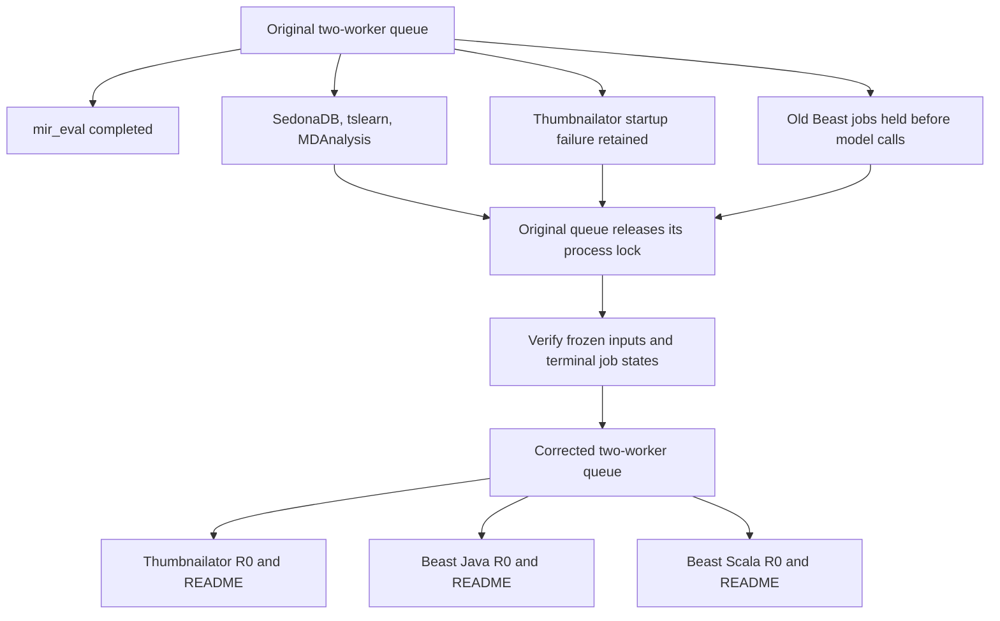

# Current launch and the Java/Scala reader correction

The cluster is running Original microbenchmarks at R0 and authoring README entries for all 5,307 selected targets. The scope is six libraries in seven banks. Each R0 target gets one program and no repairs. README authoring is a separate activity; an authored entry is not a successful evaluation result.

Start with [the end-to-end guide](RUN_FLOW.md), [the numbered workflow figure](review/figures/RUN_FLOW.svg), [the full API/task bank](review/qualified-bank/INDEX.html), and [actual prompts and outputs](operator/launch/live/STATUS.html).

## Completed result

| Library | Original R0 | README authoring | Input tokens | Output tokens |
|---|---|---|---:|---:|
| mir_eval 0.8.2 | 128/178 pass, 71.91%; zero repairs | 178/178 entries, not execution validated | 1,529,138 | 203,674 |
| SedonaDB 0.5.0 | 78/217 pass, 35.94%; zero repairs | Authoring in progress at the saved check | 1,230,325 | 56,067 |

mir_eval tokens include both stages, totaling 358 model calls. SedonaDB tokens in this table cover its completed R0 stage only; [its result and metric caveats](operator/launch/completed/sedonadb/README.md) remain separate from the [diagnostic audit](operator/launch/audits/sedonadb/README.md). The two stages overlapped for about 13 minutes; their wall times must not be added. [Complete evidence and per-stage counts](operator/launch/completed/mir_eval/README.md).

## What failed and what changed

The first Thumbnailator jobs stopped because Java/Scala source inventory records can omit `description`, an optional source-comment field. The reader forwarded those records to code that expected a string. R0 stopped before generating its first program; README authoring had already made two corpus-distillation calls. Those failed attempt logs and spent tokens remain in the original output folder.

The corrected reader supplies an empty string for an absent/null comment after verifying the frozen source and selected identity. It preserves existing comments and rejects nontext metadata. It does not invent documentation, edit the source library, change API selection, or change the task/prompt policy. See `vendor/aideal_engine/src/aideal/api_public_inventory.py`, `qualified_inventory_details`, around line 572. The regression tests reproduce the old failure for Java and Scala and pass with the correction.

The old frozen evaluator remains available. The corrected evaluator is `2026-11-17-source-comments-e4a18b3fabce`. Its release receipt lists exactly two changed files: one production reader and its tests. All original library commits, API inventories and documentation files remain pinned.

## How the corrected jobs start



The corrected queue waits for the original queue to finish. Holding the original queue lock also proves its child workers have exited. It then runs only the three affected banks, under a separate output root. At most two model jobs run concurrently. Duplicate launchers cannot overwrite the active process receipts. An unexpected completed replacement job, changed input, or incomplete original queue blocks the corrected queue for inspection.

The old Beast output directories use `REVIEW_HOLD.json` as an operational stop for the known reader defect. These are not a new permission request. The corrected outputs are outside those held directories. This keeps the failed startup evidence, avoids repeated model spending on a known failure, and preserves completed Python results.

## Folder map

On the cluster, all paths below begin with `/home/zshan011/apps/aideal/studies/2026-11-17-latest-stable-canonical/`.

```text
review_snapshot/                 Frozen source inventories, configs and task review
qualified/
  launch/                        Original plan, authorization, process state
  runs/original/<bank>/<bank>/    Original R0 programs, prompts, execution, results
  authoring/<bank>/<bank>/        Author requests, responses, state and README
  supervisor/                    Original queue attempts and logs
qualified-description-recovery/
  launch/                        Corrected release binding, checks, waiting/running state
  runs/original/<bank>/<bank>/    Corrected-bank R0 results
  authoring/<bank>/<bank>/        Corrected-bank authoring results
  supervisor/                    Corrected queue attempts and logs
```

Inside an R0 bank, inspect `inputs/api_manifest.json`, `configs/aideal.yaml`, `launch.json`, `console.log`, `execution/comprehension_progress.jsonl`, and the final `result.json` / `REPORT.md`. The execution folder retains each program, prompt, response, standard output/error, time and tokens. Inside an authoring bank, inspect `author_calls/`, `.aideal_exec/readme_generation_state.json`, `docs/LLM_readme.md`, and `completion.json`.

The local study and GitHub contain the frozen inputs, code versions, current progress snapshots, completed summaries and selected full traces. The cluster owns the actively growing raw logs. A local snapshot is timestamped; it is not a continuously synchronized live filesystem.

## Check progress without another model call

```bash
ssh -o ClearAllForwardings=yes lab
/home/zshan011/apps/aideal/venv/bin/python \
  /home/zshan011/apps/aideal/studies/2026-11-17-latest-stable-canonical/qualified-description-recovery/launch/progress_all.py
```

Add `--json` for the complete machine-readable status. No terminal connection is needed to keep either queue alive. Do not start the same run again while its queue owns the output folders.

## How to interpret outcomes

R0 retains genuine program failures without repair. A source-reader startup failure is not an API failure and contributes no score. Provider failures are also separate. Native micro scores measure execution plus audience-written assertions and API-use witnesses; they are not independent hidden-oracle accuracy. Some SedonaDB planning failures currently receive the generic `unknown` error category; diagnosing those belongs in a separate evidence-bound audit. A generated README must undergo its own matched evaluation before claiming an improvement.
