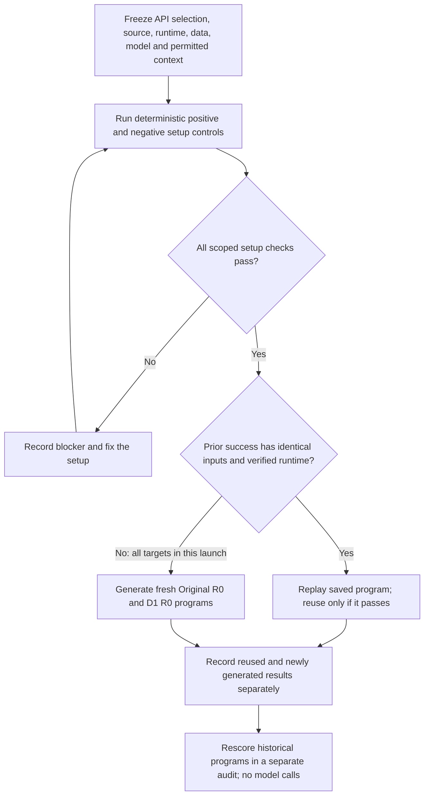

# Corrected Original / D1 evaluation

This review preserves the measured runs and prepares a new, explicitly recorded execution contract. The final selected bank has **2,823 targets** across six libraries, including separate RDPro Java and Scala banks. The historical bank had 2,850 targets. Source-audited selection revisions exclude 19 MDAnalysis wrapper/mock targets and eight tslearn import hooks/forwarders. Both conditions use the same final 1,519 MDAnalysis and 354 tslearn targets. Historical results remain unchanged. [MDAnalysis exclusions](fixture-development-v1/mdanalysis/selection-correction-final/exclusion_audit.json) and [tslearn exclusions](review/final-scope/tslearn/audit.json) record the final decisions.

[Browse every selected API](review/final-scope/SELECTED_API_BANK.tsv). This list identifies native usage targets; the audience writes the usage programs and self-checks. It is not a fixed task bank with independent expected outputs.

## Current request

- **Original R0** supplies the original documentation.
- **Generated README D1 at R0** supplies the first generated README. D1 is a document version, not repair round R1.
- Reuse a passing program only after corrected execution and verified matching inputs/runtime. For this launch none qualifies: five profiles change, RDPro Scala loses failure-specific hints, and full historical JDK identity is unavailable. Therefore all 2,823 targets receive fresh programs in both conditions (5,646 target requests before any provider retries). Saved-code rescoring follows separately and makes no model calls.
- Report reused successes and newly generated results separately. A mixed continuation is not a fresh single-trial R0 comparison.
- D2 README revision and R1/R2 program repairs are deferred from this launch.

## Runtime checks

| Bank | Targets | Correct example | Deliberate wrong assertion | Evidence |
|---|---:|---|---|---|
| RDPro Java | 69 | pass | fail (expected) | [Trace](preflight/libraries/rdpro_java/) |
| RDPro Scala | 261 | pass | fail (expected) | [Trace](preflight/libraries/rdpro_scala/) |
| MDAnalysis | 1519 | pass | fail (expected) | [Trace](preflight/libraries/mdanalysis/) |
| tslearn | 354 | pass | fail (expected) | [Trace](preflight/libraries/tslearn/) |
| mir_eval | 178 | pass | fail (expected) | [Trace](preflight/libraries/mir_eval/) |
| Thumbnailator | 225 | pass | fail (expected) | [Trace](preflight/libraries/thumbnailator/) |
| SedonaDB | 217 | pass | fail (expected) | [Trace](preflight/libraries/sedonadb/) |

A negative control must fail because its assertion is deliberately wrong. A missing package or file does not satisfy that check. These controls validate execution paths; they do not prove that all APIs or LLM programs are correct.

## What changed

| Problem | Corrected behavior |
|---|---|
| Java assertions were disabled | Child Java and local Spark JVMs receive `-ea`; conflicting disable flags are rejected. |
| Tests shared output paths | Every physical attempt has a separate working directory, classes, temporary files and output directory. Input files retain their identities. |
| Python nested test scope conflicted with scaffold variables | The test receives explicit bindings for provided variables; the generated statements are retained. |
| A generic check marker could count as success | A pass requires exit 0, the success marker and a nonempty stdout witness for the exact requested API. |
| Missing imports automatically counted as infrastructure | They now require investigation; an invented import is not proof of an environment problem. |
| Runtime packages could change without being recorded | Corrected runtime profiles bind executable paths, dependency files and setup evidence. |
| Old and new records could be mixed | New namespaces and hashes prevent altered inputs or incomplete attempts from being reused silently. |

The native witness is still a program-generated self-check, **not an independent expected-output oracle**.

## Readiness workflow



## Prompts and data

The audience receives the selected API declaration and public access information, the condition's documentation, execution instructions and permitted input data. The declaration/access facts come from the source inventory and are shared by both conditions. The audience does not receive author diagnosis windows. Authoring may use source evidence to construct D1.

Five library profiles contained stale count or documentation wording. The shared Scala context also contained failure remedies, which the new context removes. New neutral snapshots remove fixed API counts and refer to the supplied documentation. These changed profiles invalidate unchanged-input reuse. Historical requests remain intact. See the [full request audit and paired examples](review/prompt-audit/INDEX.html), [all historical API artifact paths](review/prompt-audit/ALL_API_INDEX.tsv), and [evaluation-design review](review/EVALUATION_DESIGN_REVIEW.md).

MDAnalysis now has a verified isolated runtime, 18 explicit input roles, a 523-file upstream data catalog, a controlled local IMD stream and a real source-built 3DNA executable. All 160 audited defining modules import. Format, conversion, stream-lifecycle and tool checks pass. These checks establish audited setup capability, not semantic correctness of every retained API. Native library defects remain separate from missing setup. A source or behavior bug in the upstream library is not an environment fault and should not be hidden by setup changes.

## Output layout

```text
evaluator-correction-2026-11-18/
  preflight/                 actual passing/failing control programs and logs
  runtime-mdanalysis-final-2026-11-18/  final profile and unchanged environment bindings
  fixture-development-v1/    proposed data, stream checks and input bindings
  review/                    complete prompt/input/output examples and all-target index
    corrected-profiles/      new shared profile snapshots; historical profiles retained
  current/                   preserved UNLAUNCHED preparation evidence
  fresh-original-d1/         stopped initial run; retained protocol-development evidence
  explicit-inputs-r0/         active corrected comparison namespace
    operator/                final selected-bank plans and readiness checks
    continuation/            fresh Original/D1 R0 requests and results
    rescore/                 separate zero-model saved-program replay
```

The old `current/` namespace contains unlaunched preparation evidence. The active output is `explicit-inputs-r0/`. The final MDAnalysis runtime profile changes selection metadata only; all 3,767 recorded runtime files remain unchanged.

The actual launch paths are recorded in the operator plan; directories listed above may remain pending until their stage is released. Do not infer completion from the existence of a folder.

## Reviewing one API

1. Read its manifest entry and source/document links.
2. Read the complete saved `request.json` system/user text.
3. Read the returned program and the complete scaffold that was executed.
4. Open `execution.json` for command, working directory, timeout and exit code.
5. Read full `stdout.txt` and `stderr.txt`, not only their summary tails.
6. Inspect `result.json` and its evidence hashes. Determine whether it is a control, replay, reused success or newly generated attempt.
7. Check the bank-level report for selected/completed counts and separate old/new token usage.

Code entry points are `scripts/run_evaluator_correction.py` for stage control, `scripts/rescore_native_programs.py` for saved-code execution, and `scripts/run_verified_readme_continuation.py` for the requested Original/D1 continuation. Shared native execution rules live in `vendor/aideal_engine/src/aideal/native_execution_contract.py`; runtime verification lives in `workflow/runtime_profile.py`.

## Caches and history

Historical prompts, responses, source versions and measured results are evidence, not disposable caches. New executions never share their writable output directories. Five disposable Python/pytest cache directories (961,377 bytes) were removed. No measured files or installed dependencies were deleted.

## Final release and launch gate

The final cluster release is `2026-11-18-corrected-r0-d8ba3815cf95`; all 146 packaged files have verified hashes. [GitHub commit `56a42d9`](https://github.com/ZhuochengShang/AIDEAL/commit/56a42d91d8548ce7e4bf71b17b19fc5155f132f7) on `study/2026-11-17-latest-stable-canonical` contains identical code files. The local full offline suite passed 818 tests and 436 subtests. Final focused checks passed 124 tests and 92 subtests after the latest changes.

The final seven-bank preparation passed for 2,823 selected APIs. Fourteen sampled Original/D1 prompts matched outside documentation, and prepared files remained unchanged. The final gate passed with 14 current runtime control receipts plus six supporting native MDAnalysis controls and a verified environment-equivalence record. See [READINESS.json](explicit-inputs-r0/operator/READINESS.json) and the [configuration/prompt report](explicit-inputs-r0/preflight/ACTUAL_BANK_CONFIGURATION_AND_PROMPTS.json). The first launch was stopped after a live audit found unclear input roles. Its 212 returned responses and 211 executions remain in `fresh-original-d1/`; they will not be pooled with the replacement run. [RUN_AMENDMENT.json](RUN_AMENDMENT.json) preserves recorded usage and the one provider request whose final usage is unavailable. The replacement `explicit-inputs-r0/` makes buffer/file roles, file schemas and deterministic input-construction permission explicit. [Input-equivalence evidence](explicit-inputs-r0/preflight/INPUT_CONTRACT_EQUIVALENCE.json) verifies unchanged source, runtime, data, scaffolds, profiles, documentation, model and selected API set. Both conditions receive the same revised context. Its final seven-bank readiness gate passed. After publication of the [reviewed protocol](https://github.com/ZhuochengShang/AIDEAL/commit/726bd29f0f583d4967c7152adc3049e7814272c0), the replacement started on November 18 at 16:07 Pacific (November 19, 00:07 UTC). The 00:10 UTC snapshot records 41 mir_eval and 39 Thumbnailator responses, all 80 executed, with no provider errors; five other banks remain queued. These are progress counts, not completed condition scores. See [START.json](explicit-inputs-r0/operator/START.json), [STATE.json](explicit-inputs-r0/operator/STATE.json), and the timestamped [LIVE_STATUS.json](explicit-inputs-r0/operator/LIVE_STATUS.json).

```bash
# Cluster. This prepares inputs and plans; it makes no model calls.
ssh lab
cd /home/zshan011/apps/aideal/studies/2026-11-17-latest-stable-canonical
/home/zshan011/apps/aideal/venv/bin/python \
  /home/zshan011/apps/aideal/releases/2026-11-18-corrected-r0-d8ba3815cf95/scripts/run_evaluator_correction.py \
  --study "$PWD" \
  --output "$PWD/evaluator-correction-2026-11-18/explicit-inputs-r0" \
  --runtime-profiles "$PWD/evaluator-correction-2026-11-18/explicit-inputs-r0/operator/RUNTIME_PROFILES.json" \
  --input-overrides "$PWD/evaluator-correction-2026-11-18/explicit-inputs-r0/operator/INPUT_OVERRIDES.json" \
  --phases continuation rescore
```

The launch uses this same command with `--run` and the existing permitted credential-file path. The trusted supervisor handles the credential; it is never copied into configuration or Git. Check `explicit-inputs-r0/operator/STATE.json` and `explicit-inputs-r0/continuation/supervisor/summary.json` before any restart. Do not start duplicate queues.

For a local, no-key walkthrough:

```bash
cd /Users/clockorangezoe/Documents/phd_projects/code/geoAI/AIDEAL_workflow
/Users/clockorangezoe/miniconda3/envs/geo_llm_spark/bin/python \
  scripts/trace_original_micro.py --pause
```

This walkthrough uses scripted model responses and real local execution. Full library execution uses the pinned Linux cluster runtime; reviewing identical files locally does not make Mac and Linux dependencies interchangeable.

## Post-launch check

A read-only review of ten recent failures at 00:11 UTC found candidate-code errors and no new setup blocker in that sample. Examples include an invalid plotting attribute, missing required constructor arguments, and a nonexistent Java method. The review does not certify every remaining API. [Review and evidence](review/run-checks/LATEST_REVIEW.json). The frozen run continues unchanged.
