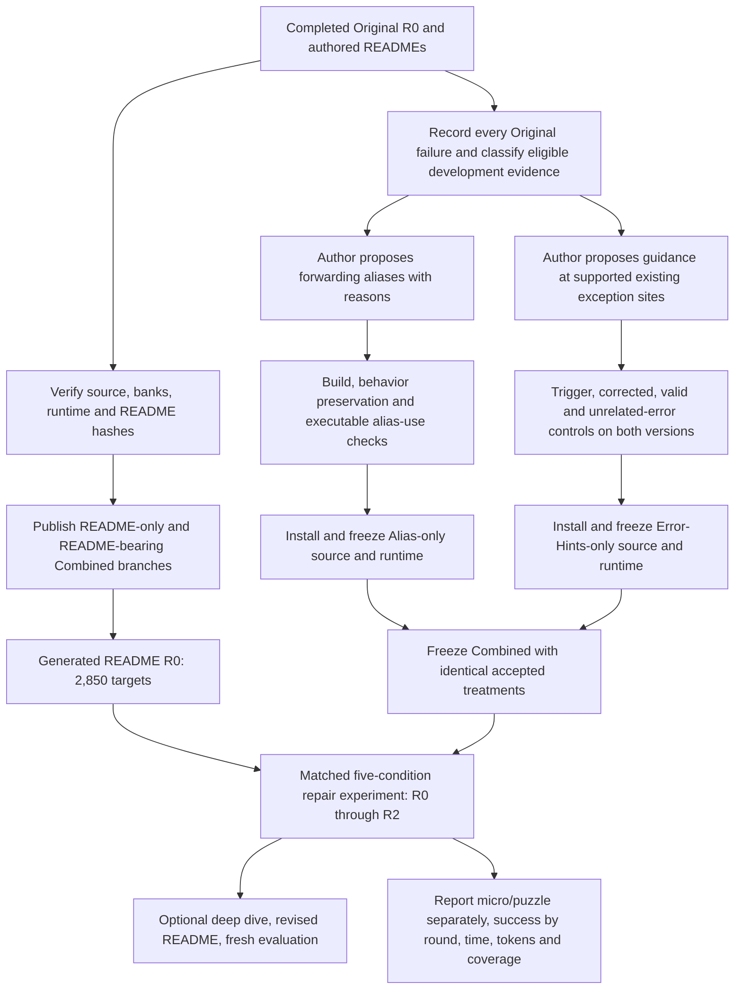

# Six-library ablation continuation

Authorization: the developer requested “Generated-README evaluation and the remaining ablation conditions … plan it and run it” on November 18, 2026. This continuation preserves the completed Original R0 results and all authoring records.

## Immediate matched comparison

| Library | Frozen microbenchmark targets | Original R0 pass | Generated README entries |
| --- | ---: | ---: | ---: |
| RDPro, Raptor/raster scope | 330 (69 Java, 261 Scala) | 37 | 330 |
| MDAnalysis | 1,538 | 612 | 1,538 |
| tslearn | 362 | 219 | 362 |
| mir_eval | 178 | 128 | 178 |
| Thumbnailator | 225 | 104 | 225 |
| SedonaDB | 217 SQL APIs | 78 | 217 |
| Total | 2,850 | 1,178 | 2,850 |

Run Generated README R0 first with the same per-library pinned evaluator, source, target manifest, fixtures, interpreter, execution command, model (`gemini-3.1-flash-lite`), output allowance, and provider settings as Original R0. Use one trial per target and zero program repairs. Copy the completed README bytes into each new output and verify their author-completion checksums. The engine selects the generated API entry instead of the original-document excerpt. This changes the documentation selection strategy as well as its contents; the report must state both.

The completed runs measure native API microbenchmark execution under the existing checks. They are not a newly created independently adjudicated puzzle bank. Keep microbenchmark and puzzle results separate.

## Full design and execution gates

| Condition | Documentation in initial request | Callable implementation | R0 | R1/R2 | Deep dive |
| --- | --- | --- | --- | --- | --- |
| Original | Pinned original documentation | Original | Complete | Planned as a separately frozen repair experiment | No |
| README only | Completed generated README | Original | Next executable stage | Planned, up to two repairs | After R2, revise affected entries; fresh evaluation |
| Alias only | Original + alias interface descriptions | Original + validated forwarding aliases | After alias validation | Up to two repairs | No |
| Error Hints only | Original | Original + validated exception-message edits | After native-hint validation | Up to two repairs using emitted diagnostics | No |
| Combined | Generated README + alias descriptions | Same validated aliases and native hints | After both validations | Up to two repairs | After R2, revised README; fresh evaluation |

R0 is the first generated program. R1 and R2 repair a failed program; successful tasks stop early. A provider retry is not a program repair. Deep dive changes the README and starts a fresh evaluation; it is not R3. Native hints enter the audience's context only when the library emits them in an execution diagnostic. Therefore a native-hints benefit is expected during repair, not in initial program generation. Changing an exception message can also affect programs that inspect exact messages and needs the paired controls below.



## Treatment acceptance

- Aliases must forward to a selected native API. A name or schema check is not behavior validation. Keep every proposal, rationale, rejection, build, execution and target-reach check.
- Embedded hints must change an existing exception message in the source. Separate JSON records may preserve evidence, but cannot substitute for the source treatment. Validate the triggering program, its correction, another valid program, and an unrelated error against both original and candidate versions.
- Keep unsupported cases explicit. Compiler errors, missing dependencies, unsupported exception syntax, and SQL registration gaps do not become fabricated source hints.
- Publish accepted source commits, rebuild or install the condition-specific library, and verify the loaded implementation before evaluation. A branch with README bytes alone is not a completed Combined treatment.
- Do not silently relabel the existing Original evaluation as held-out evidence. If its failures inform improvements, subsequent use of the same target bank is a within-bank development comparison. An independent generalization claim requires a separately frozen held-out task bank.

## Preserved limitations

The existing environment includes known optional-dependency and compatibility failures, unavailable conditional MDAnalysis targets, and SedonaDB helper/signature issues. Keep this environment and bank fixed for the immediate documentation comparison and report those strata explicitly. Correcting them requires a new versioned, matched Original/Generated comparison, not overwriting the existing baseline. The RDPro bank has a reviewed strict exclusion receipt; the other banks do not yet have equivalent wrapper review. Do not claim uniform strict filtering.

## Version and output organization

Shared evaluator, operator scripts and evidence: `ZhuochengShang/AIDEAL`, branch `study/2026-11-17-latest-stable-canonical`.

Each library repository uses `study/2026-11-17-latest-stable-canonical/{original,readme-only,alias-only,error-hints-only,combined}`. Branch names express intended conditions; receipts and commits establish what is actually installed. Never switch or patch the Original checkout to run another condition.

The continuation's operator records belong under `operator/ablation/2026-11-18/`. Runtime outputs use a new namespace and retain exact requests, returned program text, provider metadata, execution stdout/stderr, result JSON, reports and completion bindings. A live progress report must distinguish queued, running, completed, failed and awaiting validation.

## Commands and review route

Run this matched comparison on the lab cluster. Its original interpreter, installed packages, source and fixture paths are part of the frozen protocol. A local execution needs a separately prepared local protocol; copying a cluster result into a Mac run is not a valid resume.

```bash
ssh lab
cd /home/zshan011/apps/aideal/studies/2026-11-17-latest-stable-canonical
/home/zshan011/apps/aideal/venv/bin/python operator/ablation/2026-11-18/progress.py
```

The detached launch uses `operator/ablation/2026-11-18/start_generated.py`. It owns an exclusive launch lock and the existing supervisor owns the queue lock. If interrupted, invoking that launcher resumes the same prepared condition. Do not start a second copy while it is running.

Review in this order:

1. `operator/ablation/2026-11-18/QUEUE.json` and `specs/<bank>.json`: commands, pinned evaluator, baseline and authored-input locations.
2. `operator/ablation/2026-11-18/branches/BRANCHES.json`: the public README commits and exact hashes; Combined is still incomplete until other treatments pass validation.
3. `ablation-2026-11-18/generated-readme-r0/<bank>/GENERATED_LAUNCH.json`: matched-input checks and new documentation binding.
4. That bank's `docs/LLM_readme.md` and `configs/generated_readme.yaml`: actual documentation and settings used.
5. `execution/run_<API-storage-key>/attempt_0001/`: exact prompt, provider response, generated program, execution output and errors. Later physical attempt directories can represent provider retries; the logical program repair limit remains zero.
6. `execution/comprehension_progress.jsonl`, `result.json`, `REPORT.md`, and `completion.json`: per-target evidence, aggregate results, and completion verification.

`configs/aideal.yaml` and `launch.json` in the new folder are preparation receipts copied through the Original preparation code. The active condition is identified by `configs/generated_readme.yaml`, `GENERATED_LAUNCH.json` and the recorded `doc_source=aideal` request/run identity.

## Report quantities

For each library and condition report completed/selected targets, R0 pass rate, cumulative pass rate after R1 and R2, newly repaired failures per round, unresolved failures by category, input/output tokens, model calls, provider retries, model time and build/run/check time. Preserve the full denominator and report provider failures separately. Never pool missing conditions as zero scores.
