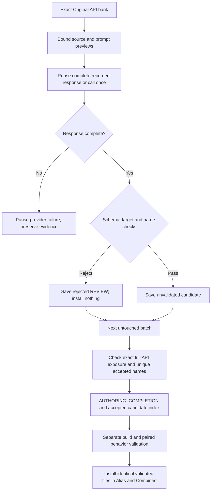

# Review every selected alias batch

This is the current authoring entry point. It uses the existing frozen authoring release and a study-local review controller. A complete model response can produce a valid candidate, no candidate, or a rejected candidate. All three count as reviewed API exposure. A rejected candidate is retained as evidence and excluded from the accepted candidate index; it does not stop later batches. Provider failures or incomplete responses still pause the bank. No validation criterion is relaxed.

## Scope and reuse

| Bank | Full API targets | Prior reviewed prefix | Remaining APIs | New batches |
|---|---:|---:|---:|---:|
| RDPro Java | 69 | 69 | 0 | 0 |
| RDPro Scala | 261 | 8 | 253 | 32 |
| mir_eval | 178 | 130 | 48 | 7 |
| Thumbnailator | 225 | 194 | 31 | 4 |
| tslearn | 362 | 63 | 299 | 44 |
| MDAnalysis | 1,538 | 79 | 1,459 | 210 |
| SedonaDB | 217 | No source-bound SQL alias adapter | Not launched | — |

The prior prefixes include complete rejected responses. Their exact prompts, raw responses and source bindings remain unchanged. Offline revalidation makes zero new model calls. The new queue exposes only the 2,090 previously unexposed API targets in 297 batches. It runs one author worker, prioritizing MIR, Scala, Thumbnailator, tslearn, and MDAnalysis.

## What completion means

`AUTHORING_COMPLETION.json` uses `alias_authoring_complete` when every reviewed candidate passed schema checks, or `reviewed_with_rejections` when some complete candidates were rejected. Both statuses require exact disjoint full-bank API exposure. They do not mean runtime validation, source installation, or successful audience evaluation.

`ACCEPTED_CANDIDATES.json` is the sole candidate list for subsequent validation. It excludes every rejected response and records that runtime validation is pending. Each accepted proposal binds its exact source and interface files. Each batch `REVIEW.json` binds the raw request/response, source preview, validator, decision and earlier accepted names. A resumed rejected batch makes no repeated model call. `BANK_UNION.json` separates reviewed APIs, APIs in accepted batches, alias count and rejected batches.

All aliases remain uninstalled by this authoring queue. Alias-only and Combined evaluation remain gated on separately tested source installation and treatment freezing. Existing generated README branches and measured evaluation results remain unchanged.
