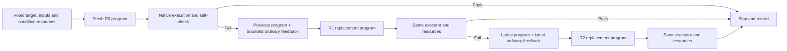

# Matched native repair pilot

This is a new, study-local evaluation protocol. It does not change or import the
completed Original R0 or Generated R0 measurements. Each API gets a fresh R0 and
at most two repairs. The same frozen bank, model, prompt, fixtures, and repair
policy apply to every condition. Only the documented treatment changes.

| Condition | Documentation | Installed aliases | Native exception hints |
|---|---|---|---|
| Original | Original | No | No |
| Generated README | Authored README | No | No |
| Aliases | Original + validated interface descriptions | Yes | No |
| Error Hints | Original | No | Yes |
| Combined | Authored README + validated interface descriptions | Yes | Yes |

A condition cannot be called Combined until both source treatments are installed
and their runtime receipt is verified. The first real pilot should use the exact
`python:mir_eval.transcription.validate` target for Original and Error Hints.
Its development evidence was used to build the hint, so report this pilot as a
same-bank mechanism check, not as held-out generalization.



## What is new

`matched_repairs.py` controls the three logical rounds. Each round invokes the
pinned native comprehension executor with its internal repair count set to zero.
That executor still owns the full prompt, provider response, scaffold, execution,
and self-check artifacts. `ROUND.json` records the outer round explicitly;
`request.json` retains the native internal `round: 0` rather than being rewritten.

`repair_context.py` supplies the complete preceding snippet and bounded public
execution feedback. It preserves the exact classified error and complete native
hint lines, then adds stream tails within 8,000 characters. The full original
streams remain saved. Programs above 60,000 characters and essential diagnostics
above 8,000 fail closed for review instead of being silently cut. This pilot
accepts only verified single-line exception hints. It does not retrieve source
hints, a private checker, expected outputs, generic fix-guide text, previous tasks,
or persistent development memory. The native engine can still record its own
classification log; that log is never the source of the retry prompt.

Each stable logical round has a bound result and evidence receipt. A provider
outage in R1 resumes R1 without regenerating R0. Explicit truncated, refused, or
empty provider output is recorded as `generation_invalid` and is never executed.
Infrastructure failures stop that API and remain separately counted. Scoring
reports cumulative successful targets at R0/R1/R2 over the same selected bank.
This is native execution and configured self-check success, not an independent
puzzle-oracle accuracy claim. Per-attempt provider tokens and execution time
remain in the native evidence; do not sum native replay session totals twice.

## Spec and commands

Use the completed Original prepared configuration for `prepared_config` in every
condition. The catalog source stays baseline-bound. `runtime.command` selects
the actual installed condition version; `runtime.files` binds the verified
runtime source/adapters, and `runtime.receipt` binds import/build evidence.
Generated conditions additionally bind the exact `generated_readme` file.
Alias conditions bind `alias_interfaces`, a JSON object mapping API IDs to
reviewed public alias descriptions; no implementation body or private checks.

Required spec fields are `schema: 1`, `condition`, `api_ids`, `output`,
`prepared_config`, `engine_helper`, `release`, `release_binding`,
`release_binding_sha256`, and `runtime`. File bindings have `path` and `sha256`.
The helper is the previously verified `generated_readme_r0.py`; its release
loader verifies the pinned evaluator before any import. Runtime fields are
`command`, `status: verified`, `files`, `receipt`, `aliases_installed`, and
`native_hints_installed`. Hint conditions also provide
`native_hint_format: single-line-exception` and `native_hint_messages` containing
the exact reviewed exception strings. These strings validate the treatment;
they are not added to a prompt unless actually emitted by execution.

```bash
# Offline protocol checks, without provider calls.
python -m unittest discover -s /path/to/repair-protocol -p 'test_*.py' -v

# Real input/runtime/documentation preflight, without provider calls.
python /path/to/repair-protocol/matched_repairs.py --spec /path/to/spec.json --prepare

# Real native execution with three scripted answers, no provider calls.
# This requires its own fresh output and spec with mode: offline_mock.
python /path/to/repair-protocol/mock_native_trace.py --spec /path/to/mock-spec.json

# Live launch, only through the existing reviewed supervisor environment.
python /path/to/repair-protocol/matched_repairs.py --spec /path/to/live-spec.json --run
```

Use the same pinned evaluator interpreter and 300-second, two-retry,
one-second-interval transport contract as the matched baseline. The supervisor
loads the permitted credential path; these scripts do not read a credential file.
No paid calls have been performed by the staged tests.

## Review artifacts

```text
<new condition output>/
  LAUNCH.json                  # Frozen inputs, policy, runtime and source identity
  result.json                  # All targets and cumulative R0/R1/R2 passes
  completion.json              # Written only after the bank finishes
  apis/<target hash>/round_00/  # Analogous round_01 and round_02 when needed
    ROUND.json                 # Exact logical round and permitted retry context
    api_manifest.json          # One canonical target identity
    result.json                # Native executor result
    STABLE.json                # Hash-bound terminal evidence; never rerun
    console.log
    error_log.jsonl             # Recorded classification, not exposed as memory
    execution/run_<api>/attempt_0001/
      request.json             # Complete delivered system/user prompts
      response.txt             # Complete provider text
      provider.json            # Provider outcome, tokens, elapsed time
      api_test.py              # Executed scaffold plus generated snippet
      execution.json           # Command, exit status, time
      stdout.txt
      stderr.txt
```

The baseline root and its measured artifacts remain read-only. Existing native
engine functions and model adapter are reused; no extra evaluator framework or
provider client is introduced.
