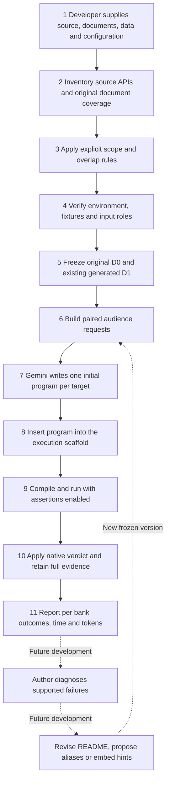
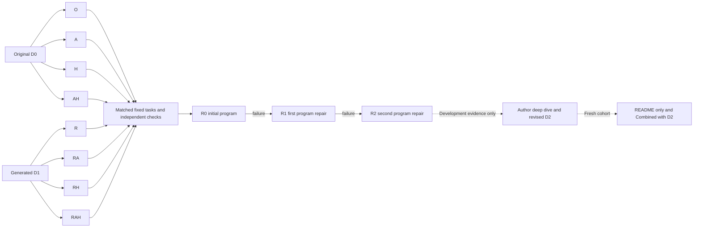

# AIDEAL professor meeting report

## 1. Main finding and current status

AIDEAL aims to turn failures in agent use into improvements that a library can distribute with its documentation and code. The current experiment evaluates the first part of this process. It compares the original documentation with an existing generated README across six libraries and seven execution banks. RDPro has separate Java and Scala banks.

The results do not show a uniform benefit from README generation. The current D1 improves native acceptance for mir_eval, SedonaDB and tslearn, while RDPro and Thumbnailator decline. Concrete RDPro traces identify incorrect generated documentation, but they do not explain every failure. A shared path representation omission also affects four Scala attempts. These findings motivate validation and selective revision before broader treatment claims.

This report captures **18 November 2026 at 23:44:56 Pacific**, corresponding to **19 November at 07:44:56 UTC**. Thirteen of fourteen condition runs have completed. MDAnalysis D1 has resumed after a provider interruption and has executed 316 of 1,519 targets at this snapshot. Its final result remains pending. The snapshot does not update automatically.

| Bank | Selected APIs | Original R0 | Generated D1 R0 | Change in percentage points |
|---|---:|---:|---:|---:|
| RDPro Java | 69 | 12/69 (17.4%) | 4/69 (5.8%) | -11.6 |
| RDPro Scala | 261 | 20/261 (7.7%) | 14/261 (5.4%) | -2.3 |
| SedonaDB | 217 | 87/217 (40.1%) | 96/217 (44.2%) | +4.1 |
| MDAnalysis | 1,519 | 592/1519 (39.0%) | Pending | Pending |
| tslearn | 354 | 211/354 (59.6%) | 221/354 (62.4%) | +2.8 |
| mir_eval | 178 | 134/178 (75.3%) | 144/178 (80.9%) | +5.6 |
| Thumbnailator | 225 | 109/225 (48.4%) | 97/225 (43.1%) | -5.3 |

Each percentage divides accepted programs by all selected APIs in that bank. **These are native execution and generated self check results, not accuracy against independent task oracles.** Scala treatment interpretation remains provisional. The report preserves its recorded scores rather than deleting affected cases or predicting their corrected outcomes.

Across the six completed paired banks, D1 gains 118 accepted cases and loses 115 among 1,304 targets. The net gain of three conceals different behavior across libraries. These transitions compare two independently generated initial programs. They do not measure repair success. MDAnalysis does not enter this paired summary because its D1 run remains incomplete.

## 2. Motivation and research question

An agent can fail to use a data processing library even when the library implements the required operation correctly. Documentation may omit a receiver construction path, a name may obscure an operation, or an exception may identify an invalid value without explaining its requirement. Repairing one generated program leaves these obstacles in place for the next user.

AIDEAL evaluates agent use, records the failure evidence and develops reusable library resources. Its improvement components generate and revise README entries, add executable aliases that delegate to existing operations, and append corrective guidance to existing exception messages. Shared development memory preserves recurring errors and verified or unverified corrections so that later development can reuse the evidence.

The main research question asks which resource changes improve correct task completion and recovery, and at what cost, under matched tasks, agent settings and environments. The present native probe measures a narrower prerequisite. It checks whether the model can construct and execute a usage example with its own assertions under each documentation condition.

## 3. Workflow from repository to result



| Step | Actual input and action | Output that supports review |
|---|---|---|
| Inventory | Read source declarations and defining owners, then map the original document corpus to retained IDs | Selected API list, exclusion decisions and document coverage manifest |
| Environment | Check imports, dependencies, fixtures and positive and negative controls with ordinary programs | Setup report, runtime bindings and control execution records |
| Preparation | Bind source, documents, selected targets, scaffold, model and execution settings | Prepared configuration and hashes |
| Audience request | Supply exact target identity and signature, permitted documentation, typed input roles and execution instructions | Complete request.json |
| Generation | Call the configured audience model once at R0 | response.txt and provider.json |
| Execution | Insert the generated body into the existing scaffold and run in a separate attempt directory | Full source program, execution.json, stdout.txt and stderr.txt |
| Verdict | Check exit status, markers and a nonempty exact target witness in stdout | Native result and error category |
| Persistence | Append a checkpoint and retain immutable attempt evidence | comprehension_progress.jsonl, result.json and completion.json |

### Environment checks and optional LLM diagnosis

The environment gate does not need an LLM to decide whether a dependency imports, a fixture opens, a compiler runs or a known negative control fails. Deterministic checks provide the direct evidence. An LLM can help investigate an unfamiliar setup failure, but its explanation cannot replace an executable check or grant a passing status.

The final preparation checked all seven bank configurations and fourteen sampled paired prompts. The prompts matched outside documentation. Fourteen current positive and negative controls and six supporting native MDAnalysis controls verified the relevant execution mechanisms. MDAnalysis also has evidence for 160 defining modules, 523 upstream data files, eighteen fixture roles, IMD, Chemfiles and real 3DNA execution. These checks cover the recorded cases and capabilities. They do not certify every API or every possible input contract.

A later bounded audit found a Scala output URI omission despite these passing controls. This demonstrates why environment readiness and input contract review require separate checks. An upstream implementation defect also differs from a missing runtime dependency. Neither a low score nor an unfamiliar exception alone identifies a setup fault.

## 4. API inventory and documentation coverage

| Bank | Source version | Selected targets | Original corpus matches | No reviewed corpus match |
|---|---|---:|---:|---:|
| RDPro Java | 0.10.1 | 69 | 0 | 69 |
| RDPro Scala | 0.10.1 | 261 | 16 | 245 |
| SedonaDB | 0.5.0 | 217 | 211 | 6 |
| MDAnalysis | 2.11.0 | 1,519 | 1,061 | 458 |
| tslearn | 0.10.0 | 354 | 222 | 132 |
| mir_eval | 0.8.2 | 178 | 177 | 1 |
| Thumbnailator | 0.4.21 | 225 | 225 | 0 |

The current selection contains **2,823 targets** and schedules **5,646 initial programs** across Original and D1. The earlier 2,850 target index remains historical. Source audits excluded nineteen MDAnalysis and eight tslearn entries under the agreed rules for private, external, introspection or forwarding functions.

The selection preserves distinct defining classes and modules. Within one API owner, it retains the overload with the largest parameter count. It removes reviewed wrappers and unsupported declaration forms. It does not merge unrelated functions merely because their names match. The exclusion records identify the evidence for each decision. They do not prove semantic equivalence for every short function in every library.

Original document coverage records an exact match in the reviewed corpus. It does not imply that all signatures, construction requirements or examples are correct. A missing match does not prove that the entire repository lacks related prose or source comments. Both conditions receive the same source derived signature and access information. Only the documentation condition changes.

### Why RDPro had 171 targets before and now has 330

The old 171 denominator counted selected bare names from a generated README. The earlier intent filter selected 161 Scala names, and the README contained ten additional names. Bare names collapsed distinct owners. Java supplied type context but did not contribute independent target declarations. That bank also included vector and visualization operations from the broader Beast repository.

The current RDPro bank covers Raster and Raptor implementations and their supporting types. It distinguishes owners and includes Java and Scala. The source audit starts with 452 candidate sites and removes 72 wrappers or adapters, 25 unimplemented bodies, three abstract constructors, fifteen bodyless methods and seven redundant overloads. The remaining 330 sites comprise 271 methods and 59 concrete constructors.

A lexical comparison finds only 48 old names among the current bank. Those names map to 58 current qualified targets, and eight names map to multiple owners. The other 123 old names do not occur in the current selection. Even the 48 matching names do not establish identical tasks, signatures or fixtures.

## 5. Exact model inputs and scoring

### Audience generation

The current audience uses **gemini-3.1-flash-lite** with an output limit of **8,192 tokens**. Each condition generates one initial program for each selected target. The current configuration sets **max_fix_rounds to zero**. Provider retries after a service error do not constitute R1 or R2.

The audience receives the canonical target identifier, declaration and public access path, the selected documentation, the shared project profile and the permitted inputs. It also receives instructions for the scaffold, output location, materialization and assertions. It does not receive author diagnosis source windows. R0 excludes previous failure memory.

The model writes body statements that fit the scaffold. For Scala, the scaffold already supplies Spark objects and typed raster or feature inputs. Python and Java banks use their configured runners. The instructions require a meaningful assertion and a line with the literal prefix `__CHECK__` followed by the exact target ID and a witness. If the supplied documentation cannot support a meaningful check, the prompt asks the model to report that insufficiency through a failed assertion.

### A complete small successful example

The saved mir_eval example calls `intervals_to_durations` on four supplied intervals, each lasting 0.5 seconds. The Original program compares every returned duration with the difference between each end and start. Its output is `[0.5, 0.5, 0.5, 0.5]`. The D1 program checks the array shape and the first duration, then prints the sum, 2.0. Both pass the native evaluator, although the Original assertion covers more elements. This illustrates why a shared API target does not guarantee equal assertion strength.

- [Original full prompt](evidence/examples/intervals-to-durations/original/request.json)
- [Original full program](evidence/examples/intervals-to-durations/original/api_test.py)
- [Original actual output](evidence/examples/intervals-to-durations/original/stdout.txt)
- [D1 full prompt](evidence/examples/intervals-to-durations/generated_d1/request.json)
- [D1 full program](evidence/examples/intervals-to-durations/generated_d1/api_test.py)
- [D1 actual output](evidence/examples/intervals-to-durations/generated_d1/stdout.txt)
- [RDPro constructor failure prompt](evidence/examples/rdpro_java/generated_d1/request.json)
- [RDPro emitted compiler diagnostic](evidence/examples/rdpro_java/generated_d1/stderr.txt)
- [Actual RDPro source window](evidence/examples/rdpro_java/generated_d1/source_window.txt)

Each example folder also contains the raw model response, provider usage, executable command, target declaration and original evidence bindings. No model call produced these report copies.

### README authoring

Authoring precedes audience evaluation. It uses the project profile, API facts and signatures, available source comments, selected examples, original document excerpts and a distilled README summary. It does not normally transmit the entire repository. Diagnosis and revision can receive separate source windows.

The saved author audit exposes important limitations of the existing D1. The historical qualified extraction path supplied no selected test snippets for the 2,850 entries in that authoring record. All 555 JVM fact records had a null extracted source comment field. These facts describe the extractor output, not the absence of comments in the source. The author prompt also contained misleading illustrative call syntax for qualified target IDs. The code now separates identifiers from callable expressions, but **the current experiment retains the existing D1**. It does not silently substitute a newly generated README after the template correction.

### What a pass means

For a completed bank, native acceptance equals the number of accepted initial programs divided by the number of selected APIs, multiplied by 100. An accepted program must exit successfully, satisfy the configured success and failure markers, and emit a nonempty witness for the exact target on stdout. JVM assertions now remain enabled, and each attempt has its own working and output directories.

The model supplies both the example and its assertions. The evaluator does not independently prove that the assertion is sound, that the intended API actually executed or that the result meets an externally specified task. Therefore, the current result belongs in a separate native usage table. It must not fill the planned tables for independently checked microbenchmarks and puzzles.

A checkpoint can resume an interrupted condition only under its unchanged input fingerprint. The current cohort does not reuse old model responses from the earlier protocol. The completion file distinguishes a completed bank from a partial result. MDAnalysis D1 remains pending even though its checkpoint already contains executable observations.

## 6. Interpretation of the current results

| Bank | Original fail to D1 pass | Original pass to D1 fail | Net change |
|---|---:|---:|---:|
| RDPro Java | 1 | 9 | -8 |
| RDPro Scala | 6 | 12 | -6 |
| SedonaDB | 28 | 19 | +9 |
| tslearn | 47 | 37 | +10 |
| mir_eval | 20 | 10 | +10 |
| Thumbnailator | 16 | 28 | -12 |

The gains for mir_eval, SedonaDB and tslearn show that a generated entry can help some APIs while harming others. The paired counts are more informative than a net percentage alone. For example, tslearn gains 47 cases but loses 37. A source validated revision should inspect both groups rather than optimize only the already failing entries and assume earlier passes remain stable.

The reductions in RDPro and Thumbnailator do not establish that generated documentation generally hurts. Each target receives a fresh generated example, and a single sample cannot separate changes in documentation from variation in the program and its assertions. The current model and API scope also differ from earlier experiments. Targeted trace inspection can establish a concrete mechanism for an individual failure, but it cannot assign a cause to every score change.

### Confirmed RDPro documentation defects

**GeoTiffMetadata.getGeoKey.** The D1 entry demonstrates `new GeoTiffMetadata(tiffFilePath)`. The audience follows that example and compilation rejects the String argument. The actual constructor requires `ITiffReader` and `TiffRaster`. The failure therefore links a concrete documentation error to a concrete rejected call. The example supports correcting the constructor guidance. It does not show that the entire bank would pass after that edit.

**Statistics.isValid.** The D1 failure guidance says that an untouched Statistics object is invalid. The source returns `!invalid`, and the field initially remains false, so a new object reports true. The D1 audience asserts the opposite and fails. The Original audience passes this target. This provides direct evidence that an incorrect behavioral statement can generate an incorrect assertion.

**RasterMetadataSerializer.isImmutable.** The source returns true. The D1 audience assumes that a new serializer is mutable and asserts false. The inspected documentation does not establish that false expectation. This example combines missing decisive guidance with an unsupported model assumption, so its causal claim is weaker than the explicit incorrect constructor and Statistics statements.

### Failure distribution and shared Scala limitation

| RDPro bank and condition | Accepted | Compile failures | Runtime failures |
|---|---:|---:|---:|
| Java Original | 12 | 54 | 3 |
| Java D1 | 4 | 62 | 3 |
| Scala Original | 20 | 229 | 12 |
| Scala D1 | 14 | 227 | 20 |

Compilation dominates both Scala conditions. A common error accesses `rasterRDD.metadata`, although metadata belongs to a tile. The first diagnostic contains that error in 56 Original and 44 D1 attempts. Other failures use nonexistent methods, wrong constructors, wrong packages or invalid body syntax. These observations show that receiver construction and available context deserve investigation alongside document quality.

Four direct Scala runtime failures also expose a shared input contract omission. The scaffold binds `output_dir` to a `file://` URI, while the audience prompt describes a writable directory without stating its representation. Ordinary `File`, `FileOutputStream` or `Paths.get` use then produces a malformed local path.

| Condition | Target with a confirmed URI and path mismatch |
|---|---|
| Original | RasterSchemaHelper.writeExternalObj |
| Original | GeoTiffTileSerializer.read |
| D1 | ITileSerializer.write |
| D1 | RasterSchemaHelper.writeExternalObj |

The report retains these observations in the completed denominator and marks Scala interpretation provisional. A future protocol correction must describe the representation equally in both arms and use a new version. Removing the four failures or assuming they would pass would overstate the evidence.

Spark also emits a BlockManagerId message in every passing JVM trace. The runtime failures contain a later candidate error marker. The logging message alone therefore does not establish that Spark setup caused those failures. The audit uses the explicit candidate diagnostic rather than the first alarming stderr line.

## 7. Historical RDPro comparison

| Recorded study | Audience model | Scope and repair policy | Verified outcome |
|---|---|---|---|
| July Original shared set | gemini-3.1-pro-preview | 88 bare names, R0 | 37/88 |
| July Original complement | gemini-3.1-pro-preview | 83 names, up to five repairs | 9 first attempt passes and 27 eventual passes |
| July generated README | gemini-3.1-pro-preview | 171 names, R0, run 20260714-081234Z | 73/171 raw, 42.7% |
| July revised README | gemini-3.1-pro-preview | 171 names, fresh R0, run 20260716-103803Z | 132/171 raw, 77.2% |
| Prior presentation summary | Not reconciled to a complete matching result record | The slide reports 92/171 for generated README | Retain as unverified provenance |
| Current Original and D1 | gemini-3.1-flash-lite | 330 qualified Raster and support targets, R0 | 32/330 and 18/330, Scala provisional |

The familiar Original 46/171 combines 37 dedicated R0 passes with nine first attempt passes from the complement run that allowed five repairs. It is not one dedicated 171 target R0 invocation. The inspected July generated artifact records 73 raw passes rather than 92. Its top level score excludes eight infrastructure classifications and reports 44.8%, while its raw field reports 42.7%. The revised artifact similarly reports 80.0% after excluding six cases and 77.2% over all 171. The current table uses the full selected denominator.

The earlier audience model is Pro Preview, while the current audience is Flash Lite. The API identities, documentation, source selection, prompt context, fixtures and execution rules also differ. The available evidence cannot attribute the drop to model choice alone. The surviving earlier executor accepts a generic check marker in merged output, while the corrected evaluator requires an exact target witness in stdout and isolates outputs. The July artifacts lack the newer complete fingerprint fields, so the report does not claim that every surviving prompt and scaffold byte matches the historical request.

One concrete shared name illustrates the gap. In both July generated and revised runs, `getTileIDAtPixel` passes after obtaining a tile with `rasterRDD.first()` and metadata with `tile.rasterMetadata`. Current Original and D1 both try `rasterRDD.metadata` and fail compilation. This is a useful comparison of receiver reasoning, but a controlled model comparison still requires identical owner identity, input and documentation context.

## 8. Tokens and execution time

| Bank and condition | Returned calls | Input tokens | Output tokens | Model request seconds | Compile and run seconds |
|---|---:|---:|---:|---:|---:|
| RDPro Java Original | 69 | 156,675 | 11,360 | 121.0 | 851.8 |
| RDPro Java D1 | 69 | 155,117 | 15,396 | 115.4 | 536.8 |
| RDPro Scala Original | 261 | 597,438 | 53,216 | 465.9 | 2,868.7 |
| RDPro Scala D1 | 261 | 599,828 | 63,745 | 467.4 | 2,928.8 |
| SedonaDB Original | 217 | 1,275,702 | 59,127 | 393.5 | 184.7 |
| SedonaDB D1 | 217 | 555,222 | 62,863 | 396.0 | 201.4 |
| MDAnalysis Original | 1,519 | 9,095,325 | 331,191 | 2,649.1 | 5,240.0 |
| tslearn Original | 354 | 1,963,040 | 93,815 | 722.5 | 3,174.4 |
| tslearn D1 | 354 | 920,425 | 99,276 | 670.2 | 3,333.6 |
| mir_eval Original | 178 | 479,380 | 34,949 | 304.5 | 289.9 |
| mir_eval D1 | 178 | 516,025 | 44,508 | 341.9 | 287.5 |
| Thumbnailator Original | 225 | 620,183 | 45,787 | 439.3 | 246.8 |
| Thumbnailator D1 | 225 | 560,481 | 50,054 | 423.8 | 245.8 |

The thirteen completed arms record 4,127 returned model calls, 17,494,841 input tokens and 965,287 output tokens. The incomplete MDAnalysis D1 checkpoint separately records 316 returned calls, 980,188 input tokens and 81,198 output tokens at the snapshot. Its resource counters must not enter a final complete condition table yet.

Model request seconds sum elapsed provider request durations. They measure service latency rather than pure model compute. Compile and run seconds sum the command durations, including compilation when the command builds the program. Native run wall time also includes per target overhead. Queue delays and concurrent workers prevent the sum of these columns from representing study elapsed time. The report uses these concrete labels instead of the ambiguous term harness time.

These figures cover the current audience cohort. README authoring, treatment development, stopped runs and future repairs require separate totals. Dollar cost requires the applicable billing rates and provider billing reconciliation. This report does not invent a charge from token counts alone.

## 9. Improvement components and the full planned study

| Component | Implemented responsibility | Relation to the current measured cohort |
|---|---|---|
| Generated README | Author entries from extracted API evidence and project context | Current comparison uses the existing D1 |
| Deep dive | Diagnose development failures with source context and revise affected entries | No D2 result in the current cohort |
| Aliases | Propose clearer names or calling patterns through executable forwarding wrappers | Separate development evidence exists, but the current Original and D1 comparison installs no new alias treatment |
| Native embedded hints | Append supported guidance to an existing exception message and validate paired cases | No native hint condition in the current cohort |
| Learned memory | Categorize and condense development failures and corrections | R0 requests exclude previous failure history |

Alias generation does not create a wrapper for every API automatically. The author receives selected definitions, source windows and available development failures. It can return no proposal. Each proposal must identify its target and expected benefit. Compilation and finite execution checks support acceptance on tested cases. They do not prove equivalence for every input.

Native hint generation uses a failed program, its diagnostic, the relevant signature and source evidence. The supported patcher changes literal text in an existing exception message, preserving the error condition and exception type. Validation compares the triggering failure, a corrected program, a separate valid program and a different failure against original and modified libraries. An annotation that a repair prompt retrieves is a different mechanism and must carry a different label.

Learned error memory records the API, diagnostic, category, attempted correction and observed outcome. Deterministic grouping condenses recurring function and error pairs. The shared development record lets README diagnosis, alias investigation and hint authoring consult the same evidence. Evaluation trials must not gain access to failures from other evaluation conditions unless a separate memory treatment explicitly allows it.



| Planned arm | Documentation | Alias code | Native embedded hints |
|---|---|---|---|
| O | Original D0 | No | No |
| R | Generated D1 | No | No |
| A | Original D0 | Yes | No |
| H | Original D0 | No | Yes |
| RA | Generated D1 | Yes | No |
| RH | Generated D1 | No | Yes |
| AH | Original D0 | Yes | Yes |
| RAH | Generated D1 | Yes | Yes |

R0 is the initial program. R1 and R2 revise that program after its first and second failures, while the resources remain fixed. A successful episode stops early. D1 and D2 name document versions rather than repair rounds. After development episodes reach the intended repair limit, deep dive can revise D1 into D2. A separate fresh evaluation then tests D2 under the same fixed tasks.

The current general condition runner exposes five arm and refactor designs. It does not yet provide a completed eight factor study across all six libraries. The R0 based README revision operator also represents a development route, not the full planned post R2 study with separate held out evaluation. The paper should present the eight arm design as planned until its configuration, controls and measurements exist.

## 10. Professor decisions and next actions

| Decision | Reason | Proposed action |
|---|---|---|
| Define the primary claim | Native acceptance and independent task accuracy answer different questions | Keep the current native table as diagnostic evidence and build independent micro and puzzle tasks for the principal comparison |
| Reconcile the historical narrative | The 171 and 330 scopes and models differ | Report historical runs separately and retain the unreconciled 92 value only as a provenance question |
| Repair the Scala contract | Four measured attempts expose an undisclosed URI representation | Prepare one shared context correction and a new matched cohort without editing completed results |
| Validate D1 before claiming benefit | The constructor and Statistics examples contain source contradicted guidance | Validate affected examples, retain an edit ledger and evaluate a distinct D2 |
| Decide the model comparison | Pro Preview and Flash Lite differ alongside many other factors | If model sensitivity matters, use a reviewed matched subset and hold resources and tasks fixed |
| Complete the ablation | Current measurements cover only Original and D1 at R0 | Freeze aliases and native hints, implement the pairwise arms and run R0 through R2 under independent checks |
| Prevent development leakage | Memory and D2 can incorporate earlier failures | Separate development and evaluation banks and record allowed memory exposure per request |

A useful paper contribution would show how execution evidence produces reusable and validated library improvements, then measure their separate and combined effects under fixed tasks. More generated text or a larger API count alone would not establish that contribution. The current results support the need for source grounded validation and careful evaluation contracts, while leaving the main ablation claims open.

## 11. Evidence and code review route

- [Current result snapshot with per arm hashes](evidence/CURRENT_RESULTS.json)
- [RDPro bounded failure audit with exact trace and source paths](evidence/RDPRO_FAILURE_AUDIT.json)
- [Verified July generated result](/Users/clockorangezoe/Documents/phd_projects/code/geoAI/GRAIL/experiments/rdpro/docs/comprehension_A2_generated_all.json)
- [Verified July revised README result](/Users/clockorangezoe/Documents/phd_projects/code/geoAI/GRAIL/experiments/rdpro/docs/comprehension_B2_final_all171.json)
- [Historical Original shared R0 result](/Users/clockorangezoe/Documents/phd_projects/code/geoAI/GRAIL_rdpro_final_A1/experiments/rdpro/docs/comprehension_A1_original.json)
- [Historical Original complement with five repairs](/Users/clockorangezoe/Documents/phd_projects/code/geoAI/GRAIL_rdpro_final_A1/experiments/rdpro/docs/comprehension_A1_fix5_complement83.json)
- [Historical 171 result records](evidence/HISTORICAL_171_RECORDS.json)
- [Historical and current lexical API overlap](evidence/HISTORICAL_API_OVERLAP.json)
- [All selected current API IDs](../../evaluator-correction-2026-11-18/review/final-scope/SELECTED_API_BANK.tsv)
- [RDPro strict source decisions](../../review/raptor-scope/strict-no-wrappers/ALL_CANDIDATE_DECISIONS.json)
- [Historical 171 denominator audit](../../review/raptor-scope/history-171/AUDIT.json)
- [Original document corpus and coverage](../../review/raptor-scope/strict-no-wrappers/original-docs/manifest.json)
- [Full historical prompt audit](../../evaluator-correction-2026-11-18/review/prompt-audit/INDEX.html)
- [Shared explicit input contracts](../../evaluator-correction-2026-11-18/review/explicit-input-contracts/MANIFEST.json)
- [Current readiness gate](../../evaluator-correction-2026-11-18/explicit-inputs-r0/operator/READINESS.json)
- [Controller readiness checks](/Users/clockorangezoe/Documents/phd_projects/code/geoAI/AIDEAL_workflow/scripts/run_evaluator_correction.py:130)
- [Preparation and input binding](/Users/clockorangezoe/Documents/phd_projects/code/geoAI/AIDEAL_workflow/scripts/run_verified_readme_continuation.py:256)
- [Current condition entry point](/Users/clockorangezoe/Documents/phd_projects/code/geoAI/AIDEAL_workflow/scripts/run_verified_readme_continuation.py:439)
- [Native target and program loop](/Users/clockorangezoe/Documents/phd_projects/code/geoAI/AIDEAL_workflow/vendor/aideal_engine/src/aideal/doc_check_execution.py:133)
- [R0 exclusion of prior failures](/Users/clockorangezoe/Documents/phd_projects/code/geoAI/AIDEAL_workflow/vendor/aideal_engine/src/aideal/doc_check_execution.py:520)
- [Saved prompt and provider response](/Users/clockorangezoe/Documents/phd_projects/code/geoAI/AIDEAL_workflow/vendor/aideal_engine/src/aideal/doc_check_execution.py:558)
- [Compile and run evidence](/Users/clockorangezoe/Documents/phd_projects/code/geoAI/AIDEAL_workflow/vendor/aideal_engine/src/aideal/doc_check_execution.py:634)
- [Native verdict](/Users/clockorangezoe/Documents/phd_projects/code/geoAI/AIDEAL_workflow/vendor/aideal_engine/src/aideal/native_execution_contract.py:141)
- [Actual README generation](/Users/clockorangezoe/Documents/phd_projects/code/geoAI/AIDEAL_workflow/vendor/aideal_engine/src/aideal/readme_generation.py:133)
- [Author request recording](/Users/clockorangezoe/Documents/phd_projects/code/geoAI/AIDEAL_workflow/vendor/aideal_engine/src/aideal/readme_recording.py:47)
- [Alias proposal instructions](/Users/clockorangezoe/Documents/phd_projects/code/geoAI/AIDEAL_workflow/workflow/improvement_suggestions.py:20)
- [Selected source windows](/Users/clockorangezoe/Documents/phd_projects/code/geoAI/AIDEAL_workflow/workflow/improvement_context.py:294)
- [Native exception message patcher](/Users/clockorangezoe/Documents/phd_projects/code/geoAI/AIDEAL_workflow/workflow/native_hints.py:138)
- [Paired native hint validation](/Users/clockorangezoe/Documents/phd_projects/code/geoAI/AIDEAL_workflow/workflow/native_hints.py:348)
- [Failure memory and compact retrieval](/Users/clockorangezoe/Documents/phd_projects/code/geoAI/AIDEAL_workflow/vendor/aideal_engine/src/aideal/error_log.py:94)
- [Controlled program repair loop](/Users/clockorangezoe/Documents/phd_projects/code/geoAI/AIDEAL_workflow/workflow/evaluation_runner.py:78)
- [Available general condition designs](/Users/clockorangezoe/Documents/phd_projects/code/geoAI/AIDEAL_workflow/workflow/evaluation_inputs.py:12)
- [Separate README revision operator](/Users/clockorangezoe/Documents/phd_projects/code/geoAI/AIDEAL_workflow/scripts/revise_readme_from_replay.py:245)

The active cluster evidence uses the following layout. Each attempt retains the full prompt and diagnostic, while summary tables retain the exact source paths and hashes.

```text
explicit-inputs-r0/
  operator/
    READINESS.json
    START.json
    STATE.json
  continuation/
    <bank>/
      original/ or generated_d1/
        configs/continuation.yaml
        inputs/pending_manifest.json
        execution/
          comprehension_progress.jsonl
          run_<qualified_target>/attempt_0001/
            request.json
            response.txt
            provider.json
            requested_target.json
            execution_contract.json
            ApiTest.scala or the configured program filename
            execution.json
            stdout.txt
            stderr.txt
            output/
        fresh_result.json
        result.json
        completion.json
```

The namespace `current` retains unlaunched preparation evidence. The namespace `fresh-original-d1` retains the stopped initial run with 213 saved requests, 212 returned responses and 211 executions. One interrupted provider request has unknown usage. That run stopped after the audit found missing shared input roles. It was not a planned pilot. Its outputs and costs remain separate from `explicit-inputs-r0`.

The current code release is `2026-11-18-corrected-r0-d8ba3815cf95`. GitHub code commit `56a42d91d8548ce7e4bf71b17b19fc5155f132f7` matches the packaged release, and review commit `726bd29f0f583d4967c7152adc3049e7814272c0` records the explicit input amendment. Branch names identify code and library treatments. R0, R1 and R2 identify attempts within a frozen condition, not Git branches.
