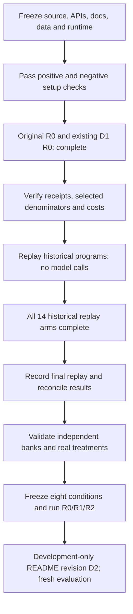

# AIDEAL pipeline follow-through

Observed November 19, 2026 at 09:24:19 Pacific. This is a saved snapshot, not a live monitor.

## What is complete and what is running

All **14 current Original/D1 R0 arms and 5,646 target outcomes are complete**. The model is `gemini-3.1-flash-lite`; each target has one initial program and zero program repairs. Existing D1 was not regenerated.

| Bank | Targets | Original R0 | Existing D1 R0 |
|---|---:|---:|---:|
| RDPro Scala | 261 | 20/261 (7.7%) | 14/261 (5.4%) |
| RDPro Java | 69 | 12/69 (17.4%) | 4/69 (5.8%) |
| MDAnalysis | 1,519 | 592/1519 (39.0%) | 621/1519 (40.9%) |
| tslearn | 354 | 211/354 (59.6%) | 221/354 (62.4%) |
| mir_eval | 178 | 134/178 (75.3%) | 144/178 (80.9%) |
| Thumbnailator | 225 | 109/225 (48.4%) | 97/225 (43.1%) |
| SedonaDB | 217 | 87/217 (40.1%) | 96/217 (44.2%) |

These results measure **native acceptance with model-written assertions**, not independent accuracy on fixed tasks. Four Scala URI/path failures and three MDAnalysis conditional mock targets remain disclosed; the frozen measurements and denominators have not changed.

The separate historical replay completed 13/14 arms under the original frozen evaluator. MDAnalysis Original stopped at target 434 when binary stderr could not be decoded as UTF-8. Its historical bank contains 1,538 targets; it is different from the current 1,519-target bank. A new, separately recorded evaluator **completed all 1,538 saved Original programs** with 620 accepted and 918 failing. It made **zero model calls**. The final audit verified 13,847 unique files and found identical verdicts for all 433 programs completed before the old crash. The other 13 replay arms are also complete. [Final verification](replay-output-recovery/FINAL_VERIFICATION.json).

## Why earlier checks missed the recorder failure

Earlier checks exercised imports, representative programs, assertions, target-use checks and checkpoint handling. They did not include non-UTF-8 subprocess output. The new failure occurred while AIDEAL read a program's diagnostic, not because the model needed another repair. The corrected recorder captures bytes, preserves invalid streams with hashes, and writes a readable diagnostic. The affected program still fails; its wrong input is not converted into a pass.

The deployment changes only `execution.py` and `rescore_native_programs.py` in a new immutable release. The other 144 release files and the original measured outputs remain unchanged. Positive, negative, invalid-byte, timeout, resume and evidence-tamper checks passed on the actual cluster. The real TNG failure, a correct MDAnalysis program and an intentionally wrong program all produced the expected verdicts in preflight.

| Check | Recorded result | Scope |
|---|---|---|
| Cluster recovery regression suite | 19 tests and 7 subtests passed | Includes real subprocess timeout cleanup and raw-byte receipt validation |
| Real MDAnalysis replay preflight | 3/3 expected verdicts | Previously crashing program remains a recorded failure; correct/incorrect controls discriminate |
| Local recovery/evidence checks | 27 tests and 56 subtests passed; 1 platform-specific test deselected | macOS process-group permission prevented that local timeout case; it passed on the cluster |
| Future authoring and eight-condition checks | 78 tests and 53 subtests passed | Software contracts only; no paid audience experiment or revised README |

## Independent cluster execution and completion

The supervisor ran with parent PID 1, no terminal and its own process session. The worker and supervisor held their expected locks. The job completed at **09:15:39 Pacific**, independently of this laptop's SSH connection. No recovery worker remains active. Closing the laptop cannot interrupt this completed job. All logs and final receipts remain on the cluster. The supervisor did not launch paid R1/R2, D2 or ablation runs. Local Codex editing may pause when the laptop sleeps.



## Development updates and remaining gates

| Component | Current status | Still required |
|---|---|---|
| Output recording | Deployed and historical replay completed | Final evidence audit passed; preserve the separate evaluator identity |
| README author evidence | Exact-owner comments and selected explicit-call test excerpts now pass regression checks | Review all-library coverage; only approved source tests may enter prompts; execute examples before calling them validated |
| Eight-condition runner | Shared runner now accepts O/R/A/H/RA/RH/AH/RAH and passes software tests | Real library treatment bundles, independent reference/wrong-output/no-target controls and runtime admission |
| Alias admission | Paired canonical/alias valid and error controls required by the new configuration | Verify every installed alias, including defaults, outputs and exception behavior |
| Native embedded hints | Required by the new eight-condition schema; legacy JSON hints rejected | Build and validate each library's actual exception-message patches |
| Evaluation memory | Eight-condition configuration requires episode-only policy | Check actual backend exposure for every frozen bank; native repair path still needs separate review |
| R1/R2 and D2 | Not launched | Complete the preceding gates; preserve development/evaluation separation |

The test suite is evidence for these checks, not a proof that every possible path is bug-free. A failed generated program is an expected experimental outcome; an evaluator failure is recorded separately and must not be counted as a successful test.

## Recorded usage for the completed current R0 comparison

**22,188,748 input tokens and 1,351,468 output tokens** are recorded across 5,647 provider attempts for 5,646 target outcomes. One retained 503 attempt has unknown usage. These totals are not exact billing. Recorded model-request intervals sum to 10,327.87 seconds; execution intervals sum to 25,055.89 seconds. These are accumulated intervals, not elapsed study time. SDK-internal retries may lack separate receipts.

## Open the evidence

- [Current completed R0 receipts](COMPLETED_R0_STATUS.json)
- [Recovery release and source hashes](replay-output-recovery/RELEASE_RECEIPT.json)
- [Cluster regression checks](replay-output-recovery/CLUSTER_TESTS.json) and [test output](replay-output-recovery/CLUSTER_TESTS.log)
- [Three real preflight programs and verdict receipts](replay-output-recovery/preflight/SUMMARY.json)
- [Detached process and lock check](DETACHED_PROCESS_CHECK.json)
- [Recovery launch](replay-output-recovery/operator/LAUNCH.json), [state snapshot](replay-output-recovery/operator/STATE.json) and [progress snapshot](replay-output-recovery/full-original/progress.json)
- [Historical replay completion receipts](HISTORICAL_REPLAY_STATUS.json)
- [Complete cost audit](completed-r0-cost-audit/SUMMARY.json); detailed per-bank ledgers stay alongside it locally and on the cluster
- [Development test scope and file hashes](DEVELOPMENT_TESTS.json)

To inspect the saved completion after reopening the laptop, run this read-only command:

```sh
ssh -o ClearAllForwardings=yes lab 'cat /home/zshan011/apps/aideal/studies/2026-11-17-latest-stable-canonical/review/followthrough-2026-11-19/replay-output-recovery/operator/STATE.json /home/zshan011/apps/aideal/studies/2026-11-17-latest-stable-canonical/review/followthrough-2026-11-19/replay-output-recovery/full-original/progress.json'
```

The files above are snapshots. The recovery is complete; no restart is needed. [Full experiment guide](../../EXPERIMENT_GUIDE.md) and [action tracker](../../reports/2026-11-18-professor-meeting/CHECKLIST.md).

## Publication and synchronization

Tested changes are published in [development commit d85f6fa](https://github.com/ZhuochengShang/AIDEAL/commit/d85f6fa4a96a1539f47ffd97fa985fc16ac8880f). The cluster keeps these future changes in a separate review copy; its completed recovery used only the two-file patch. [Cluster synchronization receipt](CLUSTER_SYNC.json).
