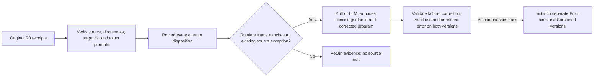

# From Original R0 failures to embedded hints

The corrected intake connects the native microbenchmark runner to the existing hint-development workflow. It records every checkpointed attempt, including provider failures, passes, unsupported diagnostics, held-out cases and cases deferred by the batch limit.

The requested API is not automatically the function that failed. Intake records both identities and requires a runtime frame, source line and exact existing literal exception message before promoting a failure to hint diagnosis. It does not invent a hidden-oracle verdict from a success marker. A proposed change must still pass the paired validation workflow before installation.

The current patcher supports suitable literal exception messages in Python, Java and Scala. Compiler errors, arbitrary interpolated messages, SQL/Cython implementations and unsupported declarations remain visible dispositions. Recording all failures does not imply that every failure should change the library.

Use the existing `preview-native-hints` command with a manifest whose `evidence_protocol` is `native_original_r0/v1`. Its `native_run` supplies the completed native run root and bound `result`, `launch`, `config` and `api_manifest` files. Retain the existing explicit `source_root`, `baseline_revision`, original-document bindings, development split and held-out identifiers. The preview is read-only and makes no model calls. Subsequent commands remain `propose-native-hints`, `validate-native-hints` and `install-native-hints`.

The native checkpoint predates per-artifact cryptographic receipts for every output. Intake verifies the experiment fingerprint, target denominator and rendered-prompt hashes, then binds the current response, execution, stdout, stderr and program bytes. It cannot establish that an unbound historical output was never edited before intake. The new preview's bindings detect later changes, and independent paired validation remains mandatory.

Alias development continues through `preview-library`, `propose-library`, bundle validation and installation. Exact API IDs now persist through batched source windows and proposals; source-location IDs remain separate for patching. Neither workflow installs new treatments merely because the five Git branches exist.

For installed Python packages, an explicit `runtime_source_roots` mapping can relate a package directory to its pinned repository directory. Intake accepts a mapped frame only if the complete runtime source file equals the pinned source bytes. It binds that runtime file in the preview. No package is imported during intake.
