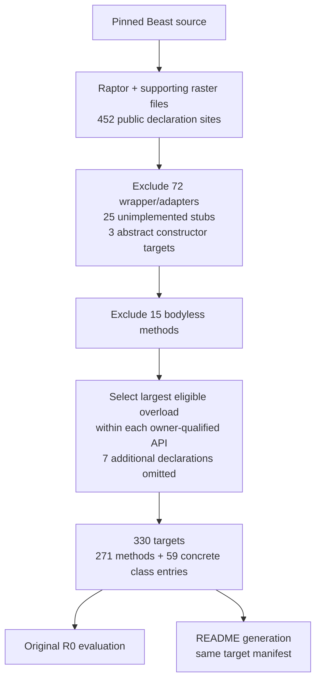

# RDPro / Raptor experiment

The current bank contains **330 targets: 271 methods and 59 concrete class/constructor entries**. It covers Raptor raster processing and its supporting raster types in pinned Beast 0.10.1. Java contributes 69 targets and Scala contributes 261.

Start with the current bank below. The 171, 422 and 406 counts belong to earlier selection stages or historical experiments.

## Review in this order

1. [Current scope and exclusions](strict-no-wrappers/README.md) — understand what the 330 targets include.
2. [Selection policy](maintenance/SELECTION_POLICY.md) — check ownership, wrappers, overloads and duplicate handling.
3. [Every selected API](strict-no-wrappers/SELECTED_APIS.json) and [excluded declarations](strict-no-wrappers/REMOVED.json) — inspect signatures, source locations and reasons.
4. [Original documentation mapping](strict-no-wrappers/original-docs/README.md) — see which original excerpts support each target.
5. [Run plan](plan/) and [queue](operator/QUEUE.json) — inspect configurations, manifests and commands.
6. [Progress](operator/PROGRESS.json) and [synchronization verification](operator/SYNC_VERIFICATION.json) — check recorded run status and local/cluster/GitHub consistency.
7. [Code and cleanup guide](maintenance/CODE_AND_CLEANUP.md) — distinguish daily commands from preparation tools and preserved evidence.

## How the current bank is selected

Different owners remain distinct. Matching short names or small source bodies alone do not establish duplicate behavior. The [duplicate review](strict-no-wrappers/NORMALIZED_BODY_REVIEW.json) explains retained cases. Exclusion changes the experiment bank; it does not delete library code.

## Current files and preserved history

| Folder or file | Purpose |
|---|---|
| `strict-no-wrappers/` | **Current 330-target bank**, source-bound exclusions and validation |
| `plan/` | Current Java/Scala input manifests, configurations and execution scaffolds |
| `operator/` | Launch commands, checks, progress snapshots and synchronization receipts |
| `maintenance/` | Navigation, selection policy and cleanup guidance |
| [COUNT_EXPLANATION.md](COUNT_EXPLANATION.md) | Reconciliation of source, documentation and historical counts |
| [history-171/](history-171/README.md) | Preserved historical manifest and provenance |
| [consolidated/](consolidated/README.md) | Intermediate 406-target preparation; still used by reconstruction scripts |
| `SCOPE.json`, `SCOPE_DECISIONS.json`, `SELECTED_APIS.tsv` | Earlier 422-target scope evidence |
| `original-docs/`, `github-docs/`, `document-audit/` | Preserved documentation snapshots and reconstruction evidence |

Preparation and reconstruction scripts contain machine-specific paths. They are one-off evidence tools, **not the everyday experiment CLI**. Use the run plan and maintenance guide for normal operation.

The active study binds exact file paths and checksums. Keep frozen inputs and preserved reconstruction dependencies in place while the run uses them. New navigation does not change those inputs.
